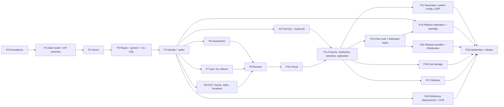

# Implementation plan

This plan orders the work that turns the [research](../research/README.md) and the
[decision records](../research/decisions/README.md) into a working registry. Decision
records describe *what* and *why*. This file describes the *order*, the *tasks* and the
*exit criteria* that must hold before a phase counts as done.

Every phase is also subject to the [definition of done](definition-of-done.md). The
target package tree is in [repo-layout.md](repo-layout.md). Research baseline:
2026-10-12.

## Build status

Updated as phases land. "Done" means the exit criteria hold, the gate (95% merged total,
90% per package) passes and lint is clean.

| Phase | Status | Notes |
|---|---|---|
| P0 Foundations | Done (2026-10-12) | Docs set, config model, layouts, strict config, server with system endpoints, OpenAPI pipeline, Linux acceptance job, parity oracle (635 JFrog operations cached, 6 matched, 629 baseline gaps). Gate 97.2% merged; `jf rt ping` and the provider configure step verified |
| P1 Data model and API schemas | Done (2026-10-13) | Derived from the 637 cached JFrog blocks; full in-scope OpenAPI surface authored with our own field descriptions; parity baseline shrinks accordingly |
| P1b Enterprise products: specs and model | Done (2026-10-13) | 574 of 635 JFrog operations at parity, 0 divergent; the 61 in the baseline are Mission Control, MyJFrog, bridges and JFConnect only. Seven services; research 16, decisions 0021 to 0026; 27 new tables in research 15 |
| P2 Stores | Done (2026-10-13) | Store contracts for every entity in research 15 (27 concerns), in-memory reference store, SQLite and PostgreSQL stores over one dialect layer with 71 tables in five migrations, the `storetest` contract suite (62 subtests) passing on all four backends, `migrate up/down/version`, `keys rotate` with versioned master keys, durable S3 upload sessions; merged coverage 97.7%. Stale-upload reaping moves to the P3 GC task; build-info tables to P5 |
| P2b Cloud blob storage and mirroring | Done (2026-10-13) | GCS and Azure blob backends (epic #21) and mirroring blobs across clouds and regions (epic #22); design in research 18 and decisions 0027 and 0028. The mirror's storage administration (#18) landed after P3's storage endpoints (#48) |
| P3 Repositories, generic artifacts, CLI AQL shape | Done (2026-10-13) | Epic #52, issues #42 to #51. The `jf` round trip and the status-code table pass. The Terraform apply criterion moved to P4 (#69): the provider authenticates only with the Bearer tokens P4 issues, and its fixture validates in CI meanwhile |
| P4 Identity and authorization | Done (2026-10-14) | **M1**. Epic #86. Access tokens, the native permission evaluator, the legacy security and Access v2 identity APIs, roles, environments, key pairs and the permission APIs, checked by the route and principal matrix (#84), the JFrog CLI identity commands and the Terraform identity scenario (#85). OIDC token exchange (#83) stays in the milestone outside P4's criteria; the Docker token endpoint is P6 task 2 |
| P4b Reference deployments and CDN delivery | In progress | Epics #113 (CDN delivery and download redirect) and #189 (consistent reference deployments, contract v2, done 2026-10-16) done; epic #114 (reference deployments) open for the CDN scenarios and the multicloud mirror; decisions 0029 and 0030 |
| P5 Full AQL, searches, build-info | Done (2026-10-16) | Epic #160; decisions 0012 and 0014, research 22. AQL over `items`, `builds` and `build.promotions` with the secondary domains, `$msp` and the `items.delete` and `properties.update` actions, compiled for SQLite and PostgreSQL; the GET searches; build-info publish, append, rename, delete, promotion and retention. The shared AQL cases give identical ordered rows on the reference evaluator and all three stores, and the JFrog CLI's build commands pass. `remote=1` on the versions searches answers from caches until P9 (#213) |
| P6 Docker/OCI | Not started | |
| P7 npm, Go, Maven locals | Not started | **M2** |
| P8 PyPI, NuGet, Helm, Terraform locals | Not started | |
| P9 Remote repositories | Not started | |
| P10 Virtual repositories | Not started | **M3** |
| P11 Projects, webhooks, retention, replication | Not started | |
| P12 Descriptor export, system configuration, LDAP | Not started | |
| P13 Peer trust and federated repositories | Not started | |
| P14 Platform federation and topology | Not started | |
| P15 Release bundles v1 and Distribution | Not started | |
| P16 Cold storage archive and retention | Not started | |
| P17 Workers | Not started | **M4** |
| P18 Hardening and release | Not started | v0.1.0-rc |

## Milestones

| Milestone | Reached after | Demonstrable outcome |
|---|---|---|
| M1 walking skeleton | P4 | `jf rt ping/u/dl/s/del/cp/mv/sp` against generic repos, and `artifactory_local_generic_repository`, `artifactory_user`, `artifactory_group`, `artifactory_scoped_token`, `platform_permission` apply, plan clean, destroy. SQLite and local disk only |
| M2 first ecosystems | P7 | Docker (repository-path method, OCI conformance green), npm, Go and Maven local repositories work with their native clients |
| M3 proxy and virtual | P10 | All eight formats resolve through remote and virtual repositories |
| M4 enterprise parity | P17 | Federated repositories converge across three artifactweave peers; users and permissions federate; a release bundle is signed, distributed to an edge peer and verified; an archive policy moves packages to the cold tier and restores them; TypeScript Workers run on download and create events |
| v0.1.0-rc | P18 | Everything above plus projects, webhooks, cleanup policies, single replication, build-info, hardening, signed binaries and a container image |

## Sequence at a glance

**Critical path:** P0 → P1 → P1b → P2 → P3 → P4 → P6 → P9 → P10 → P11 → P13 → P15 → P18.

**Parallel lanes:** P16 and P17 run beside P13 to P15 once P11 has landed; P12 runs
beside all of them. P5 runs beside P6–P8. P6, P7 and P8 are independent of each other
once P4 has landed (publishing needs credentials). P9 can start as soon as one format
exists. P4b runs beside P5 to P8 once P4 has landed: its CDN work builds on the blob
backends of P2b, and its scenarios on the Terraform job from P4.

## Cut from v1

Recorded with reasons in [research 12](../research/12-open-questions.md):
`terraformbackend` repositories, NuGet v2 OData beyond what `NuGet.Protocol` sends for
restore, PyPI XML-RPC search, Go sumdb proxying, npm audit proxying, XML descriptor
`POST`, import and export, multi-push and event-based replication, SAML, SCIM, Crowd and
HTTP SSO (501), API-key creation, Go VCS-backed remotes, a web UI, MySQL, high
availability, Mission Control, MyJFrog, SaaS bridges, JFConnect, release bundles v2,
Lifecycle, AppTrust and Xray. Federation, cold storage, Distribution and Workers were
brought back into scope on 2026-10-13 (P1b, P13 to P17).

---

## P0: Foundations

Decisions: [0001](../research/decisions/0001-mirror-the-jfrog-api-surface.md),
[0002](../research/decisions/0002-spec-first-flat-crud-handwritten-item-paths.md),
[0003](../research/decisions/0003-repository-model.md),
[0015](../research/decisions/0015-testing-and-acceptance.md).

**Tasks**
1. `make init NAME=artifactweave`; this documentation set; `CODEOWNERS`.
2. `pkg/repo`: the `Config` model with every field in [research 03](../research/03-repository-configuration-model.md), JSON round-trip that accepts the string-typed booleans JFrog documents per rclass and writes booleans, validation (key syntax, rclass and packageType sets, virtual members exist, `defaultDeploymentRepo` is a member, `projectKey` implies `environments`).
3. `pkg/layout`: pattern engine for `repoLayoutRef` tokens with the bundled layouts and the Maven-2 integration-revision regexes.
4. `internal/config`: strict app YAML, flag > env > file precedence, unknown keys rejected, `config validate`.
5. `internal/server`: chi router, request id, slog access log, recovery, body limits, the per-surface errors table, the base-URL resolver middleware, content-type normalisation for `+json` vendor types and `application/yaml`.
6. `api/*.openapi.yaml` skeletons with `GET /artifactory/api/system/{ping,version,license}`, `GET /artifactory/api/v1/system/{readiness,liveness}`, `GET /access/api/v1/system/{ping,version}`, `GET /router/api/v1/system/health`, `POST /artifactory/api/system/usage`, `POST /jfconnect/api/v1/backoffice/metrics/log`; `make generate` and the drift check; `TestOpenAPIFieldDescriptions`; `TestHandwrittenRoutesNotGenerated`.
7. `internal/layout` import-tier test.
8. `test/acceptance` skeleton: godog, `-cover` binary, pinned tool binaries (`jf`, `terraform`), the Linux `acceptance` job added to the coverage and gate `needs`; `test/terraform` with a pre-populated provider mirror.
9. `docs/security/threat-model.md` skeleton (done), `docs/operations/*` skeletons (done).
10. Parity oracle: `internal/specoracle` and `tools/specoracle` cache JFrog's embedded OpenAPI blocks under the gitignored `.specoracle/`, compare them with `api/*.openapi.yaml`, and `TestSpecParity` holds `api/parity-baseline.json` as the accepted-gap list; the `parity` CI job runs it ([research 01](../research/01-jfrog-api-landscape.md#parity-oracle)).

**Exit criteria**
- `make gate` green on the three OS runners plus the Linux acceptance job.
- `jf rt ping` returns `OK` with the pinned JFrog CLI (verified 2026-10-12 with jf 2.126.0).
- `terraform plan` with `provider "artifactory"` configured and a `data "artifactory_repositories"` block gets through the provider's configure step: the server log shows `GET /artifactory/api/system/version` and `POST /artifactory/api/system/usage` answered 200 before the data read fails with the Artifactory 404 envelope (verified 2026-10-12 with provider 12.11.14; the provider sends the path with a trailing slash, and the read itself waits for P4's access tokens, #69).
- The layout test fails when a forbidden import is added deliberately.

## P1: Data model and API schemas

Decisions: [0001](../research/decisions/0001-mirror-the-jfrog-api-surface.md),
[0002](../research/decisions/0002-spec-first-flat-crud-handwritten-item-paths.md),
[0020](../research/decisions/0020-domain-model.md).

The user's direction after P0: do not build a database before the data model is clear,
and the crawl gives us that model. This phase turns the 637 cached JFrog operation
blocks into (a) a documented domain model and (b) the complete in-scope REST API
schema with our own field descriptions, so the field semantics shape the server
features before any store is written.

**Tasks**
1. `specoracle inventory`: a generated inventory of every named schema, field, enum,
   parameter and operation in the cache (`api/oracle-inventory.json`,
   [research 14](../research/14-data-model-inventory.md)). Facts only; no JFrog prose.
2. [Research 15, data model](../research/15-data-model.md) and
   [decision 0020](../research/decisions/0020-domain-model.md): wire entities per
   family, identity and mutability, server-owned fields, relationships, and the derived
   storage model that P2 implements. Contradictions with `pkg/repo` are fixed in
   `pkg/repo`.
3. Spec tooling: `specoracle scaffold` (draft fragments from the cache with
   `TODO(author)` descriptions and `x-oracle-source` links), `openapi-bundle`
   (per-family fragments under `api/src/<service>/` merged into the three bundled
   specs), `stubgen` (every generated strict interface method answers 501 until
   implemented), all wired into `make generate` and the drift check.
4. Author the full in-scope surface family by family (tiers in
   [research 10](../research/10-scope-and-tiers.md)): repositories, artifacts and
   storage, searches, replication, trash, package-type APIs, legacy security, Access
   users/groups/permissions/tokens/roles/environments/OIDC, projects, webhooks, cleanup
   policies, system and configuration, build-info. Every field and parameter gets a
   description per [api-description-conventions](api-description-conventions.md) that
   states presence, defaults, server ownership and create/update rules; these are the
   behavioural contract the handlers implement later. Out-of-scope families get only
   their 501/404 stubs.
5. ~~`pkg/types` with `x-go-type` bindings for every entity~~ **Moved to P2 task 1
   (correction, 2026-10-13).** Binding every wire schema to a domain type contradicts
   [decision 0020](../research/decisions/0020-domain-model.md), which keeps one internal
   representation per entity with converters to the legacy, Access and YAML wire
   forms. Binding is right only where the wire and internal shapes coincide, which is
   the repository configuration (`RepositoryConfiguration` is bound to `repo.Config`).
   The generated wire models in `internal/server/gen` and `pkg/client` are the P1
   deliverable; the internal domain types are designed with the store contracts at the
   start of P2, before any SQL, so the model still precedes the database.

**Exit criteria**
- `make parity` reports zero *missing* and zero *divergent* operations for every
  in-scope family; the baseline lists only out-of-scope families, and `TestSpecParity`
  is promoted to a required check.
- `TestOpenAPIFieldDescriptions` passes with no `TODO(author)` left in a bundled spec.
- `make generate` compiles with the 501 stubs; the acceptance suite still passes; the
  gate stays green.
- Research 15 reviewed against the inventory: every entity the specs reference has a
  row, and the storage model section names every table P2 will create.

**Outcome (2026-10-13): done.**
- Parity: 407 of 635 JFrog operations matched, **0 divergent, 0 missing in scope**.
  The 228 in `api/parity-baseline.json` are all out-of-scope products: Distribution
  and release bundles v1 (75), cold storage archive and retention (30), federated
  repositories (22), platform federation and topology (25), Mission Control (19),
  MyJFrog (19), bridges (17), Workers (15), JFConnect (6). `TestSpecParity` is in the
  gate's `needs`.
- Specs: 16 authored fragments under `api/src/`, bundled into three documents with
  211 Artifactory paths plus the Access and Event surfaces; every field and parameter
  described per the conventions; no `TODO(author)` or `x-draft` left. Unverified
  semantics carry `x-unverified: true` for capture against a live Artifactory.
- Generated: strict chi servers and clients for all three services; every
  unimplemented generated operation answers 501 (`TestUnimplementedOperationsAnswer501`),
  and every hand-written operation without a handler answers 501 from the embedded
  spec, never 404.
- Gate: lint 0 issues, unit and acceptance green, merged coverage 96.6%.
- Corrections made while closing the phase: the parity comparator now merges JFrog
  pages that document variants of one route (deploy, deploy by checksum and deploy
  from archive; replication update and bulk enable/disable), which had made the
  report nondeterministic; the spec models those as one route each, with the
  `/checksum` documentation alias marked `x-not-routed`; item routes exclude the
  reserved repository key `api`; union-typed query parameters are typed as strings
  because the generator cannot bind them; `pkg/repo` gained `UnmarshalJSON`, the
  federated `priorityResolution` boolean, and class checks for `terraformType` and
  proxy fields; research 15 gained the `leases` and `vault_configs` tables; task 5
  moved to P2 (above).

## P1b: Enterprise products, specs and model

Decisions: [0021](../research/decisions/0021-peer-trust-and-sync-protocol.md) to
[0026](../research/decisions/0026-workers-runtime.md); research
[16](../research/16-enterprise-products.md).

On 2026-10-13 the user brought five products into scope: Distribution and release bundles
v1 (75 operations), cold-storage archive and retention (30), platform federation and
topology (25), federated repositories (22) and Workers (15). Following the rule set in P1
(no database before the model is clear), their specs and data model are completed before
P2 so the stores create their tables from the start. Decisions taken with the user:
artifactweave-to-artifactweave peers only (management APIs stay JFrog-compatible, the
instance-to-instance protocol is ours); Workers run TypeScript through esbuild and goja
in-process; cold storage is a second blob tier in the same instance; all of it ships in
v0.1.

**Tasks**
1. Tooling for any number of services: the service list is derived from
   `api/src/<service>/info.yaml` in the oracle tool, the Makefile and the embedded spec
   package; new services `distribution`, `worker`, `pfed` and `grid` with their own error
   envelopes (`apierror.Distribution`, `apierror.Flat`); the blanket prefix stubs for
   those products are replaced by per-operation routes.
2. Research 16 and decisions 0021 to 0026; amendments to 0001, 0003, 0017 and 0020;
   research 10, 12 and 15 updated.
3. Specs for the 167 operations, same workflow and conventions as P1.

**Exit criteria**
- `make parity` reports 0 divergent and exactly 61 missing operations, all Mission
  Control, MyJFrog, bridges and JFConnect.
- Description, 501 and hand-written route tests pass across all seven specs; the gate
  stays green.
- Research 15 section 4 names every table P2 creates for these products.

**Outcome (2026-10-13): done.**
- Parity: 574 of 635 operations matched, 0 divergent, 61 missing (MyJFrog 19, Mission
  Control 19, bridges 17, JFConnect 6). Generated: 557 operations across seven services,
  every one answering 501 in its product's documented envelope until implemented
  (`TestUnimplementedOperationsAnswer501` compares each body with the envelope table).
- New envelopes: `apierror.Distribution`, `apierror.Flat` (pfed, grid) and
  `apierror.ArtifactoryLegacy` (cold storage retention, import and export).
- Every spec-sweeping test, the parity test and the generated-mux check now derive the
  service list from the bundled specs, and a guard fails when a new service is missing
  from the mux check.
- Gate: lint 0 issues, unit and acceptance green, merged coverage 97.1%, generation
  reproducible.
- Carried forward: decision 0021 defines artifactweave's own peer API under
  `/artifactweave/peer/v1/`; it gets its own `api/src/peer/` spec as P13's first task.
  Several shapes JFrog leaves undocumented carry `x-unverified` (release bundle creation
  body, distribution status lists, worker test body, archive search criteria) for capture
  against a live instance.

## P2: Stores

Decisions: [0004](../research/decisions/0004-storage-sql-metadata-and-blobs.md),
[0017](../research/decisions/0017-sealed-columns-and-master-key.md).

**Tasks**
0. `pkg/types`: the internal domain types for every entity in
   [research 15](../research/15-data-model.md) section 2, with converters to and from
   the generated wire models (`internal/server/gen`) and table-driven round-trip tests
   per wire form (legacy, Access, YAML descriptor). Written and reviewed before task 1
   so the store contracts are expressed in these types.
1. `pkg/store` contracts (`Repos`, `Items`, `Properties`, `Stats`, `Principals`, `Groups`, `Permissions`, `Tokens`, `Projects`, `Webhooks`, `Policies`, `Runs`, `Packages`) with `Tx`, sentinel errors and keyset cursors; `pkg/store/inmem`.
2. `internal/sqlstore/sqlcommon` dialect layer; `sqlite` (modernc, WAL, single writer) and `postgres` (pgx stdlib); embedded migrations; `artifactweave migrate up|down|version`.
3. `pkg/blob` contract: `BeginUpload / Append / Commit(digest) / Abort`, `Open` returning `io.ReadSeekCloser`, `PresignGet`, `Delete`, `Stat`; `fs` backend (temp dir per upload id, rename on commit) and `s3` backend (multipart upload id persisted through the store, path-style option for MinIO); checksum index by sha256, sha1 and md5.
4. `internal/crypt`: keyring, sealed columns with purpose and row AAD, `artifactweave keys rotate`.
5. `storetest` and `blobtest` contract suites.

**Exit criteria**
- Contract suites pass on inmem, SQLite (memory and file), PostgreSQL and on fs and MinIO in the Linux jobs, and skip cleanly on macOS and Windows.
- Migration tests apply up, down, up per dialect.
- A sealed value round-trips and is unreadable with the wrong key.

**Outcome (2026-10-13): done.**
- `pkg/store`: one interface per concern (content, identity, operations, peers and federation,
  enterprise products) over the `pkg/types` domain types, with `Tx`, `AfterCommit`, sentinel
  errors and keyset cursors; `store.Normalise` defines what a stored value reads back as (UTC
  microseconds, millisecond durations).
- `pkg/store/inmem` (reference), `internal/sqlstore/sqlcommon` with `sqlite` (modernc, WAL,
  immediate transactions; file and in-memory) and `postgres` (pgx); 71 tables, identical in both
  dialects. Differences from research 15's table list are recorded in its section 4.1.
- `pkg/store/storetest`: 62 contract subtests passing on inmem, SQLite file, SQLite memory and
  PostgreSQL 17 (testcontainers, skipped without Docker), plus SQLite fault-injection tests per
  group. Every PostgreSQL contract run rolls all migrations back and applies them again.
- Sealed columns: one registry drives `Store.Reseal`; `artifactweave keys rotate` re-seals under
  the newest key version (`master_key` with a `vN:` prefix, `master_key_previous` during the
  rotation), verified over a populated store on both dialects, and a test fails when a store seals
  a purpose the registry misses.
- `artifactweave migrate up|down [--to N]|version`; `s3.StoreStates` persists S3 multipart
  sessions in the `uploads` table.
- The MinIO contract run now uses Chainguard's MinIO image pinned by digest: `minio/minio` is no
  longer published on Docker Hub, so the suite had never run.
- Dependency bumps for govulncheck: `golang.org/x/text` v0.41.0, `golang.org/x/crypto` v0.56.0,
  `github.com/moby/go-archive` v0.3.0. The remaining findings are in the Go 1.27.1 standard
  library and clear with Go 1.27.2, which CI installs.
- Moved on: stale upload reaping (the store side, `UploadStore.Stale`, exists) goes to the P3 GC
  task; the build-info tables go to P5 with a new migration once a live capture fixes their shape.

## P2b: Cloud blob storage and mirroring

Decisions: [0027](../research/decisions/0027-cloud-blob-backends.md),
[0028](../research/decisions/0028-blob-mirroring.md); research
[18](../research/18-cloud-blob-storage.md).

Requested on 2026-10-13: Google Cloud Storage and Azure Blob Storage beside S3 with the
same resumable multipart uploads, and an option to mirror every blob into several stores
across clouds and regions in parallel. The work is tracked as GitHub issues, one PR each:

- Epic #21, cloud backends:
  - research and decision (#7);
  - a shared upload-session layer with per-instance upload rows (#8);
  - `pkg/blob/gcs` (#9);
  - `pkg/blob/azure` (#10);
  - configuration (#11);
  - an opt-in real-cloud conformance workflow (#12).
- Epic #22, mirroring:
  - decision (#13);
  - named stores and mirror configuration (#14);
  - the `blob_replicas` index (#15);
  - `pkg/blob/mirror` with quorum writes and failover reads (#16);
  - the repair worker (#17);
  - per-member administration once P3 serves the storage endpoints (#18);
  - a cross-cloud scenario on Linux CI (#19).

**Exit criteria**
- `blobtest.Run` passes on each backend's fake everywhere and on its emulator on Linux.
- The mirror keeps accepting uploads with one member down and repairs the missing copy.
- Coverage is at least 95% total and 90% per package.

## P3: Repositories, generic artifacts, CLI AQL shape

Decisions: [0003](../research/decisions/0003-repository-model.md),
[0004](../research/decisions/0004-storage-sql-metadata-and-blobs.md),
[0012](../research/decisions/0012-search-and-aql.md),
[0018](../research/decisions/0018-package-index.md).

**Tasks**
1. Repositories API ([research 02](../research/02-artifactory-core-api-inventory.md) A1) including batch endpoints, `existence`, `configurations`, v2 reads, exact status codes.
2. Items: deploy with checksum headers and matrix properties, checksum deploy, explode archive, folder create, download with `Range` and `Accept-Ranges`, delete, file and folder info, `?list`, `?stats`, `?lastModified`, `?properties`, `?permissions`, set, delete and PATCH properties, copy and move with `dry` and `suppressLayouts`, archive entry download, folder archive download, `zap`, `storageinfo`, trash can and restore, GC (including reaping stale upload sessions found through `UploadStore.Stale`, deferred from P2), `.sha1/.md5/.sha256` sidecars served from metadata and validated per `checksumPolicyType`, matrix-param resolution on GET.
3. `GET /api/v1/uploads/config`. It answered `{"supported":false}` until the JFrog CLI multipart protocol landed (#91) and now answers `true`.
4. Package-index skeleton and the `generic` format handler.
5. `pkg/aql` limited to the CLI's query shape (`items.find` with `$or`/`$and`, `$match`, `$ne`, `@prop`, `type`, `include`, `sort`, `offset`, `transitive`, `limit`), with fixtures captured from `jf rt s/dl/del/cp/mv/sp` and run on both dialects.
6. Minimal admin Basic auth and the seeded `admin`, `anonymous`, `readers`, `Anything`, `Any Remote` principals and targets; `artifactory-build-info` repo.
7. YAML descriptor PATCH for `localRepositories`, `remoteRepositories`, `virtualRepositories`, `proxies`, `propertySets`, `repoLayouts` with null deletes; `artifactweave config apply`.

**Tracking.** Epic #52 holds one GitHub issue per PR:
1. Open the metadata store and blob store in `serve` (#42).
2. Basic auth and the seeded principals (#43).
3. Repositories API (#44).
4. Deploy and download generic artifacts (#45).
5. Storage API: item info, listings and properties (#46).
6. Copy, move and archives (#47).
7. Trash can, garbage collection, storage summary and zap (#48), then the mirror's storage administration (#18).
8. AQL for the JFrog CLI's query shape (#49).
9. Descriptor PATCH and `artifactweave config apply` (#50).
10. The exit checks: the JFrog CLI round trip and the Terraform job (#51).

**Exit criteria**
- `jf rt u/dl/s/cp/mv/del/sp` round-trip a tree, including a checksum-deploy hit for a file over 10 KiB and a split download. Met: `round_trip.feature` (#51).
- Moved to P4 (#69): `artifactory_local_generic_repository` and `artifactory_item_properties` apply, plan clean, destroy. The provider authenticates only with a Bearer access token, which P4 issues. Met in P4 (#69).
- The status-code table test covers every route in this phase. Met: the guard in `internal/server/status_test.go` fails while an implemented route has no row.

## P4: Identity and authorization

Decisions: [0005](../research/decisions/0005-authentication-and-tokens.md),
[0006](../research/decisions/0006-authorization-native-permission-model.md),
[0019](../research/decisions/0019-human-authentication-tiers.md).

**Tasks**
1. Legacy security shims: `/api/security/users|groups|permissions`, `/api/v2/security/permissions` (POST create 201, PUT replace 200, HEAD), `lockedUsers`, `unlockUsers` in both forms, `userLockPolicy`, `passwordExpirationPolicy` with real JSON types, `encryptedPassword`, keypairs (POST 201) and the per-repo key assignment, certificates, legacy token create/list/revoke, API-key shims.
2. Access v2 users, groups, permissions with cursors; tokens v1 (create 200 with `token_id`, list, get, revoke by id and by value, default expiry); roles; environments; `basic_authentication_enabled`; password policy (204).
3. JWT access tokens with the RawStdEncoding-safe payload, reference tokens, refresh tokens, Docker token endpoint.
4. Native evaluator: admin, permission targets in the three wire formats over one internal shape, `ANY` targets, Ant patterns, groups, token scope narrowing, anonymous.
5. Route × principal matrix tests including `anonymous`.
6. OIDC token exchange for CI workload identity (#83, decision 0019, research 21):
   providers, identity mappings and `POST /access/api/v1/oidc/token`. Outside the exit
   criteria. Done: `oidc.feature` with the real `jf eot`, and
   `deploy/artifactweave/terraform/oidc` in the `terraform` job.

**Exit criteria**
- `artifactory_user`, `artifactory_managed_user`, `artifactory_group`, `platform_permission`, `artifactory_permission_target`, `artifactory_scoped_token`, `artifactory_keypair`, `platform_group` apply, plan clean, destroy. Met: `deploy/artifactweave/terraform/identity` in the `terraform` job (#85). `artifactory_permission_target` is a stub in provider 12.11.14 that fails every operation with "deprecated. Use platform_permission instead", so the scenario reads the permission back through its data source.
- `jf rt user-create`, `group-create`, `permission-target-create`, `access-token-create` and `jf c add` with the created token work. Met: `identity_exit.feature` (#85), with `security.feature`, `permissions.feature` and `tokens.feature`.
- A token scoped to one repository cannot read another. **M1.** Met: `identity_exit.feature` (#85), where the token's `jf rt dl` from the other repository fails and its GET answers 403.
- Moved from P3 (#69): the `terraform` CI job mints an admin access token and runs `make terraform TERRAFORM_MODE=apply`. `artifactory_local_generic_repository` and `artifactory_item_properties` apply, `terraform plan` is empty, then destroy, and the job's coverage joins the gate. Met: the `terraform` job (#69), after the repository API started writing its flags as JSON booleans and listing no environments as `[]`.

## P4b: Reference deployments and CDN delivery

Decisions: [0029](../research/decisions/0029-cdn-delivery-and-download-redirect.md),
[0030](../research/decisions/0030-reference-deployments.md); research
[19](../research/19-cdn-and-download-redirect.md) and
[20](../research/20-reference-deployments.md).

Requested on 2026-10-14, after the Terraform apply job (#109) showed that the
`downloadRedirect` and `cdnRedirect` flags were stored but barely used:
- CDN delivery on all three clouds, on self-hosted instances;
- every Terraform root the Makefile uses moved under `deploy/`, as documented reference
  deployments per cloud and scenario that artifactweave is tested against by manual
  dispatch.

The phase number places it after P4 because its scenarios use P4's access tokens and
Terraform job. It runs beside P5 to P8.

**Tracking.** One GitHub issue per PR:
- Epic #113, CDN delivery and download redirect:
  - the download-redirect fixes: HEAD, conditional requests, counts, mirror health (#117, done);
  - research 19 and decision 0029 (#118);
  - the redirect policy, signing capability and redirect settings (#119);
  - `cdnRedirect` with CloudFront signed URLs and a fake edge (#120);
  - Cloud CDN signed URLs (#121);
  - Azure Front Door with SAS passthrough (#122).
- Epic #114, reference deployments:
  - research 20 and decision 0030 (#123);
  - static checks and mocked tests for deployment Terraform (#124);
  - the acceptance roots moved to `deploy/platform/terraform` (#125);
  - per-cloud bootstrap roots for CI trust, remote state, DNS and budgets (#126);
  - app-layer references in `deploy/artifactweave` (#127);
  - AWS bootstrap, `aws/single-bucket` and real S3 conformance (#128);
  - the scenario workflow and the `test/platform` suite (#129);
  - multi-region mirror scenarios (#130);
  - geo-replicated scenarios with native replication (#131);
  - then epic #189, consistent reference deployments (below, done);
  - then `aws/cdn` (#132), `gcp/cdn` (#133) and `azure/cdn` (#134), on contract v2;
  - last, the multicloud mirror scenario (#135), on contract v2.
- Epic #189, consistent reference deployments, done 2026-10-16: every scenario written once
  as both the acceptance test and the consumer documentation of its deployment path,
  composing per-cloud modules under a linted contract (decision 0030, contract v2). Every
  scenario's proof run is linked from decision 0030's Verification:
  - decision 0030 amended into the scenario contract v2, with the README templates (#178);
  - prove only the scenarios a pull request changes (#179);
  - the bootstraps and the lab harness moved to `deploy/ci` (#180), after #179;
  - the contract linter (#181) and the local runner for any scenario (#182), after #180;
  - storage modules v2 with the multi-region scenarios on them (#183), and the app-layer
    references aligned (#187), after #181;
  - AWS (#184), GCP (#185) and Azure (#186) single-bucket and geo-replicated as module
    compositions, in parallel, after #182 and #183;
  - closing the work (#188), last: the linter strict everywhere, with no list of exempt
    roots.
- Alongside, outside both epics: the deviations register (#115, done) and the stale
  references it found (#116).

**Exit criteria**
- `jf rt dl` downloads files above and below 5 MiB from a `downloadRedirect` repository on
  every backend that signs; HEAD and conditional requests are answered locally; redirected
  downloads are counted.
- `cdnRedirect` redirects to CloudFront, Cloud CDN and Front Door URLs, verified against
  the fake edge in acceptance and against the real edges in the CDN scenarios.
- `X-JFrog-Download-Redirect-To` with `None`, `S3` and `CF` is honoured.
- Every Terraform root the Makefile uses lives under `deploy/`; `test/terraform` keeps only
  its driver.
- `single-bucket`, `multi-region`, `geo-replicated` and `cdn` exist for AWS, GCP and
  Azure, plus `multicloud/mirror`, each documented with inputs, outputs, costs and a
  rendered `artifactweave.yaml`.
- Every pull request runs fmt, validate, tflint, trivy, mocked `terraform test` and the
  docs drift check over them.
- Each scenario has a recorded `platform-scenarios` run that applied, passed
  `test/platform` and destroyed.
- Every scenario composes per-cloud modules, keeps lab values and harness-only outputs out of
  its consumer Terraform, and has a README that follows the scenario template with a tested
  `artifactweave.yaml` example; `deploy/platform` holds only consumer references, and the
  contract linter in `make deploy-check` is strict.

## P5: Full AQL, searches, build-info

Decisions: [0012](../research/decisions/0012-search-and-aql.md),
[0014](../research/decisions/0014-build-info.md); research
[22](../research/22-aql-searches-build-info.md).

**Tasks**
1. Full AQL grammar for `items`, `properties`, `builds` and the secondary domains, `.delete()`, `properties.update()`, dialect-specific compilation with the traps named in 0012.
2. GET searches: quick, GAVC, property, checksum, bad checksum, usage, dates, creation, pattern, versions, latest version (text), latest by properties.
3. Build-info: the `builds`, `build_artifacts`, `build_dependencies` and `build_promotions` tables (a new migration and a `BuildStore` contract, deferred from P2), `PUT/GET /api/build`, build runs, build artifacts, delete, retention (204), rename, promotion with the vendor content type, `build.name`/`build.number` properties on upload.

**Tracking.** Epic #160 holds one GitHub issue per PR:
1. Research 22 and amendments to decisions 0012 and 0014 (#161).
2. The Builds API in the spec oracle and the OpenAPI sources (#162).
3. The AQL items domain: properties, statistics, `$msp`, output rules and limits (#163).
4. The build-info store: migration, `BuildStore` contract and storetest (#164).
5. The build-info API: publish, read, append, rename, delete and build artifacts (#165).
6. Build promotion and retention (#166).
7. AQL builds and the build secondary domains (#167).
8. AQL actions: `items.delete` and `properties.update` (#168).
9. GET searches: quick, property, checksum, bad checksum, usage, dates, creation and pattern (#169).
10. GET searches: GAVC, versions, latest version, latest by properties, dependency and build artifacts (#170).
11. A remote repository's key matching its cached items in AQL (#68).
12. The versions searches ordered as Artifactory orders them, in Mercury order (#214).
13. The versions, latest version and build artifacts searches answering as Artifactory's do (#215).
14. The exit checks: AQL fixtures on both dialects and the JFrog CLI build commands (#171).

**Exit criteria**
- AQL fixtures (CLI-captured plus hand-written per operator) produce identical ordered output on SQLite and PostgreSQL. Met: the cases in `pkg/aql/aqltest` run on the reference evaluator (`pkg/aql/cases_test.go`) and through `storetest` on the in-memory store, SQLite and PostgreSQL, comparing ordered rows (#171). The CLI-captured fixtures come from jf 2.126.0 through `make capture-aql`, now including `jf rt s --build` and `jf rt dl --build`; the hand-written cases cover every operator on `items`, `builds` and `build.promotions`, the relation paths, `$msp`, the include rules, the actions and the result cap.
- `jf rt u --build-name --build-number`, `jf rt bp` and `jf rt build-promote` work. Met: `builds.feature` (#165, #166, #171) runs them with the real `jf`, with `bp --overwrite`, `s --build`, `dl --build`, `bpr` with copy, status, properties and a move, `bdi`, and `ba` followed by `bp`. The promotion is read back through AQL `build.promotions`.

## P6: Docker/OCI

Decisions: [0003](../research/decisions/0003-repository-model.md),
[0005](../research/decisions/0005-authentication-and-tokens.md),
[0018](../research/decisions/0018-package-index.md).

**Tasks**
1. `/v2/{repo}/...` repository-path routing, `/artifactory/api/docker/{repo}/v2/...`, optional subdomain match.
2. Token challenge and issuance with values captured from a live Artifactory ([research 12](../research/12-open-questions.md)).
3. Blobs, chunked and monolithic uploads with resumable `Range`, cross-repo mount, manifests (single, index, `subject` with `OCI-Subject`), referrers API, tags list with Link pagination, `_catalog`, delete, `promote`, `parentManifests`, multi-arch delete.
4. Artifactory storage layout (`manifest.json`, `list.manifest.json`, `sha256__` layers, `referrers.json`, labels as properties) and tag retention through the package index.
5. The `conformance` CI job.

**Exit criteria**
- OCI conformance suite green for push, pull, discovery and management.
- `crane`, `oras` and `cosign sign` round-trip; `docker push/pull` through the tool-binary path; `jf rt docker-promote`.

## P7: npm, Go, Maven locals

**Tasks**
1. npm: packuments (full and abbreviated), scoped names, publish with attachments and conflict handling, unpublish, deprecate, dist-tags, search, web login and the `done` poll, legacy `adduser`, `ping`, reindex, strict layout conversion.
2. Go: `@v/list`, `.info`, `.mod`, `.zip`, `@latest`, case encoding, `go-publish` PUTs with matrix params and `X-Checksum-Sha256` in the response.
3. Maven: layouts for Maven, Gradle, Ivy and SBT; artifact and snapshot-level `maven-metadata.xml`, `snapshotVersionBehavior`, `maxUniqueSnapshots` through the index, `calculateMetadata`, `generatePom`, version tokens `[RELEASE]`/`[INTEGRATION]`/`SNAPSHOT`.

**Exit criteria**
- `npm publish/install/dist-tag/unpublish`, `go mod download` plus `jf go-publish`, `mvn deploy` and resolve including snapshots pass in the acceptance containers. **M2.**

## P8: PyPI, NuGet, Helm, Terraform locals

**Tasks**
1. PyPI: PEP 503 HTML, PEP 691/714 JSON at api-version 1.1 (opt-in global setting), PEP 658 metadata files, twine upload, JSON endpoints, reindex, normalised redirects.
2. NuGet: v3 service index with the required resources, flat container, registration pages, search, push with `X-NuGet-ApiKey`, delete and relist, symbols, the v2 OData subset `NuGet.Protocol` uses for restore, reindex, force authentication.
3. Helm: `index.yaml` generation, `.prov`, enforce layout, reindex and partial reindex, `helmoci` through the Docker path.
4. Terraform: host-root `.well-known/terraform.json`, module and provider registry protocols with the `__` and `-rt-ns-` namespace encodings, network mirror, GPG keypair signing, `terraform login`, reindex.

**Exit criteria**
- `pip install` and `twine upload`, `dotnet nuget push/restore`, `helm push/pull` in both modes, `terraform init` with a private provider and module pass.

## P9: Remote repositories

Decision: [0007](../research/decisions/0007-remote-repositories.md).

**Tasks**
1. `internal/remote` fetcher with the full remote field set, the retrieval decision table, negative caching, offline and hard-fail modes, assumed-offline tripping, HEAD-before-GET, singleflight, client TLS, custom headers, Docker Hub token auth.
2. `-cache` aliasing and `zap`.
3. Per-format upstream adapters with metadata rewriting through the base-URL resolver.
4. `internal/fakeupstream` with fault modes; nightly `-tags e2e` job.
5. `remote=1` on the versions and latest version searches: the upstream's `maven-metadata.xml`, or a remote listing for other layouts ([0012](../research/decisions/0012-search-and-aql.md)).

**Exit criteria**
- Every format except Go resolves through a remote against the fakes, including each fault mode; Go remotes are proven in P10.

## P10: Virtual repositories

Decision: [0008](../research/decisions/0008-virtual-repositories.md).

**Tasks**
1. Ordered resolution, `defaultDeploymentRepo`, `artifactoryRequestsCanRetrieveRemoteArtifacts`, `hideUnauthorizedResources`.
2. Per-format merging with `virtualRetrievalCachePeriodSecs`.

**Exit criteria**
- Each client resolves through a virtual over local plus remote members, including Go.
- `artifactory_virtual_*_repository` for the eight types apply, plan clean, destroy. **M3.**

## P11: Projects, webhooks, retention, replication

Decisions: [0010](../research/decisions/0010-retention-trash-and-gc.md),
[0011](../research/decisions/0011-webhooks.md),
[0013](../research/decisions/0013-projects-and-environments.md).

**Tasks**
1. Projects API with roles, membership, attach (204, synchronous `projectKey` on the repo), share, environments, key prefix enforcement, `soft_limit` and quota accounting.
2. Webhooks with the exact event names, criteria, both handler types, signing, retries, delivery log, `test` and `troubleshooting`.
3. Package cleanup policies with the scheduler, dry runs, run reports, enablement, force-disable.
4. Single push and pull replication between two instances; replication config CRUD and `execute`.

**Exit criteria**
- `jfrog/project` resources and the 24 webhook resources apply, plan clean, destroy.
- Deliveries observed by a chi receiver; a cleanup dry run produces a report; replication syncs a repository.

## P12: Descriptor export, system configuration, LDAP

Decisions: [0009](../research/decisions/0009-configuration-as-code.md),
[0019](../research/decisions/0019-human-authentication-tiers.md).

**Tasks**
1. XML descriptor `GET`, `baseUrl`, `webServer` with both `sslPort` and `httpsPort`, the nginx snippet, loggers.
2. Full YAML descriptor coverage: `backups`, `mailServer`, `security.*`, `gcConfig`, `trashcanConfig`, `quotaConfig`, `systemMessageConfig`.
3. LDAP bind and group sync through the Access LDAP API.

**Exit criteria**
- `platform_reverse_proxy`, `artifactory_backup`, `artifactory_mail_server`, `artifactory_property_set`, `artifactory_proxy`, `artifactory_repository_layout`, `artifactory_ldap_setting_v2` apply, plan clean, destroy.
- A descriptor round-trips through PATCH and `config apply`; LDAP bind works against a test container.

## P13: Peer trust and federated repositories

Decisions: [0021](../research/decisions/0021-peer-trust-and-sync-protocol.md),
[0022](../research/decisions/0022-federated-repositories.md).

**Tasks**
0. Specify artifactweave's own peer API (`/artifactweave/peer/v1/`, decision 0021) as
   `api/src/peer/`, with the same conventions and generation as the JFrog-compatible
   services; it has no JFrog counterpart, so it is outside the parity oracle.
1. Peer identities and keys, pairing through `service_trust/pairing`, mutually signed
   requests, the ordered event outbox with acknowledgements, idempotent apply and
   full-sync fallback.
2. Federated repositories: create and convert, member management, event sync of
   deploy, delete, move, copy and property changes, conflict rule, full and forced
   sync, status, lag, inconsistent repositories, failed-binary replay.
3. A Linux `acceptance-peers` CI job that runs multi-instance scenarios.

**Exit criteria**
- Three instances converge after deploys, deletes and property changes on each; full
  sync repairs a partitioned member.
- `artifactory_federated_*_repository` for the eight formats apply, plan clean, destroy.

## P14: Platform federation and topology

Decision: [0025](../research/decisions/0025-platform-federation-and-topology.md).

**Tasks**
1. Access federation of users, groups, permissions and tokens over the peer protocol.
2. `pfed` federations and instance membership; `grid` topology and health.

**Exit criteria**
- A user, group and permission created on one instance appear on its federated peers.
- `pfed` and `grid` endpoints report the topology and health of the peers.

## P15: Release bundles v1 and Distribution

Decision: [0023](../research/decisions/0023-release-bundles-and-distribution.md).

**Tasks**
1. Release bundles v1 in Artifactory (`/api/release`), the `releasebundles`
   repository, GPG signing through the keypair store, bundle retention v1.
2. The `/distribution` service: bundles, signing keys, distribution rules and jobs,
   edge targets that are artifactweave peers in an edge role. The v1 tracker status
   returns the union of the documented `DistributionProgress` and the older status
   object jfrog-client-go parses, so `jf ds` output works ([research 17](../research/17-undocumented-shapes.md)).

**Exit criteria**
- `jf ds rbc`, `rbs` and `rbd` create, sign and distribute a bundle to an edge peer, and
  the signature verifies there.
- Bundle retention removes expired versions; `artifactory_distribution_public_key`
  applies, plans clean and destroys.

## P16: Cold storage archive and retention

Decision: [0024](../research/decisions/0024-cold-storage-tier.md).

**Tasks**
1. A cold blob tier configured beside the hot store; archive policies, runs, search
   across tiers, restore jobs and executions.

**Exit criteria**
- An archive policy moves eligible versions to the cold tier (a MinIO bucket in tests),
  search finds them, and restore returns them byte-identical.
- `artifactory_archive_policy` applies, plans clean and destroys.

## P17: Workers

Decision: [0026](../research/decisions/0026-workers-runtime.md).

**Tasks**
0. Specify the Workers v2 endpoints the JFrog CLI uses but JFrog does not publish
   (`/worker/api/v2/workers` with `action` as `{application, name}` and a `version`
   object, and the v2 test endpoint) from the `jf worker` plugin source, and settle the
   `jf worker list` response shape (`{"workers": [...]}` in the client, a bare array in
   the published definition) with a live capture ([research 17](../research/17-undocumented-shapes.md)).
1. The runtime: esbuild transpiles TypeScript; goja executes it in a pool of helper
   processes (the same binary, hidden `worker-host` subcommand), one execution per
   helper at a time, with the default limits of decision 0026 (64 MiB memory, 1 s CPU,
   5 s per call, 20 s overall, call depth 100, 100 KiB payload); no host access;
   outbound HTTP through the platform client with an allow-list.
2. Hook points in the item and event services for the action catalogue; worker CRUD,
   test, execute, rerun and execution history.

**Exit criteria**
- A `BEFORE_DOWNLOAD` worker blocks a download and an `AFTER_CREATE` worker sets a
  property; a looping worker is terminated by its timeout; a worker allocating past
  64 MiB fails with the memory-limit error while the server's heap is unaffected, and
  the next execution runs on a healthy helper.
- `platform_workers_service` applies, plans clean and destroys. **M4.**

## P18: Hardening and release

Decision: [0016](../research/decisions/0016-observability-and-health.md).

**Tasks**
1. Prometheus metrics, health, rate and body limits, request timeouts, graceful shutdown.
2. Threat model completed and reviewed, including peer trust and the Workers sandbox;
   fuzz tests for layouts, AQL, archive explode and the peer protocol decoder.
3. goreleaser with signed binaries and a distroless container image; operations docs completed.
4. Decision records moved to Accepted.

**Exit criteria**
- v0.1.0-rc tagged; the full Terraform fixture applies clean against a fresh instance; the manual smoke list in [testing/ci.md](../testing/ci.md) passes against the container image.
