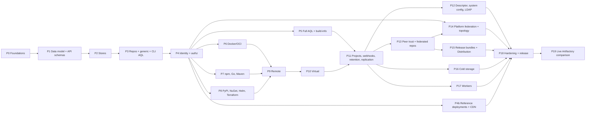
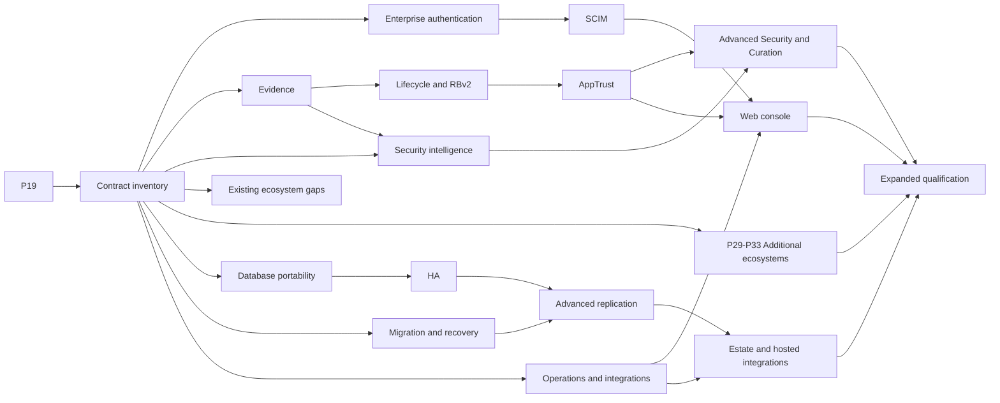

# Implementation plan

This plan orders the work that turns the [research](../research/README.md) and the
[decision records](../research/decisions/README.md) into a working registry. Decision
records describe *what* and *why*. This file describes the *order*, the *tasks* and the
*exit criteria* that must hold before a phase counts as done.

Every phase is also subject to the [definition of done](definition-of-done.md). The
target package tree is in [repo-layout.md](repo-layout.md). Research baseline:
2026-10-12. Implementation status reviewed against merged `main` on 2026-10-21, after
the P8 exit PR #609. Format scope was expanded on 2026-10-22 in P9b; that planning
change is not an implementation claim.

**Scope direction (2026-10-21):** only features superseded by newer capabilities may be
excluded. The former "cut from v1" items now have owners in P20–P41; the
[capability roadmap](capability-roadmap.md) accounts for the gaps and the evidence needed
for any supersession. This expands planned scope, not current implementation status.

## Build status

Updated as phases land. "Done" means the exit criteria hold, the gate (95% merged total,
90% per package) passes and lint is clean.

| Phase | Status | Notes |
|---|---|---|
| P0 Foundations | Done (2026-10-12) | Docs set, config model, layouts, strict config, server with system endpoints, OpenAPI pipeline, Linux acceptance job, parity oracle (635 JFrog operations cached, 6 matched, 629 baseline gaps). Gate 97.2% merged; `jf rt ping` and the provider configure step verified |
| P1 Data model and API schemas | Done (2026-10-13) | Derived from the 637 cached JFrog blocks; full in-scope OpenAPI surface authored with our own field descriptions; parity baseline shrinks accordingly |
| P1b Enterprise products: specs and model | Done (2026-10-13) | 574 of 635 JFrog operations at parity, 0 divergent; the 61 in the baseline are Mission Control, MyJFrog, bridges and JFConnect only. Seven services; research 16, decisions 0021 to 0026; 27 new tables in research 15 |
| P2 Stores | Done (2026-10-13) | Store contracts for every entity in research 15 (27 concerns), in-memory reference store, SQLite and PostgreSQL stores over one dialect layer with 71 tables in five migrations, the `storetest` contract suite (62 subtests) passing on all four backends, `migrate up/down/version`, `keys rotate` with versioned master keys, durable S3 upload sessions; merged coverage 97.7%. Stale-upload reaping moves to the P3 GC task; build-info tables to P5 |
| P2b Cloud blob storage and mirroring | Done (2026-10-13) | GCS and Azure blob backends (epic #21) and mirroring blobs across clouds and regions (epic #22); design in research 18 and decisions 0027 and 0028. The mirror's storage administration (#18) landed after P3's storage endpoints (#48) |
| P3 Repositories, generic artifacts, CLI AQL shape | Done (2026-10-13) | Epic #52, issues #42 to #51. The `jf` round trip and the status-code table pass. The Terraform apply criterion moved to P4 (#69): the provider authenticates only with the Bearer tokens P4 issues, and its fixture validates in CI meanwhile |
| P4 Identity and authorization | Done (2026-10-14) | **M1**. Epic #86. Access tokens, the native permission evaluator, the legacy security and Access v2 identity APIs, roles, environments, key pairs and the permission APIs, checked by the route and principal matrix (#84), the JFrog CLI identity commands and the Terraform identity scenario (#85). OIDC token exchange (#83) is also implemented; the Docker token endpoint landed in P6 |
| P4b Reference deployments and CDN delivery | Done (2026-10-16) | Epics #113 (CDN delivery and download redirect), #189 (consistent reference deployments, contract v2) and #114 (reference deployments) done; decisions 0029 and 0030. `single-bucket`, `multi-region`, `geo-replicated` and `cdn` on AWS, GCP and Azure, plus `multicloud/mirror`, each proven on its real cloud; `azure/cdn` proves with the `test` lifecycle alone, for Front Door Premium's hourly fee. The `gcp/cdn` proof settled decision 0029's open fact: Cloud CDN passes the response overrides on a cache fill |
| P5 Full AQL, searches, build-info | Done (2026-10-16) | Epic #160; decisions 0012 and 0014, research 22. AQL over `items`, `builds` and `build.promotions` with the secondary domains, `$msp` and the `items.delete` and `properties.update` actions, compiled for SQLite and PostgreSQL; the GET searches; build-info publish, append, rename, delete, promotion and retention. The shared AQL cases give identical ordered rows on the reference evaluator and all three stores, and the JFrog CLI's build commands pass. `remote=1` on the versions searches answers from caches until P9 (#213) |
| P6 Docker/OCI | Done (2026-10-16) | Epic #217; research 23 and decision 0031. Repository-path routing on `/v2` and Artifactory's prefix with the subdomain option; the Bearer challenge and short-lived registry tokens (#221, #248); blobs with resumable uploads and cross-repository mount; manifests in Artifactory's storage layout; manifest lists and indexes with `subject` and the referrers API; tags, catalogs and deletes; Docker tags in the package index with tag retention; promote and parent manifest lists. The OCI distribution-spec v1.1.1 suite passes all four categories (73 pass, 6 skipped by design, decision 0031), and `docker`, `crane`, `oras`, `cosign`, `jf docker push/pull`, `jf rt build-docker-create` and `jf rt docker-promote` round-trip in acceptance (#229). With P7, milestone M2 |
| P7 npm, Go, Maven locals | Done (2026-10-19) | **M2** reached, with P6. Epic #261; research 24 to 27 and decisions 0032 to 0036. Format framework v2 with the `formattest` contract and the persistent work queue; npm packuments, publish, dist-tags, deprecate, unpublish, search, legacy login and logout, `api/npm/auth`, reindex and the strict-layout conversion; the GOPROXY reads and `jf go-publish`; Maven deploy rules, metadata at three levels, `snapshotVersionBehavior`, version tokens, `calculateMetadata`, `generatePom` and `maxUniqueSnapshots`, with the Gradle, Ivy and SBT layouts. npm 11 and 12, the `go` command, Maven 3.10 and 3.9, `jf npm`, `jf go-publish` and `jf mvn` round-trip in acceptance and the Terraform scenario applies the four repository types (#275, #284, #294, #295); `jf gradle` runs informationally. Web login (#262) and package signatures (#362) remain separately tracked follow-ups outside the completed P7 milestone |
| P8 PyPI, NuGet, Helm, Terraform locals | Done (2026-10-21) | Epic #526; research 28 to 32 and decisions 0037 to 0041. PyPI, NuGet v2/v3 with PDB symbol serving, classic/OCI Helm, Terraform module/provider registries and the remote state backend round-trip with their native clients. Shared REST deploy, copy, delete, trash restore and completed reindexes preserve format reads; JFrog's Terraform providers manage all seven P8 repository types (#560). Browser approval (`login.v1`) remains #262; pasted-token Terraform login is verified |
| P9 Remote repositories | In progress | Shared source/HTTP/security/cache foundation, generic retrieval and [cache maintenance](remote-cache-maintenance.md) (#613–#622) implemented. Native adapter completion, upstream browsing/search (#213) and final qualification remain phase-owned; initial [Smart Remote synchronization](smart-remote.md) is implemented; #487 has a concrete P9 source design with runtime sharing completion in P11 |
| P9b Newly identified Artifactory formats | Not started | LuaRocks, NVIDIA NIM, Skills, Agent Plugins and Agent Packages: repository management and native protocols for every documented supported class |
| P10 Virtual repositories | Not started | **M3** |
| P11 Projects, webhooks, retention, replication | Not started | |
| P12 Descriptor export, system configuration, LDAP | Not started | |
| P13 Peer trust and federated repositories | Not started | |
| P14 Platform federation and topology | Not started | |
| P15 Release bundles v1 and Distribution | Not started | |
| P16 Cold storage archive and retention | Not started | |
| P17 Workers | Not started | **M4** |
| P18 Hardening and release | Not started | Release-wide hardening and acceptance; published early releases do not complete this phase |
| P19 Live Artifactory comparison and tidy-up | Not started | After P18. Brings artifactweave up to the latest Artifactory 7.x release: one comparison against a JFrog trial of that release for everything earlier phases could only infer (#216) |
| P20 Capability inventory and contract coverage | Not started | Operation/client/format ownership and an automated unmapped-gap check |
| P21 Browser and enterprise authentication | Not started | #262; SAML, human OIDC/OAuth, Crowd, HTTP-SSO, sessions and MFA |
| P22 SCIM and identity lifecycle | Not started | Provisioning, group reconciliation, deactivation and revocation |
| P23 Evidence and provenance | Not started | Attestations, verification, signing-key APIs and subject lifecycle |
| P24 Lifecycle and release bundles v2 | Not started | Stages, immutable releases, promotion, v2 distribution and cleanup |
| P25 AppTrust and policy governance | Not started | Applications, versions, binding, approvals and Unified Policy |
| P26 Security scanning and intelligence | Not started | Xray, SBOM, vulnerability/license analysis, Catalog/OneModel and reports |
| P27 Advanced Security and Curation | Not started | Contextual analysis, admission policies, PTC and package rerouting |
| P28 Existing ecosystem and core API completion | Not started | #362, #523; protocol/client/search/build gaps from P5–P8 |
| P29 Linux package repositories | Not started | Alpine, Debian, RPM and Opkg |
| P30 Language package repositories | Not started | Cargo, Composer, Gems, Pub, Swift, Hex and Bower |
| P31 Native build and plugin repositories | Not started | Conan, CocoaPods, Bazel modules, P2, JetBrains and AI editor extensions |
| P32 Data and model repositories | Not started | Conda, CRAN, Hugging Face ML and Machine Learning |
| P33 Automation and source repositories | Not started | Ansible, Chef, Puppet, Vagrant, VCS, Git LFS and Nix |
| P34 Database portability | Not started | MySQL, dialect/migration equivalence and supported-engine inventory |
| P35 High availability | Not started | Shared sessions, distributed work, failover and rolling upgrades |
| P36 Migration, backup and recovery | Not started | Artifactory/Access import/export, XML POST and coordinated recovery |
| P37 Advanced replication and interoperability | Not started | Multi-push, event/checksum replication and cross-vendor contracts |
| P38 Operations and external integrations | Not started | IAM, Vault, logs, metrics, support, key administration and queued-work controls |
| P39 Web console | Not started | Repository, identity, governance and operations workflows |
| P40 Estate and hosted-service integrations | Not started | Mission Control, MyJFrog, JFConnect, bridges and Pipelines replacement/integration |
| P41 Expanded platform qualification | Not started | Full capability, security, migration, HA and live-comparison sign-off |

## Remaining follow-ups after P8

All P8 tasks and its milestone are complete. The following open issues describe real
remaining work; completion of P8 does not close them. This is the backlog disposition as
of 2026-10-21, separate from the dated exit evidence above.

| Issue | Current state and next dependency |
|---|---|
| [#213: upstream version searches](https://github.com/weaveplatform/artifactweave/issues/213) | P9 task 5. `remote=1` currently reads local repositories and caches; upstream discovery depends on the remote fetcher and format adapters |
| [#487: project-scoped remotes](https://github.com/weaveplatform/artifactweave/issues/487) | Fields, admin endpoints and upstream resolution remain absent. P9 owns the source design; P11 owns completion with project sharing and authorization |
| [#362: npm package signatures](https://github.com/weaveplatform/artifactweave/issues/362) | P28 owns local ECDSA signing, key discovery and native `npm audit signatures` acceptance; it can be pulled forward independently of P9 |
| [#262: browser approval login](https://github.com/weaveplatform/artifactweave/issues/262) | P21 owns shared npm web login and Terraform `login.v1` with PKCE. P7 legacy npm login and P8 Terraform pasted-token login are implemented |
| [#303: anonymous registry acceptance](https://github.com/weaveplatform/artifactweave/issues/303) | Explicitly blocked on P12 applying `security.anonAccessEnabled`; the scenario must grant anonymous Read rather than relying on the seed permission |
| [#523: JFrog Maven 3.10 acceptance](https://github.com/weaveplatform/artifactweave/issues/523) | P28 owns the client gap; retry as soon as the upstream extractor fix ships. Native Maven 3.10 is tested; `jf mvn` uses Maven 3.9.16 meanwhile |
| [#216: live Artifactory captures](https://github.com/weaveplatform/artifactweave/issues/216) | Deliberately scheduled for P19 after P1–P18. The P8 inference checklists have been added; successful native-client tests do not replace captures from Artifactory |

## Milestones

| Milestone | Reached after | Demonstrable outcome |
|---|---|---|
| M1 walking skeleton | P4 | `jf rt ping/u/dl/s/del/cp/mv/sp` against generic repos, and `artifactory_local_generic_repository`, `artifactory_user`, `artifactory_group`, `artifactory_scoped_token`, `platform_permission` apply, plan clean, destroy. SQLite and local disk only |
| M2 first ecosystems | P7 | Docker (repository-path method, OCI conformance green), npm, Go and Maven local repositories work with their native clients |
| M3 proxy and virtual | P9b and P10 | The original eight format families resolve through remote and virtual repositories; P9b's five new types pass their documented class and native-client exits, including LuaRocks virtual resolution |
| M4 peer services and distribution | P17 | Federated repositories converge across three artifactweave peers; users and permissions federate; a release bundle is signed, distributed to an edge peer and verified; an archive policy moves packages to the cold tier and restores them; TypeScript Workers run on download and create events |
| Release hardening | P18 | Everything above plus projects, webhooks, cleanup policies, single replication, build-info, hardening, signed binaries and a container image |
| M5 enterprise identity | P22 | Browser/native login and external authentication work; SCIM provisioning/deactivation changes effective access |
| M6 supply-chain governance | P27 | Evidence, releases, applications, security findings and admission decisions compose into a verified release workflow |
| M7 ecosystem coverage | P33 | Every inventoried package type has native-client proof for its supported repository classes |
| M8 operational resilience | P38 | Database portability, HA, recovery, replication and operator integrations have failure/recovery evidence |
| M9 platform workflows | P40 | Console and estate/integration workflows produce real, authorized outcomes |
| M10 expanded qualification | P41 | The full capability inventory is implemented or has evidenced supersession and migration; no unowned gaps remain |

The original P18 target was named `v0.1.0-rc`. Release automation and packaging landed
earlier, and [v0.1.0](https://github.com/weaveplatform/artifactweave/releases/tag/v0.1.0)
was published on 2026-10-19. That tag does not imply P18 completion; the release version
for the hardening milestone must be selected when it is reached.

## Sequence at a glance

**Critical path:** P0 → P1 → P1b → P2 → P3 → P4 → P6 → P9 → P10 → P11 → P13 → P15 → P18 → P19.

**Parallel lanes:** P16 and P17 run beside P13 to P15 once P11 has landed; P12 runs
beside all of them. P5 runs beside P6–P8. P6, P7 and P8 are independent of each other
once P4 has landed (publishing needs credentials). P9 can start as soon as one format
exists. P4b runs beside P5 to P8 once P4 has landed: its CDN work builds on the blob
backends of P2b, and its scenarios on the Terraform job from P4.

## Expanded scope and sequencing

The former "cut from v1" list is replaced by the
[capability ownership table](capability-roadmap.md#p20-onward-capability-ownership).
SAML, SCIM, Crowd, HTTP-SSO, Lifecycle, release bundles v2, Evidence, AppTrust, Xray,
additional package ecosystems, UI, HA, databases and integrations are in scope.
Only a documented replacement and migration can justify excluding an older interface.
API-key creation is such a narrow case; an entire capability is not removed merely
because one implementation or protocol is old.

P9–P19 keep their existing delivery sequence. P20 establishes the expanded contract
baseline after that first live comparison. P21/P22, P23–P27, P28–P33 and P34–P38 are
separate lanes once their named prerequisites hold; the numbering is not a requirement
to serialize independent work. P39/P40 integrate the services and P41 qualifies the
complete expanded scope. Earlier implementation of an independent gap is welcome,
provided its phase and issue keep the evidence and dependencies.

The diagram shows the major work streams; each phase below names its full prerequisites
and integration dependencies. This is a planning baseline, not a claim of effort estimates. Each phase is split into
research/contracts, implementation, native acceptance and sign-off PRs. P20 must expand
any family whose initial inventory proves too large; splitting a phase cannot discard
its capabilities. [Decision 0042](../research/decisions/0042-capability-scope-and-supersession.md)
and the [definition of done](definition-of-done.md) govern changes to this scope.

---

## P0: Foundations

Decisions: [0001](../research/decisions/0001-mirror-the-jfrog-api-surface.md),
[0002](../research/decisions/0002-spec-first-flat-crud-handwritten-item-paths.md),
[0003](../research/decisions/0003-repository-model.md),
[0015](../research/decisions/0015-testing-and-acceptance.md).

**Tasks**
1. `make init NAME=artifactweave`; this documentation set; `CODEOWNERS`.
2. `pkg/repo`: the `Config` model with every field in [research 03](../research/03-repository-configuration-model.md), JSON round-trip that accepts the string-typed booleans JFrog documents per rclass and writes booleans, validation (key syntax, rclass and packageType sets, virtual members exist, `defaultDeploymentRepo` is a member, `projectKey` implies `environments`).
3. `pkg/layout`: pattern engine for `repoLayoutRef` tokens with the bundled layouts and the Maven-2 integration-revision regexes.
4. `internal/config`: strict app YAML, flag > env > file precedence, unknown keys rejected, `config validate`.
5. `internal/server`: chi router, request id, slog access log, recovery, body limits, the per-surface errors table, the base-URL resolver middleware, content-type normalisation for `+json` vendor types and `application/yaml`.
6. `api/*.openapi.yaml` skeletons with `GET /artifactory/api/system/{ping,version,license}`, `GET /artifactory/api/v1/system/{readiness,liveness}`, `GET /access/api/v1/system/{ping,version}`, `GET /router/api/v1/system/health`, `POST /artifactory/api/system/usage`, `POST /jfconnect/api/v1/backoffice/metrics/log`; `make generate` and the drift check; `TestOpenAPIFieldDescriptions`; `TestHandwrittenRoutesNotGenerated`.
7. `internal/layout` import-tier test.
8. `test/acceptance` skeleton: godog, `-cover` binary, pinned tool binaries (`jf`, `terraform`), the Linux `acceptance` job added to the coverage and gate `needs`; `test/terraform` with a pre-populated provider mirror.
9. `docs/security/threat-model.md` skeleton (done), `docs/operations/*` skeletons (done).
10. Parity oracle: `internal/specoracle` and `tools/specoracle` cache JFrog's embedded OpenAPI blocks under the gitignored `.specoracle/`, compare them with `api/*.openapi.yaml`, and `TestSpecParity` holds `api/parity-baseline.json` as the accepted-gap list; the `parity` CI job runs it ([research 01](../research/01-jfrog-api-landscape.md#parity-oracle)).

**Exit criteria**
- `make gate` green on the three OS runners plus the Linux acceptance job.
- `jf rt ping` returns `OK` with the pinned JFrog CLI (verified 2026-10-12 with jf 2.126.0).
- `terraform plan` with `provider "artifactory"` configured and a `data "artifactory_repositories"` block gets through the provider's configure step: the server log shows `GET /artifactory/api/system/version` and `POST /artifactory/api/system/usage` answered 200 before the data read fails with the Artifactory 404 envelope (verified 2026-10-12 with provider 12.11.14; the provider sends the path with a trailing slash, and the read itself waits for P4's access tokens, #69).
- The layout test fails when a forbidden import is added deliberately.

## P1: Data model and API schemas

Decisions: [0001](../research/decisions/0001-mirror-the-jfrog-api-surface.md),
[0002](../research/decisions/0002-spec-first-flat-crud-handwritten-item-paths.md),
[0020](../research/decisions/0020-domain-model.md).

The user's direction after P0: do not build a database before the data model is clear,
and the crawl gives us that model. This phase turns the 637 cached JFrog operation
blocks into (a) a documented domain model and (b) the complete in-scope REST API
schema with our own field descriptions, so the field semantics shape the server
features before any store is written.

**Tasks**
1. `specoracle inventory`: a generated inventory of every named schema, field, enum,
   parameter and operation in the cache (`api/oracle-inventory.json`,
   [research 14](../research/14-data-model-inventory.md)). Facts only; no JFrog prose.
2. [Research 15, data model](../research/15-data-model.md) and
   [decision 0020](../research/decisions/0020-domain-model.md): wire entities per
   family, identity and mutability, server-owned fields, relationships, and the derived
   storage model that P2 implements. Contradictions with `pkg/repo` are fixed in
   `pkg/repo`.
3. Spec tooling: `specoracle scaffold` (draft fragments from the cache with
   `TODO(author)` descriptions and `x-oracle-source` links), `openapi-bundle`
   (per-family fragments under `api/src/<service>/` merged into the three bundled
   specs), `stubgen` (every generated strict interface method answers 501 until
   implemented), all wired into `make generate` and the drift check.
4. Author the full in-scope surface family by family (tiers in
   [research 10](../research/10-scope-and-tiers.md)): repositories, artifacts and
   storage, searches, replication, trash, package-type APIs, legacy security, Access
   users/groups/permissions/tokens/roles/environments/OIDC, projects, webhooks, cleanup
   policies, system and configuration, build-info. Every field and parameter gets a
   description per [api-description-conventions](api-description-conventions.md) that
   states presence, defaults, server ownership and create/update rules; these are the
   behavioural contract the handlers implement. Families outside P1's initial schema
   boundary received only 501/404 stubs; their delivery is now owned by P13–P41.
5. ~~`pkg/types` with `x-go-type` bindings for every entity~~ **Moved to P2 task 1
   (correction, 2026-10-13).** Binding every wire schema to a domain type contradicts
   [decision 0020](../research/decisions/0020-domain-model.md), which keeps one internal
   representation per entity with converters to the legacy, Access and YAML wire
   forms. Binding is right only where the wire and internal shapes coincide, which is
   the repository configuration (`RepositoryConfiguration` is bound to `repo.Config`).
   The generated wire models in `internal/server/gen` and `pkg/client` are the P1
   deliverable; the internal domain types are designed with the store contracts at the
   start of P2, before any SQL, so the model still precedes the database.

**Exit criteria**
- `make parity` reports zero *missing* and zero *divergent* operations for every
  family in P1's initial scope; the baseline lists families assigned beyond P1, and `TestSpecParity`
  is promoted to a required check.
- `TestOpenAPIFieldDescriptions` passes with no `TODO(author)` left in a bundled spec.
- `make generate` compiles with the 501 stubs; the acceptance suite still passes; the
  gate stays green.
- Research 15 reviewed against the inventory: every entity the specs reference has a
  row, and the storage model section names every table P2 will create.

**Outcome (2026-10-13): done.**
- Parity: 407 of 635 JFrog operations matched, **0 divergent, 0 missing in scope**.
  The 228 operations in the baseline at that date belonged to products beyond P1's scope: Distribution
  and release bundles v1 (75), cold storage archive and retention (30), federated
  repositories (22), platform federation and topology (25), Mission Control (19),
  MyJFrog (19), bridges (17), Workers (15), JFConnect (6). `TestSpecParity` is in the
  gate's `needs`.
- Specs: 16 authored fragments under `api/src/`, bundled into three documents with
  211 Artifactory paths plus the Access and Event surfaces; every field and parameter
  described per the conventions; no `TODO(author)` or `x-draft` left. Unverified
  semantics carry `x-unverified: true` for capture against a live Artifactory.
- Generated: strict chi servers and clients for all three services; every
  unimplemented generated operation answers 501 (`TestUnimplementedOperationsAnswer501`),
  and every hand-written operation without a handler answers 501 from the embedded
  spec, never 404.
- Gate: lint 0 issues, unit and acceptance green, merged coverage 96.6%.
- Corrections made while closing the phase: the parity comparator now merges JFrog
  pages that document variants of one route (deploy, deploy by checksum and deploy
  from archive; replication update and bulk enable/disable), which had made the
  report nondeterministic; the spec models those as one route each, with the
  `/checksum` documentation alias marked `x-not-routed`; item routes exclude the
  reserved repository key `api`; union-typed query parameters are typed as strings
  because the generator cannot bind them; `pkg/repo` gained `UnmarshalJSON`, the
  federated `priorityResolution` boolean, and class checks for `terraformType` and
  proxy fields; research 15 gained the `leases` and `vault_configs` tables; task 5
  moved to P2 (above).

## P1b: Enterprise products, specs and model

Decisions: [0021](../research/decisions/0021-peer-trust-and-sync-protocol.md) to
[0026](../research/decisions/0026-workers-runtime.md); research
[16](../research/16-enterprise-products.md).

On 2026-10-13 the user brought five products into scope: Distribution and release bundles
v1 (75 operations), cold-storage archive and retention (30), platform federation and
topology (25), federated repositories (22) and Workers (15). Following the rule set in P1
(no database before the model is clear), their specs and data model are completed before
P2 so the stores create their tables from the start. Decisions taken with the user:
artifactweave-to-artifactweave peers only (management APIs stay JFrog-compatible, the
instance-to-instance protocol is ours); Workers run TypeScript through esbuild and goja
in-process; cold storage is a second blob tier in the same instance; all of it ships in
v0.1.

**Tasks**
1. Tooling for any number of services: the service list is derived from
   `api/src/<service>/info.yaml` in the oracle tool, the Makefile and the embedded spec
   package; new services `distribution`, `worker`, `pfed` and `grid` with their own error
   envelopes (`apierror.Distribution`, `apierror.Flat`); the blanket prefix stubs for
   those products are replaced by per-operation routes.
2. Research 16 and decisions 0021 to 0026; amendments to 0001, 0003, 0017 and 0020;
   research 10, 12 and 15 updated.
3. Specs for the 167 operations, same workflow and conventions as P1.

**Exit criteria**
- `make parity` reports 0 divergent and exactly 61 missing operations, all Mission
  Control, MyJFrog, bridges and JFConnect.
- Description, 501 and hand-written route tests pass across all seven specs; the gate
  stays green.
- Research 15 section 4 names every table P2 creates for these products.

**Outcome (2026-10-13): done.**
- Parity: 574 of 635 operations matched, 0 divergent, 61 missing (MyJFrog 19, Mission
  Control 19, bridges 17, JFConnect 6). Generated: 557 operations across seven services,
  every one answering 501 in its product's documented envelope until implemented
  (`TestUnimplementedOperationsAnswer501` compares each body with the envelope table).
- New envelopes: `apierror.Distribution`, `apierror.Flat` (pfed, grid) and
  `apierror.ArtifactoryLegacy` (cold storage retention, import and export).
- Every spec-sweeping test, the parity test and the generated-mux check now derive the
  service list from the bundled specs, and a guard fails when a new service is missing
  from the mux check.
- Gate: lint 0 issues, unit and acceptance green, merged coverage 97.1%, generation
  reproducible.
- Carried forward: decision 0021 defines artifactweave's own peer API under
  `/artifactweave/peer/v1/`; it gets its own `api/src/peer/` spec as P13's first task.
  Several shapes JFrog leaves undocumented carry `x-unverified` (release bundle creation
  body, distribution status lists, worker test body, archive search criteria) for capture
  against a live instance.

## P2: Stores

Decisions: [0004](../research/decisions/0004-storage-sql-metadata-and-blobs.md),
[0017](../research/decisions/0017-sealed-columns-and-master-key.md).

**Tasks**
0. `pkg/types`: the internal domain types for every entity in
   [research 15](../research/15-data-model.md) section 2, with converters to and from
   the generated wire models (`internal/server/gen`) and table-driven round-trip tests
   per wire form (legacy, Access, YAML descriptor). Written and reviewed before task 1
   so the store contracts are expressed in these types.
1. `pkg/store` contracts (`Repos`, `Items`, `Properties`, `Stats`, `Principals`, `Groups`, `Permissions`, `Tokens`, `Projects`, `Webhooks`, `Policies`, `Runs`, `Packages`) with `Tx`, sentinel errors and keyset cursors; `pkg/store/inmem`.
2. `internal/sqlstore/sqlcommon` dialect layer; `sqlite` (modernc, WAL, single writer) and `postgres` (pgx stdlib); embedded migrations; `artifactweave migrate up|down|version`.
3. `pkg/blob` contract: `BeginUpload / Append / Commit(digest) / Abort`, `Open` returning `io.ReadSeekCloser`, `PresignGet`, `Delete`, `Stat`; `fs` backend (temp dir per upload id, rename on commit) and `s3` backend (multipart upload id persisted through the store, path-style option for MinIO); checksum index by sha256, sha1 and md5.
4. `internal/crypt`: keyring, sealed columns with purpose and row AAD, `artifactweave keys rotate`.
5. `storetest` and `blobtest` contract suites.

**Exit criteria**
- Contract suites pass on inmem, SQLite (memory and file), PostgreSQL and on fs and MinIO in the Linux jobs, and skip cleanly on macOS and Windows.
- Migration tests apply up, down, up per dialect.
- A sealed value round-trips and is unreadable with the wrong key.

**Outcome (2026-10-13): done.**
- `pkg/store`: one interface per concern (content, identity, operations, peers and federation,
  enterprise products) over the `pkg/types` domain types, with `Tx`, `AfterCommit`, sentinel
  errors and keyset cursors; `store.Normalise` defines what a stored value reads back as (UTC
  microseconds, millisecond durations).
- `pkg/store/inmem` (reference), `internal/sqlstore/sqlcommon` with `sqlite` (modernc, WAL,
  immediate transactions; file and in-memory) and `postgres` (pgx); 71 tables, identical in both
  dialects. Differences from research 15's table list are recorded in its section 4.1.
- `pkg/store/storetest`: 62 contract subtests passing on inmem, SQLite file, SQLite memory and
  PostgreSQL 17 (testcontainers, skipped without Docker), plus SQLite fault-injection tests per
  group. Every PostgreSQL contract run rolls all migrations back and applies them again.
- Sealed columns: one registry drives `Store.Reseal`; `artifactweave keys rotate` re-seals under
  the newest key version (`master_key` with a `vN:` prefix, `master_key_previous` during the
  rotation), verified over a populated store on both dialects, and a test fails when a store seals
  a purpose the registry misses.
- `artifactweave migrate up|down [--to N]|version`; `s3.StoreStates` persists S3 multipart
  sessions in the `uploads` table.
- The MinIO contract run now uses Chainguard's MinIO image pinned by digest: `minio/minio` is no
  longer published on Docker Hub, so the suite had never run.
- Dependency bumps for govulncheck: `golang.org/x/text` v0.41.0, `golang.org/x/crypto` v0.56.0,
  `github.com/moby/go-archive` v0.3.0. The remaining findings are in the Go 1.27.1 standard
  library and clear with Go 1.27.2, which CI installs.
- Moved on: stale upload reaping (the store side, `UploadStore.Stale`, exists) goes to the P3 GC
  task; the build-info tables go to P5 with a new migration once a live capture fixes their shape.

## P2b: Cloud blob storage and mirroring

Decisions: [0027](../research/decisions/0027-cloud-blob-backends.md),
[0028](../research/decisions/0028-blob-mirroring.md); research
[18](../research/18-cloud-blob-storage.md).

Requested on 2026-10-13: Google Cloud Storage and Azure Blob Storage beside S3 with the
same resumable multipart uploads, and an option to mirror every blob into several stores
across clouds and regions in parallel. The work is tracked as GitHub issues, one PR each:

- Epic #21, cloud backends:
  - research and decision (#7);
  - a shared upload-session layer with per-instance upload rows (#8);
  - `pkg/blob/gcs` (#9);
  - `pkg/blob/azure` (#10);
  - configuration (#11);
  - an opt-in real-cloud conformance workflow (#12).
- Epic #22, mirroring:
  - decision (#13);
  - named stores and mirror configuration (#14);
  - the `blob_replicas` index (#15);
  - `pkg/blob/mirror` with quorum writes and failover reads (#16);
  - the repair worker (#17);
  - per-member administration once P3 serves the storage endpoints (#18);
  - a cross-cloud scenario on Linux CI (#19).

**Exit criteria**
- `blobtest.Run` passes on each backend's fake everywhere and on its emulator on Linux.
- The mirror keeps accepting uploads with one member down and repairs the missing copy.
- Coverage is at least 95% total and 90% per package.

## P3: Repositories, generic artifacts, CLI AQL shape

Decisions: [0003](../research/decisions/0003-repository-model.md),
[0004](../research/decisions/0004-storage-sql-metadata-and-blobs.md),
[0012](../research/decisions/0012-search-and-aql.md),
[0018](../research/decisions/0018-package-index.md).

**Tasks**
1. Repositories API ([research 02](../research/02-artifactory-core-api-inventory.md) A1) including batch endpoints, `existence`, `configurations`, v2 reads, exact status codes.
2. Items: deploy with checksum headers and matrix properties, checksum deploy, explode archive, folder create, download with `Range` and `Accept-Ranges`, delete, file and folder info, `?list`, `?stats`, `?lastModified`, `?properties`, `?permissions`, set, delete and PATCH properties, copy and move with `dry` and `suppressLayouts`, archive entry download, folder archive download, `zap`, `storageinfo`, trash can and restore, GC (including reaping stale upload sessions found through `UploadStore.Stale`, deferred from P2), `.sha1/.md5/.sha256` sidecars served from metadata and validated per `checksumPolicyType`, matrix-param resolution on GET.
3. `GET /api/v1/uploads/config`. It answered `{"supported":false}` until the JFrog CLI multipart protocol landed (#91) and now answers `true`.
4. Package-index skeleton and the `generic` format handler.
5. `pkg/aql` limited to the CLI's query shape (`items.find` with `$or`/`$and`, `$match`, `$ne`, `@prop`, `type`, `include`, `sort`, `offset`, `transitive`, `limit`), with fixtures captured from `jf rt s/dl/del/cp/mv/sp` and run on both dialects.
6. Minimal admin Basic auth and the seeded `admin`, `anonymous`, `readers`, `Anything`, `Any Remote` principals and targets; `artifactory-build-info` repo.
7. YAML descriptor PATCH for `localRepositories`, `remoteRepositories`, `virtualRepositories`, `proxies`, `propertySets`, `repoLayouts` with null deletes; `artifactweave config apply`.

**Tracking.** Epic #52 holds one GitHub issue per PR:
1. Open the metadata store and blob store in `serve` (#42).
2. Basic auth and the seeded principals (#43).
3. Repositories API (#44).
4. Deploy and download generic artifacts (#45).
5. Storage API: item info, listings and properties (#46).
6. Copy, move and archives (#47).
7. Trash can, garbage collection, storage summary and zap (#48), then the mirror's storage administration (#18).
8. AQL for the JFrog CLI's query shape (#49).
9. Descriptor PATCH and `artifactweave config apply` (#50).
10. The exit checks: the JFrog CLI round trip and the Terraform job (#51).

**Exit criteria**
- `jf rt u/dl/s/cp/mv/del/sp` round-trip a tree, including a checksum-deploy hit for a file over 10 KiB and a split download. Met: `round_trip.feature` (#51).
- Moved to P4 (#69): `artifactory_local_generic_repository` and `artifactory_item_properties` apply, plan clean, destroy. The provider authenticates only with a Bearer access token, which P4 issues. Met in P4 (#69).
- The status-code table test covers every route in this phase. Met: the guard in `internal/server/status_test.go` fails while an implemented route has no row.

## P4: Identity and authorization

Decisions: [0005](../research/decisions/0005-authentication-and-tokens.md),
[0006](../research/decisions/0006-authorization-native-permission-model.md),
[0019](../research/decisions/0019-human-authentication-tiers.md).

**Tasks**
1. Legacy security shims: `/api/security/users|groups|permissions`, `/api/v2/security/permissions` (POST create 201, PUT replace 200, HEAD), `lockedUsers`, `unlockUsers` in both forms, `userLockPolicy`, `passwordExpirationPolicy` with real JSON types, `encryptedPassword`, keypairs (POST 201) and the per-repo key assignment, certificates, legacy token create/list/revoke, API-key shims.
2. Access v2 users, groups, permissions with cursors; tokens v1 (create 200 with `token_id`, list, get, revoke by id and by value, default expiry); roles; environments; `basic_authentication_enabled`; password policy (204).
3. JWT access tokens with the RawStdEncoding-safe payload, reference tokens, refresh tokens, Docker token endpoint.
4. Native evaluator: admin, permission targets in the three wire formats over one internal shape, `ANY` targets, Ant patterns, groups, token scope narrowing, anonymous.
5. Route × principal matrix tests including `anonymous`.
6. OIDC token exchange for CI workload identity (#83, decision 0019, research 21):
   providers, identity mappings and `POST /access/api/v1/oidc/token`. Outside the exit
   criteria. Done: `oidc.feature` with the real `jf eot`, and
   `deploy/artifactweave/terraform/oidc` in the `terraform` job.

**Exit criteria**
- `artifactory_user`, `artifactory_managed_user`, `artifactory_group`, `platform_permission`, `artifactory_permission_target`, `artifactory_scoped_token`, `artifactory_keypair`, `platform_group` apply, plan clean, destroy. Met: `deploy/artifactweave/terraform/identity` in the `terraform` job (#85). `artifactory_permission_target` is a stub in provider 12.11.14 that fails every operation with "deprecated. Use platform_permission instead", so the scenario reads the permission back through its data source.
- `jf rt user-create`, `group-create`, `permission-target-create`, `access-token-create` and `jf c add` with the created token work. Met: `identity_exit.feature` (#85), with `security.feature`, `permissions.feature` and `tokens.feature`.
- A token scoped to one repository cannot read another. **M1.** Met: `identity_exit.feature` (#85), where the token's `jf rt dl` from the other repository fails and its GET answers 403.
- Moved from P3 (#69): the `terraform` CI job mints an admin access token and runs `make terraform TERRAFORM_MODE=apply`. `artifactory_local_generic_repository` and `artifactory_item_properties` apply, `terraform plan` is empty, then destroy, and the job's coverage joins the gate. Met: the `terraform` job (#69), after the repository API started writing its flags as JSON booleans and listing no environments as `[]`.

## P4b: Reference deployments and CDN delivery

Decisions: [0029](../research/decisions/0029-cdn-delivery-and-download-redirect.md),
[0030](../research/decisions/0030-reference-deployments.md); research
[19](../research/19-cdn-and-download-redirect.md) and
[20](../research/20-reference-deployments.md).

Requested on 2026-10-14, after the Terraform apply job (#109) showed that the
`downloadRedirect` and `cdnRedirect` flags were stored but barely used:
- CDN delivery on all three clouds, on self-hosted instances;
- every Terraform root the Makefile uses moved under `deploy/`, as documented reference
  deployments per cloud and scenario that artifactweave is tested against by manual
  dispatch.

The phase number places it after P4 because its scenarios use P4's access tokens and
Terraform job. It runs beside P5 to P8.

**Tracking.** One GitHub issue per PR:
- Epic #113, CDN delivery and download redirect, done:
  - the download-redirect fixes: HEAD, conditional requests, counts, mirror health (#117, done);
  - research 19 and decision 0029 (#118);
  - the redirect policy, signing capability and redirect settings (#119);
  - `cdnRedirect` with CloudFront signed URLs and a fake edge (#120);
  - Cloud CDN signed URLs (#121);
  - Azure Front Door with SAS passthrough (#122).
- Epic #114, reference deployments, done 2026-10-16:
  - research 20 and decision 0030 (#123);
  - static checks and mocked tests for deployment Terraform (#124);
  - the acceptance roots moved to `deploy/platform/terraform` (#125);
  - per-cloud bootstrap roots for CI trust, remote state, DNS and budgets (#126);
  - app-layer references in `deploy/artifactweave` (#127);
  - AWS bootstrap, `aws/single-bucket` and real S3 conformance (#128);
  - the scenario workflow and the `test/platform` suite (#129);
  - multi-region mirror scenarios (#130);
  - geo-replicated scenarios with native replication (#131);
  - then epic #189, consistent reference deployments (below, done);
  - then `aws/cdn` (#132), `gcp/cdn` (#133) and `azure/cdn` (#134), on contract v2, done;
    `azure/cdn` proves with the `test` lifecycle alone;
  - the multicloud mirror scenario (#135), on contract v2, done.
- Epic #189, consistent reference deployments, done 2026-10-16: every scenario written once
  as both the acceptance test and the consumer documentation of its deployment path,
  composing per-cloud modules under a linted contract (decision 0030, contract v2). Every
  scenario's proof run is linked from decision 0030's Verification:
  - decision 0030 amended into the scenario contract v2, with the README templates (#178);
  - prove only the scenarios a pull request changes (#179);
  - the bootstraps and the lab harness moved to `deploy/ci` (#180), after #179;
  - the contract linter (#181) and the local runner for any scenario (#182), after #180;
  - storage modules v2 with the multi-region scenarios on them (#183), and the app-layer
    references aligned (#187), after #181;
  - AWS (#184), GCP (#185) and Azure (#186) single-bucket and geo-replicated as module
    compositions, in parallel, after #182 and #183;
  - closing the work (#188), last: the linter strict everywhere, with no list of exempt
    roots.
- Alongside, outside both epics: the deviations register (#115, done) and the stale
  references it found (#116).

**Exit criteria**
- `jf rt dl` downloads files above and below 5 MiB from a `downloadRedirect` repository on
  every backend that signs; HEAD and conditional requests are answered locally; redirected
  downloads are counted.
- `cdnRedirect` redirects to CloudFront, Cloud CDN and Front Door URLs, verified against
  the fake edge in acceptance and against the real edges in the CDN scenarios.
- `X-JFrog-Download-Redirect-To` with `None`, `S3` and `CF` is honoured.
- Every Terraform root the Makefile uses lives under `deploy/`; `test/terraform` keeps only
  its driver.
- `single-bucket`, `multi-region`, `geo-replicated` and `cdn` exist for AWS, GCP and
  Azure, plus `multicloud/mirror`, each documented with inputs, outputs, costs and a
  rendered `artifactweave.yaml`.
- Every pull request runs fmt, validate, tflint, trivy, mocked `terraform test` and the
  docs drift check over them.
- Each scenario has a recorded `platform-scenarios` run that applied, passed
  `test/platform` and destroyed.
- Every scenario composes per-cloud modules, keeps lab values and harness-only outputs out of
  its consumer Terraform, and has a README that follows the scenario template with a tested
  `artifactweave.yaml` example; `deploy/platform` holds only consumer references, and the
  contract linter in `make deploy-check` is strict.

## P5: Full AQL, searches, build-info

Decisions: [0012](../research/decisions/0012-search-and-aql.md),
[0014](../research/decisions/0014-build-info.md); research
[22](../research/22-aql-searches-build-info.md).

**Tasks**
1. Full AQL grammar for `items`, `properties`, `builds` and the secondary domains, `.delete()`, `properties.update()`, dialect-specific compilation with the traps named in 0012. The `item.infos`, `releases` and `release_artifacts` domains answer 400 as unsupported (#410); includes of a related row's properties and statistics nest them (#494).
2. GET searches: quick, GAVC, property, checksum, bad checksum, usage, dates, creation, pattern, versions, latest version (text), latest by properties.
3. Build-info: the `builds`, `build_artifacts`, `build_dependencies` and `build_promotions` tables (a new migration and a `BuildStore` contract, deferred from P2), `PUT/GET /api/build`, build runs, build artifacts, delete, retention (204), rename, promotion with the vendor content type, `build.name`/`build.number` properties on upload.

**Tracking.** Epic #160 holds one GitHub issue per PR:
1. Research 22 and amendments to decisions 0012 and 0014 (#161).
2. The Builds API in the spec oracle and the OpenAPI sources (#162).
3. The AQL items domain: properties, statistics, `$msp`, output rules and limits (#163).
4. The build-info store: migration, `BuildStore` contract and storetest (#164).
5. The build-info API: publish, read, append, rename, delete and build artifacts (#165).
6. Build promotion and retention (#166).
7. AQL builds and the build secondary domains (#167).
8. AQL actions: `items.delete` and `properties.update` (#168).
9. GET searches: quick, property, checksum, bad checksum, usage, dates, creation and pattern (#169).
10. GET searches: GAVC, versions, latest version, latest by properties, dependency and build artifacts (#170).
11. A remote repository's key matching its cached items in AQL (#68).
12. The versions searches ordered as Artifactory orders them, in Mercury order (#214).
13. The versions, latest version and build artifacts searches answering as Artifactory's do (#215).
14. The exit checks: AQL fixtures on both dialects and the JFrog CLI build commands (#171).

**Exit criteria**
- AQL fixtures (CLI-captured plus hand-written per operator) produce identical ordered output on SQLite and PostgreSQL. Met: the cases in `pkg/aql/aqltest` run on the reference evaluator (`pkg/aql/cases_test.go`) and through `storetest` on the in-memory store, SQLite and PostgreSQL, comparing ordered rows (#171). The CLI-captured fixtures come from jf 2.126.0 through `make capture-aql`, now including `jf rt s --build` and `jf rt dl --build`; the hand-written cases cover every operator on `items`, `builds` and `build.promotions`, the relation paths, `$msp`, the include rules, the actions and the result cap.
- `jf rt u --build-name --build-number`, `jf rt bp` and `jf rt build-promote` work. Met: `builds.feature` (#165, #166, #171) runs them with the real `jf`, with `bp --overwrite`, `s --build`, `dl --build`, `bpr` with copy, status, properties and a move, `bdi`, and `ba` followed by `bp`. The promotion is read back through AQL `build.promotions`.

## P6: Docker/OCI

Decisions: [0003](../research/decisions/0003-repository-model.md),
[0005](../research/decisions/0005-authentication-and-tokens.md),
[0015](../research/decisions/0015-testing-and-acceptance.md),
[0018](../research/decisions/0018-package-index.md),
[0029](../research/decisions/0029-cdn-delivery-and-download-redirect.md),
[0031](../research/decisions/0031-docker-oci-registry.md); research
[23](../research/23-docker-oci-registry.md).

**Tasks**
1. `/v2/{repo}/...` repository-path routing, `/artifactory/api/docker/{repo}/v2/...`, optional subdomain match.
2. Token challenge and issuance with the values from [research 17](../research/17-undocumented-shapes.md).
3. Blobs, chunked and monolithic uploads with resumable `Range`, cross-repo mount, manifests (single, index, `subject` with `OCI-Subject`), referrers API, tags list with Link pagination, `_catalog`, delete, `promote`, `parentManifests`, multi-arch delete.
4. Artifactory storage layout (`manifest.json`, `list.manifest.json`, `sha256__` layers, digest folders, the manifest properties, labels as properties) and tag retention through the package index.
5. The `conformance` CI job.

**Tracking.** Epic #217 holds one GitHub issue per PR, all done (2026-10-16):
1. Research 23 and decision amendments for Docker and OCI (#218).
2. Docker REST operations in the OpenAPI sources: promote and the listings (#219).
3. Registry routing: `/v2`, `/artifactory/api/docker/{repo}/v2` and the subdomain option (#220).
4. Docker token challenge and issuance (#221).
5. Blobs: pull, monolithic and chunked uploads, resumable sessions and cross-repository mount (#222).
6. Image manifests in Artifactory's storage layout (#223).
7. OCI conformance CI job (#224).
8. Manifest lists and OCI indexes, subject and the referrers API (#225).
9. Tags list, catalogs and deletes, with the multi-architecture delete (#226).
10. Docker tags in the package index and tag retention (#227).
11. Docker promote and parent manifest lists (#228).
12. P6 exit checks: `docker`, `crane`, `oras`, `cosign` and `jf rt docker-promote` (#229).
13. Registry tokens for OIDC-exchanged users that are not stored (#248).

**Exit criteria**
- OCI conformance suite green for push, pull, discovery and management.
- `crane`, `oras` and `cosign sign` round-trip; `docker push/pull` through the tool-binary path; `jf rt docker-promote`.

## P7: npm, Go, Maven locals

Decisions: [0003](../research/decisions/0003-repository-model.md),
[0015](../research/decisions/0015-testing-and-acceptance.md),
[0018](../research/decisions/0018-package-index.md),
[0032](../research/decisions/0032-package-format-handlers.md),
[0033](../research/decisions/0033-persistent-work-queue.md); research
[24](../research/24-package-format-handlers.md).

**Tasks**
1. npm: packuments (full and abbreviated), scoped names, publish with attachments and conflict handling, unpublish, deprecate, dist-tags, search, legacy `adduser`, `ping`, reindex, strict layout conversion. Web login and the `done` poll are deferred to #262.
2. Go: `@v/list`, `.info`, `.mod`, `.zip`, `@latest`, case encoding, `go-publish` PUTs with matrix params and `X-Checksum-Sha256` in the response.
3. Maven: layouts for Maven, Gradle, Ivy and SBT; artifact and snapshot-level `maven-metadata.xml`, `snapshotVersionBehavior`, `maxUniqueSnapshots` through the index, `calculateMetadata`, `generatePom`, version tokens `[RELEASE]`/`[INTEGRATION]`/`SNAPSHOT`.

**Tracking.** Epic #261 holds one GitHub issue per PR:
- **Prework, done (2026-10-16):**
  1. SHA-512 as a first-class checksum of stored content (#296).
  2. Persistent work queue for asynchronous derived work (#297).
- **Research:**
  1. Research 24 and decision 0032: package format handlers (#263).
  2. npm research and decision (#264).
  3. Go modules research and decision (#265).
  4. Maven, Gradle, Ivy and SBT research and decision (#266).
- **Groundwork:**
  1. Format framework v2: hook environment, optional interfaces and format errors (#267).
  2. Format contract suite and shared helpers (#268).
  3. Package protocol router kit and per-format test tables (#269).
  4. Acceptance clients for npm, Go and Maven (#270).
  5. Terraform: local npm, Go, Maven and Gradle repositories (#271).
- **Go:**
  1. Go format handler and package index (#272).
  2. GOPROXY read endpoints under `/artifactory/api/go/{repo}` (#273).
  3. `jf go-publish` uploads to Go repositories (#274).
  4. P7 Go exit checks (#275).
- **Maven:**
  1. Maven format handler, coordinates and package index (#276).
  2. Verify the Gradle, Ivy, SBT and Maven 1 layouts (#277).
  3. Maven deploy rules: release and snapshot policy, POM checks, metadata and checksum uploads (#278).
  4. `maven-metadata.xml` at the snapshot, artifact and plugin levels (#279).
  5. `snapshotVersionBehavior`: unique, non-unique and deployer (#280).
  6. Version tokens `[RELEASE]`, `[INTEGRATION]` and `SNAPSHOT` download resolution (#281).
  7. `calculateMetadata` and `generatePom` (#282).
  8. `maxUniqueSnapshots` (#283).
  9. P7 Maven exit checks (#284).
- **npm:**
  1. npm REST operations in the OpenAPI sources (#285).
  2. npm format: tarball inspection, canonical paths, properties and the package index (#286).
  3. npm read path: packuments, version manifests, tarballs, ping and whoami (#287).
  4. npm publish (#288).
  5. npm dist-tags and deprecate (#289).
  6. npm unpublish (#290).
  7. npm search (#291).
  8. npm authentication: legacy login, logout and `api/npm/auth` (#292).
  9. npm reindex and strict-layout conversion (#293).
  10. P7 npm exit checks (#294).
- **Exit:** P7 exit checks: npm, Go and Maven with their native clients, M2 (#295).

**Exit criteria**
- `npm publish/install/dist-tag/unpublish`, `go mod download` plus `jf go-publish`, `mvn deploy` and resolve including snapshots pass in the acceptance containers. **M2.** Met (2026-10-19, #295):
  - npm: `npm.feature` and `npm_search_auth.feature` run each client scenario with npm 11 (Node 24 LTS) and npm 12: publish, unscoped and scoped, with the lockfile's `resolved` and `integrity` checked against the served tarball; the republish refused with 403; `dist-tag`, `deprecate`, `unpublish`, `search`, `ping`, `whoami`, legacy `login` and `logout`; reindex and the strict-layout conversion. `jf npm publish`, with `--tag` and in native mode, and `jf npm install` with a build, then `jf rt bp` (#294).
  - Go: `go.feature`, with `go mod download`, `go list -m` and `go build` against what `jf go-publish` published with a build and `jf rt bp` (#275).
  - Maven: `maven.feature` with Maven 3.10 and 3.9: a release and two snapshot deploys resolved by a build with strict checksums, a non-unique repository, `maxUniqueSnapshots`, 409 when `handleSnapshots` is off, a tampered `.sha1` under each checksum policy, `calculateMetadata` and `generatePom`; `maven_versions.feature` for `[RELEASE]` and `[INTEGRATION]`. `jf mvn` with a build, then `jf rt bp`, runs Maven 3.9, because the JFrog Maven extractor cannot start on Maven 3.10. `jf gradle` runs in an informational step (#284).
  - Across formats: `package_wiring.feature` shows a deploy, copy, delete and trash-can restore driving the npm, Go and Maven reads, and the npm reindex and `calculateMetadata` keeping them; the `formattest` contract rebuilds every format's index from an empty one. The Terraform job applies, plans clean and destroys the local npm, Go, Maven and Gradle repositories (#271).

## P8: PyPI, NuGet, Helm, Terraform locals

Decisions: [0003](../research/decisions/0003-repository-model.md),
[0015](../research/decisions/0015-testing-and-acceptance.md),
[0017](../research/decisions/0017-sealed-columns-and-master-key.md),
[0018](../research/decisions/0018-package-index.md),
[0031](../research/decisions/0031-docker-oci-registry.md),
[0032](../research/decisions/0032-package-format-handlers.md),
[0033](../research/decisions/0033-persistent-work-queue.md),
[0037](../research/decisions/0037-pypi.md), [0038](../research/decisions/0038-nuget.md),
[0039](../research/decisions/0039-helm.md), [0040](../research/decisions/0040-terraform.md),
and [0041](../research/decisions/0041-terraform-backend.md); research
[04](../research/04-package-protocols.md), [24](../research/24-package-format-handlers.md),
and 28 to 32.

**Tasks**
1. PyPI: PEP 503 HTML and PEP 691 JSON (api-version 1.1, behind the global opt-in 7.x has),
   PEP 658 metadata files, the simple-index redirects for unnormalised names, twine, uv and
   poetry uploads at the repository root (a folder answers 405, as 7.x), the global enforce
   layout and name normalisation settings with 7.x's 403 messages, `yanked`, the JSON API
   (`/pypi/<pkg>/json`), reindex with `?async=`.
2. NuGet: v3 service index with the required resources, flat container, registration pages,
   search and autocomplete, push with `X-NuGet-ApiKey` (201; duplicate normalised versions
   answer 409, including for administrators), hard delete and no-op relist, symbol-package
   publishing and PDB reads, force authentication,
   the v2 OData subset `NuGet.Protocol` uses for restore, reindex.
3. Helm: `index.yaml` as derived work on the queue with 7.x's relative-URL default, `.prov`
   sidecars, the `forceNonDuplicateChart` and `forceMetadataNameVersion` fields with their
   403 messages, reindex and partial reindex; `helmoci` through the Docker handler from P6
   with what charts still need (media types, tag retention, `jf helm push`).
4. Terraform registry: host-root `.well-known/terraform.json`, module and provider registry
   protocols with the `__` and `-rt-ns-` namespace encodings and the repository-scoped form,
   network mirror, GPG key pair signing keys and `SHA256SUMS` verification, `jf terraform
   publish`, bearer tokens, reindex. The browser approval flow (`login.v1`) waits for #262;
   the backend supplies Terraform's interim pasted-token login and account check.
5. Terraform backend: `terraformbackend` repositories serving Terraform's `remote` backend
   through the TFE-shaped API under `/api/terraform/remote/v2/` (organisations, workspaces,
   state versions, locking), state encrypted under the master key when `encryptStates` is
   on, and no state size limit of its own: 7.x's 20 MB limit was a bug, fixed in 7.68.11
   (decision 0041).

**Tracking.** Epic #526 holds one GitHub issue per PR:
- **Research:**
  1. Research 28 and decision 0037: PyPI (#527).
  2. Research 29 and decision 0038: NuGet (#528).
  3. Research 30 and decision 0039: Helm classic and Helm OCI (#529).
  4. Research 31 and decision 0040: Terraform modules and providers (#530).
  5. Research 32 and decision 0041: Terraform backend (#531).
- **Groundwork:**
  1. Router kit: host-root routes, encoded repository keys, multipart uploads and the NuGet API key (#532).
  2. Reindex: Manage and a queued run for every package type (#516).
  3. Format contract suite: per-repository work, sidecars and the P8 test flips (#533).
  4. Acceptance clients for pip, twine, uv, dotnet, helm and terraform (#534).
  5. Terraform: the P8 local repositories and a GPG key pair in the fixture (#535).
  6. P8 REST operations in the OpenAPI sources (#536).
- **PyPI:** the format handler (#537), the simple index (#538), upload (#539), the JSON API
  and reindex (#540), exit checks (#541).
- **NuGet:** the format handler (#542), the v3 index, flat container and registration (#543),
  search (#544), push, delete, relist and symbols (#545), v2 OData (#546), PDB symbol serving
  (#571), exit checks (#547).
- **Helm:** the format handler (#548), `index.yaml` and downloads (#549), Helm OCI through
  the registry (#550), exit checks (#551).
- **Terraform registry:** the format handler (#552), discovery and modules (#553), providers,
  mirror and signing (#554), `jf terraform publish` and tokens (#555), exit checks (#556).
- **Terraform backend:** storage and locking (#557), the TFE-shaped API (#558), exit checks
  (#559).
- **Exit:** P8 exit checks across the four formats (#560).

**Decisions (2026-10-19).** Follow JFrog's intended behaviour, never its known bugs, and
register no deviation for that. The Terraform backend is in scope. The `login.v1` browser
approval flow is deferred to #262; pasted-token login uses the backend's `tfe.v2` service.
Helm OCI stays on the Docker handler. Remote and virtual repositories of
these types answer 501 until P9 and P10.

**Exit criteria**
- `pip install` and `twine upload`, `dotnet nuget push/restore`, classic Helm REST upload
  and native `helm pull`, OCI `helm push/pull`, `terraform init` with a private provider and
  module, and `terraform apply` with the `remote` backend against a `terraformbackend`
  repository pass in the acceptance suite. **Met (2026-10-21, #560 / PR #609)**, with the
  evidence and pinned-client boundaries below.

**Exit evidence (#560).** All prerequisite implementations and native exit checks are merged,
including the PDB symbol server (#571 / PR #610). The combined implementation passed the
[full quality gate](https://github.com/weaveplatform/artifactweave/actions/runs/39587717027)
with 97.1% total coverage and a 748-second acceptance job inside the 900-second budget.
PR #609 adds the shared wiring checks and records the phase completion; its quality gate
validates the final merged base.

| Track | Permanent evidence | Scope and client boundary |
|---|---|---|
| PyPI (#541, PR #604) | `pypi_reads.feature`, `pypi_uploads.feature`, `pypi_clients.feature`, `pypi_layout.feature` | pip installs wheels and source distributions with hashes; twine, uv and Poetry publish; yanking, permissions and JFrog build-info are checked. Twine 7 rejects `--skip-existing` for private URLs before HTTP; JFrog Poetry's build proof uses publishing because its pinned install source rewriting fails |
| NuGet (#546, #547; PRs #603, #606) | `nuget_v3.feature`, `nuget_v2.feature`, `nuget_search.feature`, `nuget_publish.feature`, `nuget_exit.feature` | Both pinned .NET SDKs restore freshly pushed packages through v3 and v2, with archive and lockfile checks, duplicate refusal, delete/re-push, symbols, forced authentication, snapshots and JFrog build-info. The SDK images have no nuget.exe/Mono, so `nuget.exe list` and `jf nuget restore` are not claimed; explicit v2 configuration proves the actual v2 route |
| NuGet PDB serving (#571, PR #610) | `nuget_publish.feature`, `TestNuGetSymbolServerLifecycle`, `TestSymbolsOppositeMovesOnPostgres` | Both pinned SDKs produce PDBs that resolve by symbol key with identical bytes and return 404 after deletion; shared owners, queued reindex and PostgreSQL opposite-direction moves have regression coverage |
| Helm (#551, PR #597, merged) | `helm_classic.feature`, `helm_oci.feature` | Classic signed charts in both URL modes, search/render, layout and lifecycle; OCI push/pull/login/show, overwrite permission, tag retention and JFrog build-info |
| Terraform registry (#556, PR #608) | `terraform_modules.feature`, `terraform_providers.feature`, `terraform_publish.feature`, `terraform_registry.feature` | Private module/provider init and apply, signed registry and TLS mirror, version constraints, credentials, JFrog publishing, wrong-type refusal and delete/reindex recovery |
| Terraform backend (#558, #559; PRs #605, #607) | `terraform_backend_api.feature`, `terraform_backend.feature` | Native remote-backend init/apply, modern upload, state history, locks and force-unlock, prefix workspaces, encrypted state, a 21 MiB state, delete/recreate, pasted-token login and expired-token 401 |
| Shared paths (#560) | `package_wiring.feature` | REST deploy, cross-repository copy, source-only delete, trash restore and completed reindexes for PyPI, NuGet, classic Helm, Terraform modules and provider mirrors; every surviving format download is byte-identical to its deployed archive |
| Repository management (#535, merged) | `test/terraform/run.sh` and `deploy/artifactweave/terraform/repositories` | The separate Terraform CI job applies, plans clean and destroys all seven P8 repository resource types and the GPG key association; this proves management by JFrog's provider, separately from Terraform content protocols |

The format contracts retain the stronger empty-index rebuild checks. The shared acceptance
scenario observes only the local SQLite work queue, read-only and with a deadline, to wait
for asynchronous reindex completion; artifact operations remain HTTP requests. CI timing
and pinned-client details are recorded in [testing/ci.md](../testing/ci.md#package-clients-in-acceptance).

## P9: Remote repositories

Decision: [0007](../research/decisions/0007-remote-repositories.md).
[Delivery epic #612](https://github.com/weaveplatform/artifactweave/issues/612) and the
[retrieval contract](remote-retrieval-contract.md) allocate the full field set, source
boundary, failure tests and phase handoffs. The contract is research, not runtime completion.

**Implementation checkpoint (#621–#622).** Shared identity, HTTP transport, source security,
durable ingestion and retrieval policy now back ordinary generic remote GET/HEAD.
The [generic operations guide](../operations/remote-repositories.md) records cache
aliases, native curl/JFrog CLI proof, no-store/range/conditional behavior, current
authorization checks, origin metadata and signed delivery. [Cache maintenance](remote-cache-maintenance.md)
now implements metadata-only zap, atomic deletion/restore fencing and persistent unused
cleanup, with native curl rediscovery and database race/restart evidence. Maven-family
remote retrieval (#625) now adds authoritative raw XML, artifacts/POMs/checksums, layout
translation, admission policies, durable bounded companions and cached snapshot retention.
Its [operations guide](../operations/maven-remote-repositories.md) records the native Maven
3.10 cold/outage proof and the separately owned Gradle/Ivy/SBT client gaps. Other native
adapters and exits below retain their tickets. P9 is not complete.

**npm adapter checkpoint (#626).** [Remote npm retrieval](../operations/npm-remote.md)
implements full/abbreviated packuments, version documents, dist-tags, filtered search,
and integrity-checked tarballs. Raw upstream signatures and unknown metadata survive
cache/reindex; caller-specific public URLs and version authorization are applied on
response delivery. Native npm 11 and npm 12 prove scoped/unscoped cold install and
`ci` from an empty client cache with the server offline. Other P9 adapters retain their
own tickets; P10 owns virtual dependency-spec rewriting, P28 audit/signing, and P21
browser login.

**Terraform module checkpoint (#631).** [Remote module retrieval](../operations/terraform-remote-modules.md)
uses authoritative discovery/versions and validated upstream download-location metadata,
retains original archive bytes, resolves subdirectory globs and issues credential-bound
signed downloads. Native Terraform initializes and applies ZIP and redirected tar modules,
including relative sibling modules, then repeats from a fresh client cache with the server
offline. Provider retrieval remains #632; additional source getters and HTTP vanity
qualification remain explicitly owned by [P28 #668](https://github.com/weaveplatform/artifactweave/issues/668).

**Go source checkpoint (#633).** The [GOPROXY source](go-upstream-source.md) now
fetches every protocol resource through shared authorization, transport and cache
policy, with source-contract tests for private modules, faults and offline reads.
Direct native remote routes retain 501. P10 owns the mixed local/remote virtual
`go mod download`/`go build` proof with no direct fallback; P9 is not signed off by
source tests alone.

**Python adapter checkpoint (#627).** [Remote Python retrieval](../operations/pypi-remote.md)
retains authoritative HTML/JSON indexes and Warehouse metadata, rewrites distribution
links per request and validates wheel/sdist bytes, metadata sidecars and advertised
signatures. Real pip and uv install wheels and sdists cold and from the offline server
cache with client caches disabled. Permission, integrity, malformed-body and credential
origin tests protect admission and delivery. P28 XML-RPC and P23 attestations remain
assigned; controlled fixtures do not change ADR0037 or P19 vendor-capture status.

**Registry adapter checkpoint (#623–#624).** [Docker/OCI/Helm OCI remotes](../operations/registry-remote.md)
now perform scoped upstream challenge authentication, byte-preserving verified
manifest/index/blob reads, tag/referrer discovery and guarded foreign-layer fallback.
Native Linux crane, ORAS and Helm scenarios cover cold pulls, metadata zap and offline
reads. Existing local client/promote workflows and OCI v1.1.1 conformance remain green.
The guide records bounded traversal and the cache-layout compatibility distinctions
still awaiting P19 capture; P10 retains virtual aggregation.

**NuGet v3 adapter checkpoint (#628).** [Remote NuGet v3 retrieval](../operations/nuget-remote.md)
implements discovered service resources, flat versions, opaque registration pages/leaves,
filtered search/autocomplete and repository-signature/certificate proxying. Complete
archive identity/CRC and declared-hash validation precede publication. Native .NET
restores real signed packages and dependencies, verifies their signatures, then repeats
from an empty client cache while upstream is stopped. Remote v2/symbols and snapshot
retention remain #629; virtual metadata merging remains P10.

**Classic Helm adapter checkpoint (#630).** [Remote classic Helm](../operations/helm-remote.md)
keeps the upstream index independent of cached charts, resolves relative locations
against redirect response bases, rewrites constrained chart/provenance locations,
and validates complete archives and provenance envelopes before caching. Helm
4.3.1 proves cold and offline signed pulls in both URL modes and rejects a tampered
signature using its keyring. Index refresh/zap does not fetch every chart. Helm OCI
is separately qualified by #624; P10 owns virtual merging and P28/P41 the remaining
supported-client generations. This checkpoint does not complete P9.

**Smart Remote checkpoint (#634).** [Discovery and synchronization](smart-remote.md)
now activate initial/TTL properties, bounded durable download reporting and confirmed
source absence under independent flags. Real curl/JFrog CLI controlled-peer scenarios
exercise cached delivery, source removal, offline reads, disabled flags and actual
self-loop prevention. Current 7.x wire remains [I]/#216 and P37 owns external-peer
qualification; #635/#636 and #213 retain their separate browsing/search exits.

**Tasks**
1. `internal/remote` fetcher with the full remote field set, the retrieval decision table, negative caching, offline and hard-fail modes, assumed-offline tripping, HEAD-before-GET, singleflight, client TLS, custom headers, Docker Hub token auth.
2. Implemented by #621/#622: cache-only `-cache` reads, metadata-only `zap`, deletion
   and persistent unused-cache cleanup; generation checks prevent stale in-flight
   publication. Native adapters must reuse these operations and prove their format rules.
3. Per-format upstream adapters with metadata rewriting through the base-URL resolver.
4. `internal/fakeupstream` with fault modes; nightly `-tags e2e` job.
5. `remote=1` on the versions and latest version searches: the upstream's `maven-metadata.xml`, or a remote listing for other layouts ([0012](../research/decisions/0012-search-and-aql.md)).

**Exit criteria**
- Generic and every eligible implemented format resolve through a remote against the fakes,
  including cold/warm/expired cache, no-store, denial and each fault mode. P9 supplies the
  tested Go upstream source; native Go virtual resolution is proven in P10.
- Every P9-owned row in the retrieval contract has runtime and fault evidence, including
  Smart Remote, upstream listing/transitive AQL and #213. Provider configuration proof
  is separate from content proof; #639 records final native, security and CI evidence.

## P9b: Newly identified Artifactory formats

**Depends on:** P3 repository management and storage, P6–P8 format/index lifecycle,
and P9's remote source, transport and cache contracts. This corrective phase owns five
repository package types omitted from the 44-type inventory. Their inclusion in a
current JFrog guide is scope evidence; supported classes and exact wire behavior still
need versioned contract research. P20 will automate the ongoing inventory check.

| Package type | Documented class boundary | Primary contract and client proof |
|---|---|---|
| [LuaRocks](https://docs.jfrog.com/artifactory/docs/luarocks-repositories) | Local, remote, virtual, federated | Rockspecs, indexes, publish/install, remote metadata and virtual resolution with LuaRocks; peer convergence remains P13 |
| [NVIDIA NIM](https://docs.jfrog.com/artifactory/docs/nvidia-nim-repositories) | Remote only; requires the paired Docker remote | NGC model metadata/cache and Docker retrieval of the matching NIM image; generic OCI pulls alone do not prove the NIM repository protocol |
| [Skills](https://docs.jfrog.com/artifactory/docs/skills-repositories) | Local only | ClawHub-compatible publish, discovery, version resolution and install with `jf agent skills` and the documented REST API |
| [Agent Plugins](https://docs.jfrog.com/artifactory/docs/agent-plugins-repositories) | Local only | Plugin archive admission, manifest indexing, marketplace files and install with `jf agent plugins` plus a supported harness |
| [Agent Packages](https://docs.jfrog.com/artifactory/docs/agent-packages-repositories) | Local and federated; remote, virtual, Smart Remote and ordinary replication unsupported | APM v1 publish, list, version resolution and install using the native `apm` client; peer convergence remains P13 |

**Tasks**
1. Research each type's target-version package key, repository-class matrix, API paths,
   metadata/layout rules, authentication and client behavior. Record vendor-doc
   conflicts and add inferred compatibility details to #216 for P19's live comparison.
2. Add the five types to repository validation, configuration import/export, schemas
   and management endpoints. Implement dedicated format/index hooks, native routes and
   reindex/lifecycle handling; generic file storage alone does not close a type.
3. Build local, remote and virtual paths where the target supports them. Admit LuaRocks
   and Agent Packages federated repositories with their native local-format behavior;
   P13 owns actual peer convergence. LuaRocks
   virtual resolution may add a narrow shared resolver before P10; P10 adopts that
   primitive for its wider eight-family virtual milestone. NIM reuses P9 transport and
   the Docker remote while retaining its distinct protocol.
4. Add native client fixtures, authorization and project-boundary checks, malformed
   metadata and archive rejection, cache/offline and integrity fault cases where
   applicable. Keep each format's management and native-client proof distinct. Add
   an executable type/class matrix so every P9b type has an owned acceptance case.

**Exit criteria**
- All five package types are accepted for their documented repository classes and
  rejected for unsupported ones. Each has publish/resolve/install or discovery proof
  appropriate to its client, plus deletion, restore and completed reindex proof for
  persistent packages.
- LuaRocks works across local, remote and virtual sources; NIM resolves through its
  remote and paired Docker repository; Skills, Agent Plugins and Agent Packages work
  with their documented local clients and APIs. Denied, malformed and tampered content
  cannot be served as a successful package response.
- The inventory, roadmap and executable format/class matrix list all five; P20's later automated
  guard must keep newly introduced Artifactory types from becoming unowned again.

## P10: Virtual repositories

Decision: [0008](../research/decisions/0008-virtual-repositories.md).

**Tasks**
1. Ordered resolution, `defaultDeploymentRepo`, `artifactoryRequestsCanRetrieveRemoteArtifacts`, `hideUnauthorizedResources`.
2. Per-format merging with `virtualRetrievalCachePeriodSecs`.

**Exit criteria**
- Each client resolves through a virtual over local plus remote members, including Go.
- `artifactory_virtual_*_repository` for the eight types apply, plan clean, destroy. **M3.**

## P11: Projects, webhooks, retention, replication

Decisions: [0010](../research/decisions/0010-retention-trash-and-gc.md),
[0011](../research/decisions/0011-webhooks.md),
[0013](../research/decisions/0013-projects-and-environments.md).

**Tasks**
1. Projects API with roles, membership, attach (204, synchronous `projectKey` on the repo), share, environments, key prefix enforcement, `soft_limit` and quota accounting.
2. Webhooks with the exact event names, criteria, both handler types, signing, retries, delivery log, `test` and `troubleshooting`.
3. Package cleanup policies with the scheduler, dry runs, run reports, enablement, force-disable.
4. Single push and pull replication between two instances; replication config CRUD and `execute`.

**Exit criteria**
- `jfrog/project` resources and the 24 webhook resources apply, plan clean, destroy.
- Deliveries observed by a chi receiver; a cleanup dry run produces a report; replication syncs a repository.

## P12: Descriptor export, system configuration, LDAP

Decisions: [0009](../research/decisions/0009-configuration-as-code.md),
[0019](../research/decisions/0019-human-authentication-tiers.md).

**Tasks**
1. XML descriptor `GET`, `baseUrl`, `webServer` with both `sslPort` and `httpsPort`, the nginx snippet, loggers.
2. Full YAML descriptor coverage: `backups`, `mailServer`, `security.*`, `gcConfig`, `trashcanConfig`, `quotaConfig`, `systemMessageConfig`.
3. LDAP bind and group sync through the Access LDAP API.

**Exit criteria**
- `platform_reverse_proxy`, `artifactory_backup`, `artifactory_mail_server`, `artifactory_property_set`, `artifactory_proxy`, `artifactory_repository_layout`, `artifactory_ldap_setting_v2` apply, plan clean, destroy.
- A descriptor round-trips through PATCH and `config apply`; LDAP bind works against a test container.

## P13: Peer trust and federated repositories

Decisions: [0021](../research/decisions/0021-peer-trust-and-sync-protocol.md),
[0022](../research/decisions/0022-federated-repositories.md).

**Tasks**
0. Specify artifactweave's own peer API (`/artifactweave/peer/v1/`, decision 0021) as
   `api/src/peer/`, with the same conventions and generation as the JFrog-compatible
   services; it has no JFrog counterpart, so it is outside the parity oracle.
1. Peer identities and keys, pairing through `service_trust/pairing`, mutually signed
   requests, the ordered event outbox with acknowledgements, idempotent apply and
   full-sync fallback.
2. Federated repositories: create and convert, member management, event sync of
   deploy, delete, move, copy and property changes, conflict rule, full and forced
   sync, status, lag, inconsistent repositories, failed-binary replay.
3. A Linux `acceptance-peers` CI job that runs multi-instance scenarios.

**Exit criteria**
- Three instances converge after deploys, deletes and property changes on each; full
  sync repairs a partitioned member.
- `artifactory_federated_*_repository` for the eight formats apply, plan clean, destroy.

## P14: Platform federation and topology

Decision: [0025](../research/decisions/0025-platform-federation-and-topology.md).

**Tasks**
1. Access federation of users, groups, permissions and tokens over the peer protocol.
2. `pfed` federations and instance membership; `grid` topology and health.

**Exit criteria**
- A user, group and permission created on one instance appear on its federated peers.
- `pfed` and `grid` endpoints report the topology and health of the peers.

## P15: Release bundles v1 and Distribution

Decision: [0023](../research/decisions/0023-release-bundles-and-distribution.md).

**Tasks**
1. Release bundles v1 in Artifactory (`/api/release`), the `releasebundles`
   repository, GPG signing through the keypair store, bundle retention v1.
2. The `/distribution` service: bundles, signing keys, distribution rules and jobs,
   edge targets that are artifactweave peers in an edge role. The v1 tracker status
   returns the union of the documented `DistributionProgress` and the older status
   object jfrog-client-go parses, so `jf ds` output works ([research 17](../research/17-undocumented-shapes.md)).
3. Capture and implement the bundle-delete `archive` flag contract. Accepting and ignoring
   it is a recorded gap; coordinate archive effects with P16 before that behavior closes.

**Exit criteria**
- `jf ds rbc`, `rbs` and `rbd` create, sign and distribute a bundle to an edge peer, and
  the signature verifies there.
- Bundle retention removes expired versions; `artifactory_distribution_public_key`
  applies, plans clean and destroys.

## P16: Cold storage archive and retention

Decision: [0024](../research/decisions/0024-cold-storage-tier.md).

**Tasks**
1. A cold blob tier configured beside the hot store; archive policies, runs, search
   across tiers, restore jobs and executions.

**Exit criteria**
- An archive policy moves eligible versions to the cold tier (a MinIO bucket in tests),
  search finds them, and restore returns them byte-identical.
- `artifactory_archive_policy` applies, plans clean and destroys.

## P17: Workers

Decision: [0026](../research/decisions/0026-workers-runtime.md).

**Tasks**
0. Specify the Workers v2 endpoints the JFrog CLI uses but JFrog does not publish
   (`/worker/api/v2/workers` with `action` as `{application, name}` and a `version`
   object, and the v2 test endpoint) from the `jf worker` plugin source, and settle the
   `jf worker list` response shape (`{"workers": [...]}` in the client, a bare array in
   the published definition) with a live capture ([research 17](../research/17-undocumented-shapes.md)).
1. The runtime: esbuild transpiles TypeScript; goja executes it in a pool of helper
   processes (the same binary, hidden `worker-host` subcommand), one execution per
   helper at a time, with the default limits of decision 0026 (64 MiB memory, 1 s CPU,
   5 s per call, 20 s overall, call depth 100, 100 KiB payload); no host access;
   outbound HTTP through the platform client with an allow-list.
2. Hook points in the item and event services for the action catalogue; worker CRUD,
   test, execute, rerun and execution history.

**Exit criteria**
- A `BEFORE_DOWNLOAD` worker blocks a download and an `AFTER_CREATE` worker sets a
  property; a looping worker is terminated by its timeout; a worker allocating past
  64 MiB fails with the memory-limit error while the server's heap is unaffected, and
  the next execution runs on a healthy helper.
- `platform_workers_service` applies, plans clean and destroys. **M4.**

## P18: Hardening and release

Decision: [0016](../research/decisions/0016-observability-and-health.md).

**Tasks**
1. Prometheus metrics, health, rate and body limits, request timeouts, graceful shutdown.
2. Threat model completed and reviewed, including peer trust and the Workers sandbox;
   fuzz tests for layouts, AQL, archive explode and the peer protocol decoder.
3. goreleaser with signed binaries and a distroless container image; operations docs completed.
   Landed early: the binaries, checksums, SBOMs and keyless signature with #507, and the
   signed multi-arch distroless image on GHCR with #510.
4. Decision records moved to Accepted.

**Exit criteria**
- A release covering the completed phases is tagged; the full Terraform fixture applies clean against a fresh instance; the manual smoke list in [testing/ci.md](../testing/ci.md) passes against the container image. Select its version at this milestone; the original `v0.1.0-rc` target predates the early releases noted above.

## P19: Live Artifactory comparison and tidy-up

Decided on 2026-10-16: P1 to P18 are implemented first, and the comparison with a real
Artifactory runs once, here, against a JFrog trial instance, rather than as captures along the
way. Until then every phase labels what it can only infer, as [I] in the research documents and
as entries in the [deviations register](deviations.md), and adds each such item to #216.

The 2026-10-21 scope expansion preserves this checkpoint for P0–P18. Newly scheduled
product families collect their own contract/capture evidence in P20–P40 and receive
the expanded comparison in P41; their unfinished work does not disappear at P19 sign-off.

**Target: the latest Artifactory 7.x release** (decided on 2026-10-17). P19 brings artifactweave
up to the newest self-hosted 7.x release current when P19 runs, as listed in the
[Artifactory release notes](https://docs.jfrog.com/releases/docs/artifactory-release-notes),
and not to the release the research started from. Every claim sourced from the Artifactory
OSS 6.20 code is confirmed or corrected against it
([research sources](../research/README.md#target-version-and-sources)).

**Tracking.** Milestone "P19 Live Artifactory comparison and tidy-up", starting with #216.

**Tasks**
1. Read the 7.x release notes from the release each research document was last checked
   against up to the trial's release. Add every behaviour change in an area artifactweave
   implements to the capture list, as a fix, or as a deviation.
2. Stand up a JFrog trial instance of that release and a capture harness that records requests
   and responses for the JFrog CLI, the Terraform providers and the native clients of every
   format. Each fixture records the release it was captured from.
3. Capture every item listed on #216 for P0–P18, every [I] fact in that scope, every related
   claim sourced from the 6.20 code, and every related deviation whose Artifactory side is
   unconfirmed. Newly identified later-family captures retain their P20–P41 owners.
4. Replace inferred fixtures with captured ones. Each divergence becomes a fix, or a deviation
   recorded with the captured evidence.
5. Settle the decisions that rest on inferences, amending them in place, and update each
   document's `Checked against` release.

**Exit criteria**
- Every item on #216 is either matched by a captured fixture or recorded as a deviation with
  evidence; no [I] fact remains where a capture could settle it.
- Every research document and decision for P0–P18 is checked against the trial's release,
  and no claim in that scope rests on the 6.20 source alone where the trial could settle it.

## P20: Capability inventory and contract coverage

**Depends on:** P19's first comparison baseline. Scope planning and inventory discovery
begin now; this phase delivers the contract tooling and executable coverage controls.

**Tasks**
1. Expand the oracle/source catalogue to Security, Governance, Evidence, Catalog and the
   hosted/estate families. Inventory every operation, native-client workflow, provider
   resource and supported format/class pair, including missing routes and handwritten refusals.
2. Give each gap a stable identifier, current behavior, owning phase, dependencies, source
   and acceptance test. Reconcile the [capability roadmap](capability-roadmap.md), all
   generated stubs and the parity baseline; distinguish schema parity from runtime readiness.
3. Add CI checks that reject unmapped gaps and unexplained inventory changes. Validate each
   supersession against its named replacement, consumers and migration; create bounded
   research/implementation/client-proof issues for the following phases.
4. Decide the OpenAPI 3.1 migration with generator/client/parity proof across every service.
   Inventory persisted-but-inert fields and GraphQL/MCP/plugin consumers as well as REST
   operations; implementation technology choices cannot hide a missing capability.

**Exit criteria**
- Every discovered gap has an owner and an executable completion criterion; introducing an
  unmapped stub, missing client operation or unexplained parity exception fails CI.
- The check detects a deliberately removed mapping. No capability is marked complete from
  generated code alone, and no "later" item lacks a phase.

## P21: Browser and enterprise authentication

**Depends on:** P20, P4 identity and P12 directory/system configuration.

**Tasks**
1. Build browser sessions and native-client approval flows, including npm web login and
   Terraform `login.v1` with PKCE (#262), consent, expiry, CSRF protection and logout.
2. Implement SAML, human OIDC/OAuth, Crowd and trusted-proxy HTTP-SSO settings and login
   behavior. Keep workload OIDC exchange distinct; define account linking, group/role
   mapping, local-admin recovery, MFA policy and identity-provider failure behavior.
3. Prove provider resource lifecycles and real protocol flows with controlled identity
   providers. Establish the small browser foundation later used by P39.

**Exit criteria**
- Native npm/Terraform browser login obtains usable, scoped credentials; invalid/replayed
  approvals fail. Each identity provider signs in and maps access, with negative signature,
  issuer/audience, proxy-spoofing, MFA and session-expiry cases.
- Login does not require the future general console; no external identity mode is treated
  as satisfied by persisting its settings or returning 501.

## P22: SCIM and identity lifecycle

**Depends on:** P20 and the identity mapping/session contracts of P21.

**Tasks**
1. Implement SCIM discovery, users/groups, filters, pagination, attributes, PATCH and
   provider-specific interoperability, with idempotent reconciliation and conflict rules.
2. Link provisioned identities to local/external subjects without password copying or
   account takeover; propagate membership changes, deactivation and deletion to effective
   permissions, sessions, tokens and federation where applicable.
3. Exercise supported provisioning clients and Terraform resources, including retries,
   partial failures and administrator recovery.

**Exit criteria**
- Provision → group assignment → login/use → deactivate removes effective access within
  a documented bound. Replay and concurrent reconciliation do not duplicate identities.
- SCIM works through its API independently of whether the general web console is deployed.

## P23: Evidence and provenance

**Depends on:** P20, P4 key/permission services, P5 builds and P15 signing foundations.

**Tasks**
1. Research and implement Evidence contracts, subject identity and association for artifacts,
   builds, packages, releases and applications; define immutable payloads and allowed mutation.
2. Implement attestation upload/retrieval/query, DSSE/signature verification, trusted signer
   policy, key publication/rotation and the package-signing administration APIs still stubbed.
3. Define permission filtering, retention, deletion, replication and archive behavior, and
   capture native JFrog evidence and standards-based provenance workflows.

**Exit criteria**
- A signed attestation is published, verified and retrieved for its exact subject; tampered
  payloads, wrong subjects, revoked/untrusted keys and unauthorized reads fail predictably.
- Copy, promotion, replication and subject deletion preserve the documented evidence policy.

## P24: Lifecycle and release bundles v2

**Depends on:** P20/P23, P5 build-info, P11 projects/cleanup and P15 Distribution.

**Tasks**
1. Implement stages/lifecycle contracts and immutable release bundles v2 from builds,
   artifacts, packages, AQL and existing bundles, including signing, snapshots and collisions.
2. Implement promotion, records/status/history, permissions, v2 edge distribution, export/
   import, cleanup and build/release-bundle cleanup policies omitted from P11.
3. Share release/evidence foundations with P25. JFrog recommends AppTrust as the RLM
   successor; retain the explicitly requested Lifecycle/RBv2 API compatibility and prove
   migration rather than building unrelated duplicate engines.

**Exit criteria**
- Native `jf release-bundle-*` and Terraform resources create, sign, promote, distribute,
  inspect and delete a v2 release. Source deletion cannot corrupt an immutable release.
- Permission failures, retries, edge interruption and cleanup preserve release consistency;
  P25 owns the subsequent application-model migration proof, preserving provenance and history.

## P25: AppTrust and policy governance

**Depends on:** P23/P24 and P11 project authorization. Security-dependent rules integrate
with P26/P27; their incompleteness must remain visible until those phases pass.

**Tasks**
1. Implement applications, versions, package binding, stages and lifecycle transitions,
   ownership, release eligibility, Application Admin roles and the AppTrust client/provider
   contracts, using P11's project-role foundation.
2. Implement Unified Policy templates, rules, policies, evaluation records, evidence-based
   control points, approvals/waivers and immutable audit history.
3. Integrate evidence and release models, with explicit behavior for stale/missing evidence,
   unavailable policy inputs and invalid transitions; expose the same decisions to automation.

**Exit criteria**
- An application version binds artifacts, collects evidence, passes or fails a control
  point and advances only when authorized. Repeated evaluation is traceable and reproducible.
- Missing required security evidence cannot silently produce an approved release. Existing
  Lifecycle consumers and newer AppTrust workflows use the same verified underlying state.
- Lifecycle/RBv2 migration to the application model preserves subject identities, provenance,
  permissions and release history; exercise both compatibility and AppTrust clients.

## P26: Security scanning and intelligence

**Depends on:** P20, P5 build graphs, P11 jobs/events and P23 subject/evidence contracts.
P24/P25 and P14 must supply their data contracts before release/AppTrust/Grid subgraph
integration closes; scanning foundations can proceed independently.

**Tasks**
1. Research Xray and Catalog/OneModel APIs, select explicit analysis engines and permitted
   vulnerability/license intelligence sources, and define freshness, provenance and offline
   operation. Do not equate API compatibility with proprietary analysis equivalence.
2. Implement indexing, dependency/component graphs, SBOM import/export, vulnerability and
   license analysis, scan jobs, policies/watches/violations, ignore decisions and reports.
3. Integrate artifact/build/release scanning, `trigger_xray_scan`, native `jf scan`/`audit`
   workflows, Terraform resources and the AppTrust security-input contract.
4. Implement the OneModel GraphQL gateway and subject/subgraph contracts for stored packages,
   Catalog, Evidence, releases, AppTrust and Grid, with schema-version, permission and
   partial-error behavior. Keep the service-specific data owners and client/MCP consumers explicit.

**Exit criteria**
- Controlled vulnerable/clean and allowed/denied-license fixtures produce the expected
  findings, graph, SBOM and policy outcomes through real clients; false-success stubs fail.
- Feed updates, unavailable data, reindex, rescans and authorization behave predictably;
  no "clean" result is emitted merely because an engine or intelligence source is missing.
- Catalog label/license mutations affect subsequent queries; OneModel queries across the
  implemented subgraphs return permission-filtered data and defined partial errors.

## P27: Advanced Security and Curation

**Depends on:** P26, P25 policy integration and P9/P10 package retrieval.

**Tasks**
1. Inventory and implement the advanced-analysis contracts: applicability/contextual analysis,
   secrets, infrastructure/code analysis and malicious-package checks exposed to target clients.
2. Implement Curation admission policy, exceptions, audit decisions, PTC/package rerouting,
   and propagation of curation policies through P14's federation settings.
3. Define scanning/enforcement boundaries and engine capabilities; prove policy updates,
   cache invalidation, upstream outages and overrides without treating missing analysis as pass.
4. Implement the inventoried Runtime/workload ingestion and IDE/Frogbot integration contracts,
   including the event producers that P17 Workers and governance rules consume, such as
   `AFTER_WORKLOAD_STATE_CHANGE` and `AFTER_WORKLOAD_STATE_CHANGE_REQUEST`.

**Exit criteria**
- Native audit/curation workflows and controlled analysis fixtures exercise real findings
  and decisions. A prohibited dependency is blocked on cache miss and cached retrieval;
  approved exceptions and expiry have an auditable effect.
- Application/release gates consume these results, with documented stale/offline behavior.
- A native package client completes a TLS-protected PTC reroute/install workflow under
  admission policy; a runtime workload event triggers the intended Worker and records its
  outcome. Denied routing, duplicate events and unavailable integrations are exercised.

## P28: Existing ecosystem and core API completion

**Depends on:** P20, P9/P10 remote/virtual behavior; npm audit/security integration also
requires P26/P27. Independent client and signing work may land earlier.

**Tasks**
1. Complete npm ECDSA signing/key discovery and native signature verification (#362), npm
   audit proxy/API behavior, Go checksum-database proxying and VCS-backed module remotes.
2. Inventory and implement remaining NuGet v2/client queries and private-index PyPI XML-RPC
   search, and capture/implement the legacy `/api/pypi/<repo>/packages/<path>` alias or
   prove its replacement and migration. Add native nuget.exe/JFrog/Chocolatey/PowerShell coverage, and resolve or retain
   evidence for Gradle, JFrog Poetry, Twine and Maven extractor (#523) client constraints.
3. Implement Docker port-per-repository access and remaining core search/build contracts,
   including Builds Diff, AQL item/property-change information, archive-content search, license/Maven indexes and
   build-artifact archives. Map every unsupported domain/query to an implementation or a
   proved replacement; broad input refusal must not hide an unplanned feature.
4. Complete NuGet non-normalized mode/migration and global SemVer2/authentication settings,
   Helm global policy enforcement, Docker list-overwrite cleanup and target digest variants,
   copy-time creation timestamps and global exclude patterns, with P12 configuration and
   P36 migration support. P9/P10 retain remote NuGet signatures
   and other upstream/class behavior; these must be checked in their own exits.
5. Research and deliver the target npm stage/token/profile/legacy-search contracts and
   trusted-publishing/provenance integration with P21/P23. Implement Terraform state-version
   outputs and registry details/latest-download/search/listing contracts, and resolve the
   explicitly owned cloud/runs/configuration/variables/projects/tags
   contracts, including a named execution-service dependency for any retained remote-run
   capability. Do not mistake Artifactory state compatibility for a complete TFE implementation.

**Exit criteria**
- Each formerly omitted protocol/API has success and denial/fault tests plus a real-client
  proof where a client exists; signature tampering and sumdb trust failures are rejected.
- #362 closes with native verification; #523 closes only after a released extractor runs on
  Maven 3.10. An unresolved upstream blocker remains owned and cannot be counted as passed.

## P29: Linux package repositories

**Depends on:** P20, P9/P10 format sources and P23 signing/verification contracts.

**Tasks**
1. Research Alpine, Debian, RPM and Opkg layouts, metadata, signing, upload and native reads.
2. Implement format/index hooks, local/remote/virtual paths where supported, reindex,
   snapshots and management endpoints, including Debian snapshot and Yum metadata APIs.
3. Add per-format client fixtures and lifecycle/permission/fault matrices; validate both
   metadata signatures and artifact checksums after copy, restore and cache refresh.

**Exit criteria**
- `apk`, APT, RPM/DNF/Yum and `opkg` install from their supported repository classes;
  metadata rebuild is equivalent, and tampered indexes/packages fail verification.

## P30: Language package repositories

**Depends on:** P20 and P9/P10; shared signing/security behavior follows P23/P27.

**Tasks**
1. Implement Cargo, Composer, Gems, Pub, Swift, Hex and Bower, with contract research and
   separate PR sequences for each ecosystem rather than generic-file demonstrations.
2. Cover indexes, publish/install, version resolution, yanking/deletion and authentication;
   support modern and compatibility protocols where consumers still require them.
3. Prove local/remote/virtual behavior where each format supports it, with native clients,
   metadata rewriting, denied members and upstream/cache failure cases.

**Exit criteria**
- Cargo, Composer, RubyGems/Bundler, Dart pub, SwiftPM, Hex and Bower resolve actual packages
  through the supported class matrix; reindex and artifact lifecycle preserve those reads.
- An ecosystem's age alone is not grounds to omit it; any supersession carries a proved
  client migration and replacement in the capability inventory.

## P31: Native build and plugin repositories

**Depends on:** P20 and P9/P10.

**Tasks**
1. Implement Conan, CocoaPods, Bazel modules, P2, JetBrains plugins and AI editor extensions,
   including plugin/catalog discovery, manifests, version matching and archive delivery.
2. Research current clients and required legacy adapters, including Conan revisions and
   client generations; implement the supported repository classes and management APIs.
3. Add deterministic native build/install/update fixtures, rebuild and permission checks.

**Exit criteria**
- Each ecosystem completes an actual build, dependency install or plugin discovery/update
  workflow. Editor/IDE cases use controlled client integration evidence where CLI-only
  acceptance cannot prove the behavior; uploading a plugin archive alone is insufficient.

## P32: Data and model repositories

**Depends on:** P20 and P9/P10; storage and signed delivery from P2b/P4b.

**Tasks**
1. Implement Conda and CRAN indexes, publishing, environment/package resolution and caching.
2. Implement Hugging Face ML and Machine Learning repository contracts, including model
   revisions, large-file/chunked/Xet paths and authentication as required by current clients.
3. Implement legacy model-layout migration to the current layout, reindex and integrity
   checks without treating model hosting itself as superseded.
4. Implement the Machine Learning role/action vocabulary and effective authorization,
   using P11 project roles; repository CRUD alone does not supply model-service access.

**Exit criteria**
- Conda and R install controlled packages/environments; current model clients retrieve a
  pinned model revision with verified bytes, resume/retry and authorization behavior.
- Migration preserves model/revision identity and hashes; concurrent large transfers and
  cache/redirect failures do not yield partial successful results.

## P33: Automation and source repositories

**Depends on:** P20 and P9/P10.

**Tasks**
1. Implement Ansible, Chef, Puppet, Vagrant, VCS, Git LFS and Nix protocol/index contracts.
2. Cover dependency metadata, SCM archive/ref resolution, large-file object transfer,
   signed caches, provider-specific authentication and supported repository classes.
3. Integrate generic lifecycle, retention, reindex, replication/archive classification and
   native clients, including invalid refs, integrity failures and permission filtering.

**Exit criteria**
- Native automation tools resolve and use their content; Git LFS checks out verified large
  objects; Nix verifies cache signatures; VCS archive/ref workflows preserve commit identity.
- The original 28 additional format types have native proof by the combined P29–P33
  exit, alongside P15's release-bundle storage and P9b's five newly identified types.

## P34: Database portability

**Depends on:** P20 and existing store contracts.

**Tasks**
1. Implement the MySQL dialect, migrations, transactions, query compiler and locking
   behavior. Record supported versions and explicitly assess MariaDB compatibility and
   any additional engines discovered by the contract inventory.
2. Run store/AQL/index/work-queue contracts on the real engine, including concurrency,
   rollback, collation, timestamps, deadlocks and schema upgrade/downgrade boundaries.
3. Document deployment, backup and database migration paths without changing the SQLite/
   PostgreSQL guarantees; engine omissions found during research retain phase ownership.

**Exit criteria**
- Identical contract fixtures produce equivalent ordered results and rollback behavior;
  native acceptance and coverage gates pass against MySQL as well as existing backends.
- Supported-engine and version claims match real acceptance evidence.

## P35: High availability

**Depends on:** P20, P34's database contracts and shared blob storage from P2b.

**Tasks**
1. Remove single-node dependencies in upload staging/sessions, authentication throttling,
   lock ownership, cached configuration, scheduling and work dispatch; define fencing and
   clock/lease behavior. Reuse existing durable leases rather than assuming they prove HA.
2. Implement multi-node deployment, readiness/drain, rolling upgrades, migration coordination
   and failure recovery with explicit consistency and duplicate-work guarantees.
3. Test process/network/database/object-store failure, partitions and failover while native
   package uploads, Terraform state locks and metadata jobs are active.
4. Deliver compute-hosting references for the supported clouds/topologies, including secret
   injection, TLS, upgrade and teardown, with real-cloud proof. Resolve internal RPC/protobuf
   and peer-version negotiation against actual consumers rather than a speculative rewrite.

**Exit criteria**
- Requests can move between nodes without lost sessions or double publication; stale workers
  cannot commit after losing ownership. A rolling upgrade and node loss preserve content,
  identity revocation and Terraform lock/state consistency within documented bounds.

## P36: Migration, backup and recovery

**Depends on:** P20, P12 descriptor and P18 recovery groundwork; integrate P35 HA.
P23/P24/P25 data models are prerequisites for evidence/release/governance recovery proof;
the transfer and backup foundations may land before those producers.

**Tasks**
1. Implement Artifactory repository/system import/export and Access backup import/export,
   Artifactory bootstrap-file compatibility and Access bootstrap migration, full system
   XML descriptor POST, scheduled backups and recoverable run/report state.
2. Define portable content/metadata/identity transfer, encrypted-secret handling, permission
   mapping, checksum migration, key retention and dry-run/validation/resume behavior.
3. Exercise coordinated database/blob/key recovery on each supported backend and migration
   from controlled Artifactory exports, including old authentication/layout replacement paths.

**Exit criteria**
- A restored or migrated instance preserves bytes, metadata, identities/permissions,
  evidence/releases and encrypted Terraform state. Truncated exports, missing keys and
  conflicting paths produce actionable failures without partial silent success.
- Recovery and restore tests establish documented RPO/RTO targets; operators can prove
  backup completeness rather than relying on storage-info totals.

## P37: Advanced replication and interoperability

**Depends on:** P11 single replication, P13/P14 peers, P35 HA and P36 portable transfer.
Replication of newly added formats and governance/security entities closes only after
the relevant P23–P33 producer contracts and permission models are implemented.

**Tasks**
1. Implement multi-push, event-triggered and checksum replication, schedules, per-target
   status, retry/catch-up, conflict/delete/property behavior and new format/evidence support.
2. Research and implement the documented cross-vendor replication/federation integration
   contracts. Preserve the existing artifactweave peer protocol; external interoperability
   requires its own adapter and observed evidence, not an assertion of wire compatibility.
3. Validate filtered/project-scoped replication, outage recovery, key/permission boundaries
   and retention/archive interaction through multi-instance client workflows.
4. Complete separate cold-instance archive/restore, real Edge/RTFS/Access Federation adapters
   and federation of the new lifecycle/governance/curation entities, with observed transport
   contracts and required external test environments.

**Exit criteria**
- Fan-out and event replication converge after interruption with no unauthorized content
  transfer or lost deletes; status and retry outcomes identify each target accurately.
- Cross-vendor capabilities pass controlled source/target tests, or remain explicitly
  blocked within this phase until the contract and required environment are available.

## P38: Operations and external integrations

**Depends on:** P20, P18 observability baseline and relevant identity/storage services.

**Tasks**
1. Implement AWS IAM mapping, Vault/secret integrations, external log shipping/cloud-log
   collection, standalone signed-URL/key APIs and certificate/encryption-key administration.
2. Complete support bundles, system info/tasks, live logs/configuration, debug loggers,
   locks, application/OpenMetrics APIs and persistent-work administration, including safe
   retry/unpark/cancel semantics and audit history.
3. Prove actual integration effects, rotation, permission boundaries, redaction, outage
   behavior and operational diagnostics through REST/CLI/Terraform acceptance.
4. Resolve the Azure hierarchical-namespace rename fast path and external KMS key references
   with bounded implementation/measurement work and provider-specific recovery tests.

**Exit criteria**
- A configured integration performs the requested action against a controlled real service;
  secrets stay redacted and failures are observable. Existing CDN redirects do not substitute
  for separate signed-URL APIs, and persisting a Vault configuration does not prove retrieval.
- Operators diagnose a failed job, inspect permitted logs, retry it and verify the result;
  support bundles and metrics disclose no credentials or unauthorized tenant information.

## P39: Web console

**Depends on:** P21/P22 identity, P25 governance and P38 operator APIs; add format/security
views as P27–P33 complete.

**Tasks**
1. Build repository/artifact browsing, search, download/publish and package/build views,
   then identity/project/configuration and release/evidence/policy workflows.
2. Expose logs/jobs/replication/archive/backup status and authorized operator actions using
   the same public APIs; preserve GitOps behavior and avoid UI-only hidden configuration.
3. Add browser acceptance, accessibility, authorization/tenant isolation and session/CSRF
   checks, including error/recovery paths and concurrent configuration updates.

**Exit criteria**
- A developer and a restricted administrator complete their intended workflows in the UI;
  inaccessible actions remain denied by the server, and equivalent API automation agrees.
- The console operates against the supported deployment modes without weakening session,
  approval, permission or secret-handling guarantees.

## P40: Estate and hosted-service integrations

**Depends on:** P20, P14 topology, P37 interoperability and P38 integration primitives.

**Tasks**
1. Resolve contracts for Mission Control/estate functions, MyJFrog/account and network APIs,
   JFConnect registration/entitlement, SaaS bridges and their service-trust use cases. For
   each operation state whether it manages this platform, calls an authorized external
   account or provides a compatibility representation, and implement the observable effect.
2. Inventory Pipelines and other retired service workflows. Select and prove named modern
   replacements/migration paths where they cover the original use cases; implement required
   capabilities or adapters where they do not. EOL alone is not an exclusion.
3. Add credentials/entitlement prerequisites, API/provider acceptance, controlled external
   integration evidence and support/migration documentation; remove resolved parity gaps.
4. Map Integration Service, user/plugin extension and CI/CD trigger/run/log/artifact workflows
   to explicit implementations or proved Workers/webhook/maintained-engine migrations.
   Reuse topology identities while implementing distinct estate/account control contracts.

**Exit criteria**
- Estate, bridge and account operations perform verified authorized actions; no fabricated
  billing, licence, registration or network-provisioning successes satisfy a test.
- Every former ignore/404 family has a working contract or documented supersession with
  migration proof. Missing external access remains a named blocker, not a quiet scope cut.

## P41: Expanded platform qualification

**Depends on:** P20–P40 capability completion and the original P19 evidence baseline.

**Tasks**
1. Refresh the live vendor/client comparison for every newly implemented family and clear
   the operation/format/client inventory against current primary sources and captures.
2. Run end-to-end identity → publication → scanning/evidence → governance → distribution
   workflows, plus HA, upgrade, database migration, backup/recovery and security fault tests.
3. Review threat models, performance/capacity targets, deployment/operations docs, client
   constraints and supersession migrations; publish precise support and release matrices.

**Exit criteria**
- No unowned capability, unexplained parity exception or unimplemented operation remains
  in a family claimed complete. Explicit replacements preserve the original use case and
  have migration evidence; unresolved integration blockers prevent the affected sign-off.
- Real clients and providers pass across the supported deployment/backend matrix, release
  artifacts are verified, and docs distinguish observed compatibility from remaining limits.
