# Data model derived from the JFrog API definitions

Research baseline: **2026-10-12**. This report derives artifactweave's domain model from
the 637 OpenAPI blocks cached by the parity oracle (`.specoracle/<family>/<page>.json`,
see [01](01-jfrog-api-landscape.md)). It names every wire entity the in-scope APIs
exchange, records its fields, identity, mutability and the operations that read or write
it, draws the relationships between entities, and derives the storage tables the stores
phase must build. It is the input to decision
[0020](decisions/0020-domain-model.md) and to the stores phase in the
[implementation plan](../implementation/plan.md).

Licence rule: JFrog's definitions are proprietary. Field names, types, enumerations,
required lists and the operations that use a shape are facts about the wire protocol and
are reproduced; every explanation here is written independently.

## 1. Method

- Each cached block holds one operation and the named schemas it references. Blocks were
  parsed with a small script that resolves `$ref`, flattens `allOf`/`oneOf`, and records
  for every property its JSON type, enum, format, default and whether it is required.
- Entities were formed by clustering schemas with overlapping field sets across
  operations: `RepositoryConfiguration` and its four typed variants are one entity, the
  storage API's `FileInfo`, `FolderInfo`, `FileList`, `FileStatistics`, `ItemProperties`
  and `ItemCreated` are projections of one Item entity, and so on.
- A field is **server-owned** when it appears only in response schemas (never in a create
  or update request). A field is **write-only** when it appears only in requests (secrets
  such as passwords and webhook secret values).
- Wire naming is preserved per family: Artifactory and storage APIs use camelCase, Access
  and Projects use snake_case, the legacy v2 permission target uses kebab-case keys inside
  camelCase objects. The oracle also records where JFrog types booleans as strings.
- Families outside the scope tiers in [10](10-scope-and-tiers.md) (Xray, Distribution,
  release bundles, federation, workers, cold storage, Mission Control, grid, bridges,
  MyJFrog) were excluded. Where the oracle has no block for an in-scope entity (build-info,
  the legacy user and group writes, the system version `license` field, the YAML
  descriptor), the shape comes from [02](02-artifactory-core-api-inventory.md),
  [05](05-platform-identity-and-security-apis.md), [06](06-system-configuration-and-descriptor.md)
  and [09](09-jfrog-cli-compatibility.md) and is marked *(not in oracle)*.

Column conventions in the tables: **Req** = required on create; **Own** = server-owned
(response only); **Type** is the JSON type as the oracle types it, with enums listed.

## 2. Wire entities

### 2.1 Repository (`artifactory-repositories-api`)

One entity with four classes (`rclass`), serialised as `RepositoryConfiguration` on
create (`PUT /api/repositories/{repoKey}`), update (`POST`), read (`GET`, `GET /api/v2/...`),
batch create/update/read (`/api/v2/repositories/batch`) and the `configurations` listing.
The oracle's read, v2 read, update and batch shapes have exactly the same field set as the
create shape: there are no server-owned fields on this entity in the OpenAPI blocks (the
JSON documentation page adds read-only `signedUrlTtl` and `xrayDataTtl`, see
[03](03-repository-configuration-model.md)).

Identity: `key` (also the path parameter; the path wins when both are given). Mutability:
`key` and `rclass` are create-only; `packageType` is create-only in practice (changing it
is rejected by Artifactory and must be rejected here); everything else is updatable.

Common fields (all classes):

| Field | Type | Req | Own | Notes |
|---|---|---|---|---|
| `key` | string | yes | | identity; pattern per [03](03-repository-configuration-model.md) |
| `rclass` | string `local\|remote\|virtual\|federated` | yes | | create-only |
| `packageType` | string, per-class enum | | | default `generic`; allowed set differs per class |
| `projectKey` | string | | | implies `environments`; repo key must carry the `<projectKey>-` prefix |
| `environments` | array of string | | | mandatory when `projectKey` is set |
| `description`, `notes` | string | | | |
| `includesPattern`, `excludesPattern` | string | | | Ant patterns, comma separated; defaults `**/*` and `""` |
| `repoLayoutRef` | string | | | a layout name; default `maven-2-default` |
| `blackedOut` | boolean | | | |
| `xrayIndex` | boolean | | | persisted only; Xray is a stub |
| `propertySets` | array of string | | | names of property sets from the descriptor |
| `primaryKeyPairRef`, `secondaryKeyPairRef` | string | | | key pair names |
| `contentSynchronisation` | object (untyped in oracle) | | | `{enabled, statistics{enabled}, properties{enabled}, source{originAbsenceDetection}}` per [03](03-repository-configuration-model.md) |

Local and federated:

| Field | Type | Notes |
|---|---|---|
| `checksumPolicyType` | string `client-checksums\|server-generated-checksums` | |
| `handleReleases`, `handleSnapshots` | boolean | Maven family |
| `maxUniqueSnapshots`, `maxUniqueTags` | integer | 0 = unlimited; drives the package index |
| `snapshotVersionBehavior` | string `unique\|non-unique\|deployer` | |
| `suppressPomConsistencyChecks`, `archiveBrowsingEnabled`, `calculateYumMetadata`, `debianTrivialLayout` | boolean | |
| `yumRootDepth` | integer | |
| `dockerApiVersion` | string `V2` | |
| `terraformType` | string `MODULE\|PROVIDER` | local only in the oracle; the provider sends lower case |
| `enableFileListsIndexing`, `downloadRedirect`, `cdnRedirect`, `blockPushingSchema1` | **string** | string-typed booleans (`"true"`/`"false"`) in the oracle; Artifactory sends booleans ([03](03-repository-configuration-model.md#typing-traps)) |
| `priorityResolution` | **string** on local, **boolean** on federated | the single place the oracle disagrees with itself; Artifactory sends a boolean on both |
| `optionalIndexCompressionFormats` | array of string | Debian |
| `forceNugetAuthentication`, `forceP2Authentication`, `forceConanAuthentication`, `encryptStates` | boolean | local only in the oracle |
| `members[]` | array of `{url: string, enabled: string}` | federated only; `enabled` is a string in the oracle, a boolean on the wire |
| `proxy`, `disableProxy` | string, boolean | federated only in the oracle (and remote) |

Remote:

| Field | Type | Notes |
|---|---|---|
| `url` | string uri | required |
| `username`, `password` | string | `password` is write-only in behaviour (Artifactory returns it masked); sealed at rest |
| `proxy`, `disableProxy` | string, boolean | |
| `remoteRepoLayoutRef` | string | |
| `remoteRepoChecksumPolicyType` | string `generate-if-absent\|fail\|ignore-and-generate\|pass-thru` | |
| `handleReleases`, `handleSnapshots`, `suppressPomConsistencyChecks`, `fetchJarsEagerly`, `fetchSourcesEagerly` | boolean | Maven family |
| `maxUniqueSnapshots` | integer | |
| `hardFail`, `offline`, `blackedOut`, `storeArtifactsLocally`, `shareConfiguration`, `synchronizeProperties`, `blockMismatchingMimeTypes`, `allowAnyHostAuth`, `enableCookieManagement`, `enableTokenAuthentication` | boolean | retrieval behaviour, see decision [0007](decisions/0007-remote-repositories.md) |
| `socketTimeoutMillis`, `retrievalCachePeriodSecs`, `missedRetrievalCachePeriodSecs`, `unusedArtifactsCleanupPeriodHours`, `assumedOfflinePeriodSecs` | integer | |
| `localAddress` | string | |

Virtual:

| Field | Type | Notes |
|---|---|---|
| `repositories` | array of string | required; ordered member keys |
| `defaultDeploymentRepo` | string | must be a member |
| `artifactoryRequestsCanRetrieveRemoteArtifacts`, `forceMavenAuthentication`, `externalDependenciesEnabled`, `debianTrivialLayout` | boolean | |
| `externalDependenciesPatterns` | array of string | |
| `externalDependenciesRemoteRepo`, `keyPair`, `debianDefaultArchitectures` | string | |
| `pomRepositoryReferencesCleanupPolicy` | string `discard_active_reference\|discard_any_reference\|nothing` | |
| `optionalIndexCompressionFormats` | array of string | |

Fields the Terraform provider and the JSON documentation page use but the oracle does not
type (per-ecosystem remote URLs, `bypassHeadRequests`, `clientTlsCertificate`,
`customHttpHeaders`, `virtualRetrievalCachePeriodSecs`, `dockerTagRetention` and the rest
listed in [03](03-repository-configuration-model.md)) are part of the entity: `pkg/repo`
already carries them and the parity test cannot see them, so their round-trip is covered
by the Terraform fixture instead.

Projections:

| Projection | Operation | Shape |
|---|---|---|
| Details list item | `GET /api/repositories` | `{key, type (upper-case class incl. DISTRIBUTION), description, url, packageType}`; the `url` is derived from the base URL |
| Grouped configurations | `GET /api/repositories/configurations` | `{LOCAL[], REMOTE[], VIRTUAL[], FEDERATED[], RELEASE_BUNDLE[]}` of full configurations |
| Batch read | `GET /api/v2/repositories/batch?names=` | map of key to full configuration |
| Existence | `GET /api/repositories/existence` | `{exists, matchingRepoTypes[], projectKey}` |
| Shared remote config (deprecated) | `GET /api/repositories/{key}/configuration` | `{key, url}` |
| Bulk removal report | `DELETE /api/v2/repositories/batch` | `{statusMessage, reports[{repoKey, statusMsg, deletedArtifactsCount, success, deleteArtifactsFailureCount, errors[{status, message}]}]}` |
| Removal reports | `DELETE /api/repositories/{key}` | `RemoveRepositorySuccessReport` / `RemoveRepositoryFailureReport` (untyped in the oracle) across 200/202/207/400/403/404/409/424/500 |

### 2.2 Item (`artifactory-artifacts-storage-api`)

The Item is a file or folder at `(repo, path)`. The oracle exposes it through several
projections of one record; the canonical form in decision
[0004](decisions/0004-storage-sql-metadata-and-blobs.md) carries all of them.

| Field | Type | Own | Appears in | Notes |
|---|---|---|---|---|
| `repo` | string | yes | FileInfo, FolderInfo, ItemCreated | repository key, rendered as `<key>-cache` for cached items |
| `path` | string | yes | same | leading `/`; the storage view of the canonical `(path, name)` |
| `uri` | string | yes | every projection | storage API URL of the item, base-URL dependent |
| `downloadUri` | string | yes | FileInfo, ItemCreated | base-URL dependent |
| `remoteUrl` | string | yes | FileInfo | origin URL for cached items |
| `created`, `lastModified`, `lastUpdated` | string date-time | yes | FileInfo, FolderInfo, ItemCreated (`created`) | `lastModified` is the client-declared modification time, `lastUpdated` the server write |
| `createdBy`, `modifiedBy` | string | yes | FileInfo, FolderInfo | principal names |
| `size` | **string** | yes | FileInfo, ItemCreated, FileList (`"-1"` for folders) | bytes as a decimal string |
| `mimeType` | string | yes | FileInfo, ItemCreated | |
| `checksums{md5, sha1, sha256}` | object of string | yes | FileInfo, ItemCreated | actual checksums of the stored blob |
| `originalChecksums{md5, sha1, sha256}` | object of string | yes | FileInfo, ItemCreated | checksums the client declared (`X-Checksum-*` headers or sidecar files) |
| `children[{uri, folder}]` | array | yes | FolderInfo | `uri` is `/name` relative |
| `files[{uri, size, lastModified, folder, sha1, mdTimestamps{*}}]` | array | yes | FileList | `?list` mode |
| `lastDownloaded` (epoch ms), `downloadCount`, `lastDownloadedBy` | integer, integer, string | yes | FileStatistics | `?stats` mode; `remoteDownloads` fields exist in AQL but not here |
| `properties{<key>: [values]}` | map of string array | | ItemProperties | `?properties`; values are always arrays |
| `principals{users{<name>: [perms]}, groups{...}}` | map | yes | `?permissions` | effective permission letters per principal |
| `messages[{level INFO\|WARNING\|ERROR, message}]` | array | yes | CopyOrMoveResult | copy and move report, 200 or 400 |

Writes: deploy (`PUT /{repo}/{path}` with `X-Checksum-Sha1`, `X-Checksum-Sha256`, or the
checksum-deploy variant with `X-Checksum-Deploy` and `X-Checksum`), explode
(`X-Explode-Archive`, `X-Explode-Archive-Atomic`), delete, copy and move (`to`, `dry`,
`suppressLayouts`, `failFast`), properties set (`?properties=` with `recursive`), delete
and PATCH (`/api/metadata/{repo}/{path}` with `{props: {<key>: string | [string] | null}}`,
`recursiveProperties`, `atomicProperties`), SHA-256 property backfill
(`/api/checksum/sha256` with `{repoKey, path}`), zap (`/api/zap/{repoPath}` →
`{Message}`).

Identity: `(repo, path)`. Mutability: content is replaced by a new deploy (a new blob);
properties and statistics change independently of content; `created`, `createdBy` and the
checksums are server-owned.

Supporting records in the same family:

| Record | Operation | Shape |
|---|---|---|
| Storage summary | `GET /api/storageinfo` | `binariesSummary{binariesCount, binariesSize, artifactsSize, optimization, itemsCount, artifactsCount}` (all **strings**, human formatted), `fileStoreSummary{storageType, storageDirectory, totalSpace, usedSpace, freeSpace}`, `repositoriesSummaryList[{repoKey, repoType, foldersCount, filesCount, usedSpace, itemsCount, packageType, percentage}]` |
| Background task | `GET /api/tasks` | `tasks[{id, type, state scheduled\|running\|stopped\|cancelled, description, nodeId, started}]` |
| Prune (PUD) status | `/api/system/storage/prune/*` | `{status running\|stopped\|finished\|error, dryRun, timing{startedAtMillis, startedAt, durationMillis, duration, lastUpdatedMillis, lastUpdated}, progress, report{totalBinariesProcessed, totalBinariesCleaned, totalBytesCleaned}, lastHandledDirectory{...}, error}`; start request `{dryRun, startFromDirectory, startFromBinary, binaryOlderThanDays}` |
| Build artifacts archive request | `POST /api/archive/buildArtifacts` | `{buildName, buildNumber, buildStatus, repos[], archiveType tar\|zip\|tar.gz\|tgz, mappings[{input, output}]}` |
| Signed URL request | `POST /api/signed/url` | `{repo_path, valid_for_secs, expiry}` (Enterprise, tier stub) |
| Trash | `/api/trash/*` | no body shapes; `restore` takes `to` and `transaction-size`; `deleteDirectoryTrashProperty/start` takes `{batchSize, pauseBetweenBatchesMs, batchesCount}` |

### 2.3 Search results (`artifactory-searches-api`)

All GET searches return a `results` array of small records whose `uri` is the storage API
URL of the item. The `X-Result-Detail` header (`info`, `properties`, `info, properties`)
expands each result with the FileInfo and properties projections above.

| Search | Request | Result element |
|---|---|---|
| quick, checksum, property | `name`/`md5`/`sha1`/`sha256`/property pairs, `repos` | `{uri}` |
| GAVC | `g, a, v, c, repos, specific` | `{uri, downloadUri, ext, version, classifier}` |
| bad checksum | `type md5\|sha1, repos` | `{uri, serverMd5, clientMd5}` |
| usage | `notUsedSince, createdBefore, repos` | `{uri, lastDownloaded}` |
| creation | `from, to, repos` | `{uri, created}` |
| dates | `from, to, dateFields, repos` | `{uri, created, lastModified, lastDownloaded}` |
| pattern | `pattern` | `{repositoryUri, sourcePattern, files[]}` |
| versions | `g, a, v, remote, repos` | `{version, integration}` |
| latest version (layout) | same | text/plain version |
| latest version (properties) | `/api/versions/{repo}/{path}`, `listFiles` | `{version, artifacts[{uri}]}` |
| license | flags `unapproved, unknown, notfound, neutral, approved, autofind` | `{uri, license, found, status approved\|unapproved\|neutral\|unknown}` (tier stub) |
| dependency, build artifacts | `sha1`; `BuildArtifactsRequest` | `{uri}`; `{downloadUri}` (build-info) |
| archive entries (deprecated) | `name, repos` | `{entry, archiveUris[]}` |
| AQL | text/plain query | `{results[], range{start_pos, end_pos, total, limit, notification}}`; result rows are the AQL item/property/stat/build fields in [02](02-artifactory-core-api-inventory.md) |
| Docker listings | `_catalog` (`n`, `last`); `tags/list`; `parentManifests {dockerRepository, tag}` | `{repositories[]}`; `{name, tags[]}`; `{parentManifestLists[{dockerRepository, digest, tags[]}]}` |

These are read-only projections of Item, Property, Stat and the package index; they
introduce no stored entity of their own.

### 2.4 Replication (`artifactory-repository-replication-api`)

| Entity | Fields | Operations |
|---|---|---|
| ReplicationConfig | `url, socketTimeoutMillis, username, password` (write-only in behaviour), `enableEventReplication, enabled, cronExp, syncDeletes, syncProperties, syncStatistics, repoKey, replicationKey` (server-assigned identity of one target), `includePathPrefixPattern, excludePathPrefixPattern, proxy, disableProxy, checkBinaryExistenceInFilestore` | `GET/PUT/POST/DELETE /api/replications/{repoKey}` (single object for pull or push, array for multi-push), `PUT/POST /api/replications/multiple/{repoKey}` with `{cronExp, enableEventReplication, replications[]}` |
| ReplicationStatus | `status unknown\|never_run\|incomplete\|error\|warn\|ok\|inconsistent\|partial_failure, lastCompleted, targets[{url, repoKey, status, lastCompleted}], repositories{<key>: {status, lastCompleted}}` | `GET /api/replication/{repoPath}` (server-owned, derived from run history) |
| Execute request | array of `{url, username, password, proxy, disableProxy, properties, delete, includePathPrefixPattern, excludePathPrefixPattern, checkBinaryExistenceInFilestore}` | `POST /api/replication/execute/{repoPath}` (`strategy`) |
| Global switches | `{blockPullReplications, blockPushReplications}`; `{checkBinaryExistenceAllowed, daysToTrust}` / `{checkBinaryExistenceAllowed, trustUntil}` | `/api/system/replications`, `/block`, `/unblock`; `/api/config/storage/checksumReplication` |
| Enable/disable set | `{include[], exclude[]}` of URL patterns | `POST /api/replications/{enable\|disable}` |

Identity: `(repoKey, url)` for a target; `replicationKey` is the server-owned key. The
direction (push from a local, pull into a remote) is derived from the repository class.

### 2.5 Build-info *(not in oracle; from [09](09-jfrog-cli-compatibility.md))*

| Entity | Fields | Notes |
|---|---|---|
| Build | `name, number, started, buildAgent{name, version}, agent{name, version}, artifactoryPrincipal, url, durationMillis, properties{}, modules[], buildDependencies[], issues{}` plus free-form keys | stored as a JSON document; identity `(project, name, number, started)`, because one number may have several runs ([research 22](22-aql-searches-build-info.md#33-identity-and-storage)); also materialised as the item `<project>-build-info/<name>/<number>-<started ms>.json`, with the name and number encoded as the CLI does |
| Module | `id, type, properties{}, artifacts[], dependencies[]` | inside Build |
| Artifact / Dependency | `type, name, path, sha1, sha256, md5` (+ `id, scopes[]` on dependencies) | checksums link to Items; the AQL `artifact.module.build` domains join through them |
| Promotion | `status, comment, ciUser, timestamp, dryRun, sourceRepo, targetRepo, copy, artifacts, dependencies, scopes[], properties{}, failFast` | request `POST /api/build/promote/{name}/{number}`; stored as a promotion record on the build |
| Build runs listing | `{uri, buildsNumbers[{uri, started}]}` and `{uri, builds[{uri, lastStarted}]}` | `GET /api/build/{name}`, `GET /api/build` |

### 2.6 System (`administration-jfrog-platform-rest-apis`, `...-artifactory-system-api`, import/export, loggers)

| Record | Shape | Notes |
|---|---|---|
| Version | `{version, revision, addons[]}` (+ `license`, observed, not in the oracle) | server-owned; `version` is the compatibility string from decision [0005](decisions/0005-authentication-and-tokens.md) |
| License | `{type, validThrough, licensedTo}`; HA list adds `licenseHash, nodeId, nodeUrl, expired`; install `{licenseKey}` → `{status, message}` | served honestly |
| Probes | readiness/liveness `{code}`; ping text; `GET /api/system` text | |
| Configuration descriptor | XML (`GET`/`POST /api/system/configuration`), YAML patch (`PATCH`, `application/yaml`), `baseUrl` text | sections in [06](06-system-configuration-and-descriptor.md); the descriptor is a view over Repository, Proxy, PropertySet, Layout, Backup, MailServer, Security settings |
| Reverse proxy | `{key, webServerType, artifactoryAppContext, publicAppContext, serverName, serverNameExpression, artifactoryServerName, artifactoryPort, sslCertificate, sslKey, dockerReverseProxyMethod SUBDOMAIN\|REPOPATHPREFIX\|PORTPERREPO, useHttps, useHttp, sslPort, httpPort}` | the provider also uses `httpsPort` and `DIRECT`, see [08](08-terraform-providers.md) |
| Verify connection | `{endpoint, username, password}` → text or `{errors[]}` | |
| Loggers | `{classes{<class>: level}, timer}`; `GET .../loggers/{className}` untyped | |
| Locks | `ClusterLocksResponse{meta{queriedAt, queriedByNodeId, fanOut{enabled, responded, unreachable}}, summary{totalHeldLocks, nodesOk, nodesUnreachable}, warnings[{code, message}], nodes[{nodeId, status ok\|unreachable, locks[{category, key, lockedSinceEpochMs, lockedSinceIso, threadId, threadName}]}]}` | single node here |
| Curation interface settings | `{allowDownloadWhenUnavailable}` | persisted, no behaviour |
| Export / import settings | `ExportSettings{exportPath, includeMetadata, createArchive, bypassFiltering, verbose, failOnError, failIfEmpty, m2, incremental, excludeContent}`; `ImportSettings{importPath, includeMetadata, verbose, failOnError, failIfEmpty}`; repository export `{action: repository, path, repository, excludeMetadata, m2, verbose}`; repository import query `path, repo, metadata, verbose` | out of v1 scope, shapes recorded for later |
| Support bundles, SHA-256 migration, metadata server reindex | request/response bodies untyped | tier ignore |

### 2.7 Legacy security (`administration-jfrog-artifactory-security-api`)

| Entity | Fields | Identity | Operations |
|---|---|---|---|
| User (legacy view) | `name, email, lastLoggedIn (own), realm (own), admin, profileUpdatable, internalPasswordDisabled, groups[], disableUIAccess, policyViewer, policyManager, watchManager, reportsManager, mfaStatus NONE\|ENABLED\|DISABLED (own), status ENABLED\|DISABLED\|LOCKED (own)`; create/update also take `password` *(writes not in oracle)* | `name` | `GET /api/security/users/{name}`; legacy PUT/POST/DELETE per [05](05-platform-identity-and-security-apis.md) |
| Group (legacy view) *(not in oracle)* | `name, description, autoJoin, adminPrivileges, realm, realmAttributes, userNames[], watchManager, policyManager, reportsManager` | `name` | `/api/security/groups[/{name}]` |
| PermissionTarget v1 | `name, includesPattern, excludesPattern, repositories[] (req), principals{users{<name>: [letters]}, groups{...}}` with letters `m d w n r mxm x`; `ANY`, `ANY LOCAL`, `ANY REMOTE` targets | `name` | `GET/PUT/DELETE /api/security/permissions[/{name}]`; list returns `[{name, uri}]`; PUT answers `{info}` |
| PermissionTarget v2 | `name, repo{include-patterns[], exclude-patterns[], repositories[], actions{users{<name>: [read annotate write delete manage managedXrayMeta distribute]}, groups{...}}}, build{same, repositories fixed to artifactory-build-info}, releaseBundle{same}` | `name` | `GET/HEAD/POST/PUT/DELETE /api/v2/security/permissions[/{name}]`, `/users/{name}`, `/groups/{name}` |
| API key | `{apiKey}`; revoke answers `{info}` | per user | deprecated; shims only |
| KeyPair | `pairName (req), pairType RSA\|GPG (req), alias (req), privateKey (req, write-only), publicKey (req), passphrase (write-only), vaultKey, vaultPublicKey{path, key}`; summary `{alias, pairName, publicKey, pairType}` | `pairName` | `POST/PUT/GET/DELETE /api/security/keypair[/{name}]`, `verify`, public key per repository, repository primary/secondary assignment (`/api/v2/repositories/{repo}/keyPairs...`) |
| Certificate | `{certificateAlias, issuedTo, issuedBy, issuedOn, validUntil, fingerPrint}` (all server-owned, parsed from the PEM) | `certificateAlias` | `GET/POST/DELETE /api/system/security/certificates[/{alias}]`; POST answers `{status, message[]}` |
| User lock policy | `{enabled, loginAttempts}`. Access reads and writes the same state, with the password expiration policy, as `{attempts, passwordExpiryDays, secondsToUnlock, adminPasswordExpirable, maxLoginDelayIncorrectAttempts, maxLoginDelayMillis, baseLoginDelayMillis, clientLoginSuspensionEnabled}` (`attempts` 0 is disabled) | singleton | `/api/security/userLockPolicy`, `/access/api/v1/config/security/user_lock_policy` |
| Password expiration policy | `{enabled, passwordMaxAge, notifyByEmail}` typed as **strings** in the oracle; the provider decodes bool and int | singleton | `/api/security/configuration/passwordExpirationPolicy` |
| Distribution public GPG key | `{alias, public_key}` → `{kid, fingerprint, key, issued_on, issued_by, valid_until}` (server-owned derived fields) | `kid` | `/api/security/keys/trusted` |
| GPG signing key | text public/private key, passphrase header | singleton | `/api/gpg/key/*`, `/api/gpg/passphrase` |
| Locked users | array of names; unlock takes an array | | `/api/security/lockedUsers`, `unlockUsers`, `unlockAllUsers` |
| Expire password | array of names → `{status, message}` | | `/api/security/users/authorization/expirePassword` |
| Legacy token *(not in oracle)* | form `grant_type, username, scope, expires_in, refreshable, audience, refresh_token, access_token`; list `{tokens[{token_id, issuer, subject, expiry, refreshable, issued_at}]}` | `token_id` | `/api/security/token`, `/revoke` |

### 2.8 Access identity (`administration-jfrog-platform-rest-apis`)

| Entity | Fields | Identity and mutability | Operations |
|---|---|---|---|
| User | create `username (req), password, email (req), groups[], admin, profile_updatable, internal_password_disabled, disable_ui_access, watch_manager, policy_viewer, policy_manager, reports_manager, resources_manager, manage_webhook, platform_auditor`; details add server-owned `effective_admin, last_logged_in, realm, status invited\|enabled\|disabled\|locked`; list item `{username, uri, realm, status}` with `cursor` | `username` create-only; `password` write-only; `groups` changed only through `/groups` `{add[], remove[]}` → `{groups[]}`; password via `/password` `{password}` | `POST/GET /access/api/v2/users`, `GET/PATCH/DELETE .../{username}`, `/unlock`, `/password/expire`, `expire_password_for_all_users` |
| Group | create `name (req), description, auto_join, admin_privileges, external_id, import_from_ldap_group_setting, members[], reports_manager, watch_manager, policy_manager, policy_viewer, manage_resources, manage_webhook`; details add `realm, realm_attributes` (own); list `{groups[{group_name, uri}], cursor}` | `name` create-only; `members` via `/members` `{add[], remove[]}` → `{members[]}`; `realm`/`realm_attributes` not updatable | `POST/GET /access/api/v2/groups`, `GET/PATCH/DELETE .../{name}` |
| Permission | `name (req), description, resources{artifact\|build\|release_bundle: {actions{users{<name>: [actions]}, groups{...}}, targets{<target>: {include_patterns[], exclude_patterns[]}}}}`; action vocabulary `READ ANNOTATE WRITE DELETE SCAN MANAGE EXECUTE` and targets `ANY LOCAL`, `ANY REMOTE`, `ANY DISTRIBUTION` per [05](05-platform-identity-and-security-apis.md); list `{permissions[{name, uri}], cursor}` or expanded details | `name` create-only; a resource section is replaced (`PUT`) or merged (`PATCH`) independently | `POST/GET /access/api/v2/permissions`, `GET/DELETE .../{name}`, `GET/PUT/PATCH/DELETE .../{name}/{resourceType}` |
| Token | create `grant_type client_credentials\|refresh_token, refresh_token, username, scope, expires_in, refreshable, description, audience, include_reference_token, force_revocable` (JSON or form); response `{access_token, token_type, expires_in, scope, refresh_token, reference_token}` (+ `token_id`, observed, needed by the provider); details `{token_id, subject, expiry, issued_at, issuer, description, refreshable, scope, last_used}` | `token_id` server-owned; the JWT and reference token values are returned once; revocable by id or by value `{token}` → `{revoked_token_id}` | `POST/GET /access/api/v1/tokens`, `GET/DELETE .../{tokenId}`, `DELETE .../revoke`, `GET/PUT /access/api/v1/config/token/default_expiry` `{default_token_expiration}` |
| Global role | `name (req), description, type ADMIN\|PREDEFINED\|CUSTOM_GLOBAL (create: CUSTOM_GLOBAL), environments[], actions[]` | `name`; predefined roles are read-only | `POST/GET /access/api/v1/roles`, `GET/PUT/DELETE .../{role}` |
| Environment | `{name}`; rename `{new_name}` | `name`; `DEV` and `PROD` built in | global and `/projects/{key}/environments` |
| OIDC configuration | `name, issuer_url, audience, description, provider_type, token_issuer, enable_permissive_configuration, use_default_proxy, azure_app_id` (+ `organization`, `project_key` sent by the provider) | `name` | `POST/GET /access/api/v1/oidc`, `GET/PUT/DELETE .../{name}` |
| OIDC identity mapping | `name, description, claims{} (free-form), token_spec{username, scope, audience, expires_in, username_pattern, groups_pattern, self_revocable}, priority`; response adds `project_key` | `(provider, name)` | `.../oidc/{provider}/identity_mappings[/{name}]` |
| OIDC token exchange | request `{grant_type, subject_token_type, subject_token, provider_name, project_key, application_key, identity_mapping_name, include_reference_token, provider_type, job_id, run_id, repo, revision, branch}` → `{access_token, token_type, expires_in, issued_token_type, username, reference_token}` | stateless | `POST /access/api/v1/oidc/token` (no auth) |
| SAML setting | `name (req), enable_integration, verify_audience_restriction, login_url (req), logout_url (req), certificate (req), service_provider_name (req), auto_user_creation, allow_user_to_access_profile, use_encrypted_assertion, auto_redirect, sync_groups, group_attribute, email_attribute, name_id_attribute, ldap_group_settings[]`; general `{enable, certificateIsPresent}` | `name` | `/access/api/v1/saml[/{name}]`, `/general_settings` (tier stub) |
| LDAP setting | `key (req), enabled, ldap_url (req), user_dn_pattern, search{search_filter, search_base, search_sub_tree, manager_dn, manager_password}, auto_create_user, email_attribute, ldap_poisoning_protection, allow_user_to_access_profile, paging_support_enabled` | `key`; `manager_password` sealed | `/access/api/v1/ldap/settings[/{key}]`, `/test` |
| LDAP group setting | `name (req), enabled_ldap (req), group_base_dn, group_name_attribute, group_member_attribute, sub_tree, force_attribute_search, filter, description_attribute, strategy` | `name` | `/access/api/v1/ldap/groups[/{name}]`, `/refresh`, `/import`, `/search`, `/strategy` |
| Crowd / HTTP SSO | `CrowdConfiguration{enable_integration, server_url, application_name, password, session_validation_interval, use_default_proxy, auto_user_creation, allow_user_to_access_profile, custom_cookie_token_key, direct_authentication, override_all_groups_upon_login}`; `HttpSsoConfiguration{http_sso_proxied, auto_create_user, allow_user_to_access_profile, remote_user_request_variable, sync_ldap_groups}` | singletons | `PUT/GET /access/api/v1/crowd`, `/httpsso` (tier stub) |
| SCIM user and group | `application/scim+json`, untyped in the oracle (RFC 7643 shapes) | | `/access/api/v1/scim/v2/*` (tier stub) |
| Password policy | `{uppercase, lowercase, digit, special_char, length, not_match_old}` | singleton | `PUT/PATCH /access/api/v1/config/security/password_policy` (204) |
| Basic auth switch | `{enabled}` | singleton | `/access/api/v1/config/security/authentication/basic_authentication_enabled` |
| Vault config | `key, type (req), config{auth{type, roleId, secretId, clientCertificate, clientPrivateKey}, url, mounts[{path, type KV1\|KV2}]}` | `key` | `/access/api/v1/vault/configs[/{key}]`, `/test` |
| Certificates | root and CA PEM text | | `/access/api/v1/cert/{root,ca}` |
| Pairing token | `{pairing_token}` for `mission-control\|bridge\|platform-federation` | | tier ignore |

### 2.9 Projects (`projects-jfrog-platform-projects-api`)

| Entity | Fields | Identity and mutability | Operations |
|---|---|---|---|
| Project | `project_key (req), display_name (req), description, admin_privileges{manage_members, manage_resources, index_resources, manage_remote_repository, create_remote_repository, delete_remote_repository, create_local_repository, delete_local_repository, create_virtual_repository, delete_virtual_repository}, storage_quota_bytes`; response adds server-owned `soft_limit, storage_quota_email_notification` (the provider sends both anyway) | `project_key` create-only, pattern `^[a-z][a-z0-9-]{1,31}$` | `POST/GET /access/api/v1/projects`, `GET/PUT/DELETE .../{projectKey}`; `GET /access/api/v2/projects?role_name=` → `{projects[{name, projectKey}], cursor}` |
| Project membership | `{name, roles[]}` for a user or group; lists `{members[{name, roles[]}]}`; update `{roles[]}` | `(project, principal)` | `.../{projectKey}/users[/{user}]`, `.../groups[/{group}]` |
| Project role | `name (req), description, type PREDEFINED\|CUSTOM\|CUSTOM_GLOBAL (req), environments[], actions[]` | `(project, name)` | `.../{projectKey}/roles[/{role}]` |
| Repository assignment | status `{resource_name, assigned_to, environments[], shared_with_projects[], shared_with_all_projects, shared_read_only}` | `(repo)`; attach moves the repo (`force`), share adds read access (`readOnly`) | `PUT/DELETE /access/api/v1/projects/_/attach/repositories/{repo}[/{project}]`, `/_/share/repositories/{repo}[/{project}]`, `GET /_/repositories/{repo}` |
| Project environment | `{name}` | `(project, name)` | `.../{projectKey}/environments[/{name}/rename]` |

### 2.10 Webhooks (`integrations-jfrog-platform-webhooks-api`)

| Entity | Fields | Notes |
|---|---|---|
| Subscription | `key (req, create-only), project_key, description, enabled (req), event_filter{domain (req), event_types[] (req), criteria{anyLocal, anyRemote, anyFederated, anyBuild, anyReleaseBundle, repoKeys[], selectedBuilds[], includePatterns[], excludePatterns[], registeredReleaseBundlesNames[], selectedReleaseBundles{<name>: [versions]}, selectedEnvironments[], applicationKeys[], stages[]}}, handlers[] (req), debug` | one subscription has one domain; `event_types` names are domain-specific and echoed verbatim ([07](07-webhooks-retention-projects.md)) |
| Handler `webhook` | `handler_type, url (req), proxy, secret (write-only, format password), use_secret_for_signing, custom_http_headers[{name, value}]` | the response omits secret values |
| Handler `custom-webhook` | `handler_type, url (req), proxy, method POST\|PUT\|GET\|PATCH\|DELETE, payload (template), http_headers[{name, value}], secrets[{name, value (write-only)}]` | the response lists secret names only |
| Delivery record | `{timestamp, elapsed_millis, errors[], request{method, url, headers{}, payload, retries_attempted}, response{status, headers{}, body}, event{id, subscription_key, domain, event_type, data, source}}` | server-owned; `GET /event/api/v1/troubleshooting` (`subscription, target, start, end, count`) |

Identity: `key`. The update body (`PUT`) carries no `key`; `project_key` is immutable.

### 2.11 Retention (`administration-storage-and-archive`, package and build cleanup only)

| Entity | Fields | Notes |
|---|---|---|
| Package cleanup policy | `key (req, create-only), description, cronExp, projectKey, itemType, durationInMinutes, enabled, skipTrashcan, searchCriteria{packageTypes[] (req), repos[] (req), excludedRepos[], includedPackages[] (req), excludedPackages[], includeAllProjects, includedProjects[], includeAllStages, includedStages[], createdBeforeInMonths, createdBeforeInDays, lastDownloadedBeforeInMonths, lastDownloadedBeforeInDays, keepLastNVersions, includedProperties{<key>: [values]}, excludedProperties{...}, includedPackageVersions[], excludedPackageVersions[]}` | `enabled` must be false on create; toggled by `/enablement {enabled}`; `*InMonths` are legacy |
| Build cleanup policy | same envelope with `itemType build`, `deleteArtifacts`, `searchCriteria{includeAllProjects (req), includedProjects[] (req), includedBuilds[{name, projectKey}] (req), excludeBuildsWithReleaseBundles, createdBeforeInMonths, createdBeforeInDays}` | needs build-info |
| Run | `{runId, itemType package\|build\|releaseBundle, policyKey, displayProject, startTime, endTime, totalItems, cleanedSize, cleanedItems, status IN_PROGRESS\|IN_PROGRESS_WITH_ERRORS\|COMPLETED\|COMPLETED_WITH_ERRORS\|STOPPED\|STOPPING\|FAILED\|PENDING_WARM\|PARTIAL_WARMED\|WARMED, triggeredBy, manual, dryRun, policyTaskId, includedProjects[]}`; list `{runViews[], pagination{pageSize, currentPage, lastPage, total}}` | server-owned; `run` answers `{triggerId}`; stop takes `{action: stop}` |
| Policy view | `{policies[{itemType, policyKey, nextRunTime, enabled, displayProject, lastRunData{status, lastRunTime, dryRun, runId, reportDownloaded, totalItems}, includedProjects[]}]}` | derived |
| Run summary report | `{policySummary{policyName, runId, dryRun, status, triggeredBy}, executionSummary{startedAt, finishedAt, durationMillis}, processedItemsSummary{itemType, totalItems, processedItems, failedItems, processedPhysicalSizeBytes, processedVirtualSizeBytes}, runConfiguration{createdAt, createdBy, modifiedAt, modifiedBy, schedule{cronExpression, maxRunDurationMillis}, description, skipTrashCan, target{reposIncluded[], reposExcluded[], packageTypes[], packagesIncluded[], packagesExcluded[], includeAllProjects, projectsIncluded[]}, cleanupCriteria{createdBefore, lastDownloadedBeforeInDays, keepLastNVersions}}}` | a snapshot of the policy as it was when the run started, plus `downloadReport` CSV |

### 2.12 Package-type specific (`artifactory-package-type-specific-apis`)

| Request / response | Shape |
|---|---|
| Reindex | no body; `async` on cargo/conan/conda/cran/deb/opkg/pub/pypi/yum; `writeProps` on deb/opkg; Maven `POST /api/maven?repos&force`, `calculateMetadata/{repo}/{path}?noneRecursive`, `generatePom/{repo}/{jar}`; Helm partial reindex by path segment |
| Docker promote *(from [02](02-artifactory-core-api-inventory.md))* | `{targetRepo, dockerRepository, targetDockerRepository, tag, targetTag, copy}` |
| Docker delete, parent manifests | `{dockerRepository, tag}`; `{parentManifestLists[{dockerRepository, digest, tags[]}]}` |
| PyPI JSON | `/api/pypi/{repo}/pypi/{package}[/{version}]/json`, untyped (Warehouse JSON shape) |
| Debian snapshot | `{tag, targetRepo, distribution}` (out of scope) |
| VCS, Puppet, gems | out of scope; shapes recorded by the oracle |

### 2.13 Peers and trust (artifactweave's own, [0021](decisions/0021-peer-trust-and-sync-protocol.md))

These entities have no JFrog wire form beyond the pairing endpoints; they back federation,
distribution, Access Federation and topology. Added 2026-10-13 with
[research 16](16-enterprise-products.md).

| Entity | Fields | Identity and mutability |
|---|---|---|
| Instance identity | `instance_id` (`jfrt@<uuid>`), Ed25519 public key, private key (sealed), protocol version, cold-storage namespace id | singleton, created at first start |
| Peer | `instance_id, base_url, public_key, protocol_version, use_cases[] (federation, distribution, access-federation, platform-federation), status, last_seen_at, display_name, city_name, country_code, edge_role` | `instance_id`; use cases added and removed by pairing |
| Pairing token (wire `{pairing_token}`) | single-use, 300-second token encoding base URL, `instance_id`, key fingerprint, use case, nonce; only the nonce hash is stored until redeemed | `nonce_hash`, expires |
| Outbox entry | `origin, stream, seq, hlc_time, event_type, payload, blob_sha256, blob_size, created_at` | `(origin, stream, seq)`; append-only, pruned when acknowledged or past the window |
| Peer cursor | `peer_id, stream, acked_seq, last_sent_at, last_error` | `(peer, stream)` |
| Applied marker | `origin, stream, last_seq` | `(origin, stream)`; updated in the apply transaction for idempotency |
| Failed blob fetch (wire failed binary task `{sha1, repoKey, creationTime, failuresCount}`) | `stream, sha256, sha1, repo_key, first_failed_at, failures, last_error` | `(stream, sha256)` |

### 2.14 Federated repositories (`artifactory-federated-repositories-api`)

| Entity | Fields | Notes |
|---|---|---|
| Federated repository | the local repository fields plus `members[{url, enabled}]`, `proxy`, `disableProxy` | members must be paired peers ([0022](decisions/0022-federated-repositories.md)) |
| Federation settings per repository | `priority HIGH|STANDARD`, `propagate_created_time`, `disabled` | |
| Sync state (derived) | `{key, status SYNCING|FULL_SYNC_RUNNING|DISABLED|OUT_OF_SYNC, members[{remoteKey, remoteUrl}]}`; details `{federations[{localRepoKey, priority, memberInfoList[{url, repoKey, aggregatedStatus, isSupported, isDisabled, isInLag}]}]}`; lag `[{localRepoKey, remoteUrl, remoteRepoKey, lagInMS, eventRegistrationTimeStamp}]` | computed from cursors |
| Full sync run | `id, repo_key, peer_id, forced, started_at, finished_at, snapshot_seq, status, result_paths[]` | `fullSync` answers with `resultPaths` |

### 2.15 Release bundles v1 and Distribution ([research 16](16-enterprise-products.md#1-distribution-and-release-bundles-v1))

| Entity | Fields | Notes |
|---|---|---|
| Release bundle version | `name, version, description, release_notes{syntax, content}, storing_repository, state, spec{queries[{aql, query_name, mappings[{input, output}], added_props[{key, values[]}], exclude_props_patterns[]}]}, created, created_by, signed_at, signing_key_alias, signature, project_key, origin (source or received)` | `(name, version)`; editable only while open; create body untyped in the oracle |
| Bundle artifact | `bundle, source_path, target_path, sha256, sha512, sha1, md5, size, props[{key, values[]}]` | frozen at creation |
| Signing key (wire `keys/pgp`) | `alias, public_key, private_key (sealed), passphrase (sealed), is_default, propagated_to[]` | `alias` |
| Distribution target | `peer_id, site_name, city_name, country_code` | an edge is a peer with the `distribution` use case |
| Distribution tracker | `id (int64), bundle, kind (distribute, delete), dry_run, auto_create_missing_repositories, rules[{site_name, city_name, country_codes[], priority}], created_at, created_by, status` | wire `{id, sites[{service_id, name, type}]}` |
| Distribution job | `tracker_id, target_peer, status, stream, started_at, finished_at, error, priority` | per target |
| Distribution permission | projection of the Access v2 `destination` resource | `{id, name, resourceType DESTINATION, distribution_destinations[{siteName, cityName, countryCodes[]}], principals}` |
| Bundle retention config | `automatic, num_of_versions_to_keep_per_release_bundle, max_days_to_keep, cron_pattern, max_deletions_per_background_run, enabled` | singleton |
| Bundle keep mark and audit | keep `(name, version)`; audit `{bundle_name, bundle_version, operation DELETE|KEEP|UNKEEP, created, created_by}` | |
| Bundle export | `name, version, status, archive_blob_sha256, created_at` | |

### 2.16 Cold-storage archive ([research 16](16-enterprise-products.md#2-cold-storage-archive-and-retention))

| Entity | Fields | Notes |
|---|---|---|
| Archive policy (retention v1) | `key, enabled, cronExp, description, packageRetention, aqlQuery, searchCriteriaForm{}, packageSearchCriteriaForm{packageType, componentName, version, packageRepos[], createdBefore, downloadedBefore}, durationInMinutes, expirationTimeInMonths, skipTrashcan`; response adds `lastRunStatus`, `nextExecutionTime` | `key` |
| Smart archiving policy (v2) | the cleanup-policy envelope (section 2.11) under `/api/archive/v2` | `key`; runs reuse the cleanup run shape |
| Archive or restore execution | `policyKey, state PENDING|IN_PROGRESS|IN_PROGRESS_WITH_ERRORS|COMPLETE|COMPLETE_WITH_ERRORS|FAILED, completedNumberOfArtifacts, failedNumberOfArtifacts, totalNumberOfArtifacts, progressPercentage, startTime, finishTime, totalByteSize, successByteSize, failureByteSize, destination, destinationConfiguration, triggeredBy` | server-owned |
| Archived item | the item's metadata (repo, path, name, checksums, size, properties, statistics, created and modified data), package and version when archived as a package, `namespace, policy_key, run_id, archived_at, cold_blob_sha256, expires_at` | searchable by AQL items domain |
| Restore request | `restoreType PACKAGE_RESTORE|ARTIFACT_RESTORE, itemsToRestore[], restoreToOriginal, fallbackDestinationPath, centralDestinationPath, addNamespace`; v2 `restoreToOriginal, fallbackDestinationPath, newDestinationPath, manifestPaths[]` | async; `restore_operation_id` or `runSummaryId` |

### 2.17 Platform federation, topology and Workers ([research 16](16-enterprise-products.md#3-platform-federation-and-topology))

| Entity | Fields | Notes |
|---|---|---|
| Access Federation target | `name, url, entities[] (USERS, GROUPS, PERMISSIONS, TOKENS), permission_filters{include_patterns, exclude_patterns}, group_filters{...}, active, force_override (write-only)` | `name`; the peer with `access-federation` |
| Platform federation | `id, name, description, connection_groups{<group>: {target_jpd_ids[]}}, entities[{type}]` | `id` |
| Follower JPD | `id, url, pairing_token (write-only)` | a peer with `platform-federation` |
| JPD (derived) | `id, name, url, base_url, local, status{code ONLINE|OFFLINE|PARTIAL|UNAUTHORIZED, message}, location{city_name, country_code}, licenses[{type}]` | from the peer record |
| Topology | `key, name, description, created, modified, sites[{site_name, is_current, location, status Connected|Disconnected, status_description}]` | `key` |
| Monitoring entity (derived) | `entity_id, entity_type, targets[{source_jpd_id, source_site_name, target_jpd_id, target_site_name, status success|failure|in_progress|pending|sent, status_description, modified}]` | from outbox cursors |
| Worker | `key, action, sourceCode, enabled, description, debug, shared, project_key, filterCriteria{artifactFilterCriteria{repoKeys[], includePatterns[], excludePatterns[], anyLocal, anyRemote, anyFederated}}`, compiled program hash, failure counters, blocked until | `key` |
| Worker state | `worker_key, key (40 chars), value (250 chars)` | at most 10 per worker by default |
| Worker secret | `worker_key, name, value (sealed)` | listed by name only |
| Worker execution | `id, worker_key, action, trigger (event, http, test, rerun), payload, result, logs, status, started_at, duration_ms, error` | `GET /worker/api/v1/execution_history`; pruned by age |

## 3. Relationships

```mermaid
erDiagram
    REPOSITORY ||--o{ ITEM : contains
    REPOSITORY }o--o{ REPOSITORY : "virtual members / default deployment"
    REPOSITORY ||--o{ REPLICATION_TARGET : replicates
    REPOSITORY }o--o| PROJECT : "assigned to"
    REPOSITORY }o--o{ PROJECT : "shared with"
    REPOSITORY }o--o{ ENVIRONMENT : "belongs to"
    REPOSITORY }o--o{ PROPERTY_SET : uses
    REPOSITORY }o--o| LAYOUT : "repoLayoutRef"
    REPOSITORY }o--o| PROXY : "proxy"
    REPOSITORY }o--o{ KEYPAIR : "primary / secondary"
    ITEM }o--|| BLOB : "sha256"
    ITEM ||--o{ PROPERTY : has
    ITEM ||--o| STAT : has
    ITEM }o--o| PACKAGE_VERSION : "indexed as"
    PACKAGE ||--o{ PACKAGE_VERSION : has
    ITEM ||--o{ TRASH_ENTRY : "deleted into"
    USER }o--o{ GROUP : "member of"
    PERMISSION ||--o{ PERMISSION_GRANT : "actions per principal"
    PERMISSION_GRANT }o--|| USER : grants
    PERMISSION_GRANT }o--|| GROUP : grants
    PERMISSION ||--o{ PERMISSION_TARGET : "targets with patterns"
    PERMISSION_TARGET }o--o| REPOSITORY : "artifact target"
    PERMISSION_TARGET }o--o| BUILD_REPO : "build target"
    TOKEN }o--|| USER : "subject"
    TOKEN }o--o| PROJECT : "scoped to"
    PROJECT ||--o{ PROJECT_ROLE : defines
    PROJECT ||--o{ PROJECT_MEMBERSHIP : has
    PROJECT_MEMBERSHIP }o--|| USER : "user member"
    PROJECT_MEMBERSHIP }o--|| GROUP : "group member"
    PROJECT_MEMBERSHIP }o--o{ PROJECT_ROLE : "roles"
    PROJECT ||--o{ ENVIRONMENT : "project environments"
    GLOBAL_ROLE }o--o{ ENVIRONMENT : "scoped to"
    WEBHOOK ||--|{ WEBHOOK_HANDLER : has
    WEBHOOK }o--o| PROJECT : "project_key"
    WEBHOOK ||--o{ WEBHOOK_DELIVERY : records
    CLEANUP_POLICY }o--o| PROJECT : "projectKey"
    CLEANUP_POLICY ||--o{ CLEANUP_RUN : runs
    CLEANUP_POLICY }o--o{ REPOSITORY : "repos / excludedRepos"
    CLEANUP_POLICY }o--o{ PACKAGE : "includedPackages patterns"
    BUILD ||--o{ BUILD_MODULE : has
    BUILD_MODULE ||--o{ BUILD_ARTIFACT : produces
    BUILD_MODULE ||--o{ BUILD_DEPENDENCY : consumes
    BUILD_ARTIFACT }o--o| ITEM : "by checksum"
    BUILD ||--o{ BUILD_PROMOTION : promoted
    BUILD }o--o| PROJECT : "project"
    OIDC_CONFIG ||--o{ OIDC_IDENTITY_MAPPING : has
    OIDC_IDENTITY_MAPPING }o--o| PROJECT : "project_key"
    LDAP_SETTING ||--o{ LDAP_GROUP_SETTING : "enabled_ldap"
    SAML_SETTING }o--o{ LDAP_GROUP_SETTING : "ldap_group_settings"
    PEER ||--o{ PEER_CURSOR : "acknowledges"
    OUTBOX_ENTRY }o--|| PEER : "consumed via cursor"
    REPOSITORY ||--o{ FEDERATION_MEMBER : "federated with"
    FEDERATION_MEMBER }o--|| PEER : "is"
    REPOSITORY ||--o{ OUTBOX_ENTRY : "stream repo:key"
    RELEASE_BUNDLE ||--|{ BUNDLE_ARTIFACT : contains
    BUNDLE_ARTIFACT }o--|| BLOB : "sha256"
    RELEASE_BUNDLE }o--o| SIGNING_KEY : "signed with"
    RELEASE_BUNDLE }o--|| REPOSITORY : "storing repository"
    RELEASE_BUNDLE ||--o{ DISTRIBUTION_TRACKER : distributed
    DISTRIBUTION_TRACKER ||--|{ DISTRIBUTION_JOB : "per target"
    DISTRIBUTION_JOB }o--|| PEER : "edge"
    ARCHIVE_POLICY ||--o{ ARCHIVE_EXECUTION : runs
    ARCHIVE_EXECUTION ||--o{ ARCHIVED_ITEM : archived
    ARCHIVED_ITEM }o--|| COLD_BLOB : "sha256"
    RESTORE_JOB }o--o{ ARCHIVED_ITEM : restores
    ACCESS_FEDERATION_TARGET }o--|| PEER : "is"
    PLATFORM_FEDERATION }o--o{ PEER : "connection groups"
    TOPOLOGY ||--|{ TOPOLOGY_SITE : has
    TOPOLOGY_SITE }o--|| PEER : "site"
    WORKER ||--o{ WORKER_EXECUTION : records
    WORKER ||--o{ WORKER_STATE : keeps
    WORKER ||--o{ WORKER_SECRET : uses
```

Reading the diagram:

- Items belong to exactly one repository, and cached items of a remote repository are
  items of that repository with the `cached` flag (rendered as `<key>-cache` on the wire).
  Blobs are shared across items by sha256; an item references one blob.
- Permissions are the Access v2 shape internally: a permission has resource sections,
  each with targets (patterns) and grants (actions per user or group). The legacy v1 and
  v2 permission targets are projections of the same record.
- Projects own roles, memberships and environments and claim repositories by assignment.
  Sharing is a many-to-many relation with a read-only flag.
- Tokens have a subject user, a scope string and an optional project; their JWT is not
  stored, only the id, hash and metadata needed for listing and revocation.
- Build-info is a document whose artifacts and dependencies link to items by checksum
  rather than by path, which is why the AQL build domains are joins through checksums.
- Every cross-instance relationship goes through a peer: federation members, distribution
  edges, Access Federation targets, follower JPDs and topology sites are peers with a use
  case, and their progress is a cursor over the sending instance's outbox.
- Archived items keep their full metadata in the hot database while their bytes live in
  the cold blob store; restore recreates an item from that record without touching the
  record.

## 4. Derived storage model

This is what the stores in decision [0004](decisions/0004-storage-sql-metadata-and-blobs.md)
must persist. Columns are listed where they are queried (filters, sorts, joins); the rest of
a record is a JSON document column so wire shape changes do not need migrations. All
timestamps are UTC; identifiers are the wire identities above.

| Table | Columns | JSON document | Why |
|---|---|---|---|
| `repositories` | `key PK, rclass, package_type, project_key, created_at, updated_at` | the full configuration minus sealed fields | listing filters by class, package type and project; the document is the wire shape |
| `repository_secrets` | `repo_key PK, password (sealed)` | | sealed column separate from the document so a read never leaks it |
| `repository_members` | `virtual_key, member_key, position` | | ordered virtual membership; FK to repositories |
| `items` | `id PK, repo_key, path (parent, "." for root), name, depth, type (file/folder), cached, sha256, sha512, sha1, md5, original_sha256, original_sha512, original_sha1, original_md5, size, mime_type, created_at, created_by, modified_at, modified_by, updated_at, remote_url` | | every AQL item field is a column (AQL has no sha512 field); unique `(repo_key, cached, path, name)`; indexes on `(repo_key, path)`, `sha256`, `sha1`, `md5`, `modified_at`, `created_at`; sha512 is never a lookup key, so it has none |
| `item_properties` | `item_id, key, value` | | EAV; index `(key, value)` and `(item_id, key)`; AQL `@key` criteria and property search |
| `item_stats` | `item_id PK, download_count, last_downloaded_at, last_downloaded_by, remote_download_count, remote_last_downloaded_at, remote_last_downloaded_by, remote_origin, remote_path` | | updated out of band on download, so it is not on `items` |
| `blobs` | `sha256 PK, sha512, sha1, md5, size, created_at, ref_count` | | content-addressed store index; checksum deploy, checksum search and checksum files |
| `uploads` | `id PK, repo_key, path, backend_handle, started_at, bytes` | | upload sessions (chunked Docker uploads, S3 multipart) |
| `packages` | `id PK, repo_key, package_type, name, created_at` | | package index ([0018](decisions/0018-package-index.md)); unique `(repo_key, package_type, name)` |
| `package_versions` | `id PK, package_id, version, order_key, created_at, last_downloaded_at` | per-type metadata | `order_key` is the comparator-normalised sort key; retention and tag limits |
| `package_version_files` | `version_id, item_id` | | |
| `trash` | `id PK, original_repo_key, original_path, original_name, item_json, deleted_at, deleted_by` | the item record and its properties | restore and purge by `retentionPeriodDays` |
| `users` | `name PK, email, password_hash, admin, profile_updatable, internal_password_disabled, disable_ui_access, realm, status, last_logged_in_at, created_at` | the role flags (`watch_manager` …) | legacy and Access views are projections |
| `groups` | `name PK, description, auto_join, admin_privileges, realm, realm_attributes, external_id` | role flags | |
| `group_members` | `group_name, user_name` | | |
| `permissions` | `name PK, description, created_at, updated_at` | `resources` in the Access v2 shape | one representation; v1/v2 projections computed |
| `permission_grants` | `permission_name, resource_type, principal_type, principal_name, action` | | the authorizer queries by principal, not by scanning documents |
| `permission_targets` | `permission_name, resource_type, target, include_patterns, exclude_patterns` | | `target` is a repo key, `ANY LOCAL`, `ANY REMOTE`, `ANY`, or `artifactory-build-info` |
| `tokens` | `id PK, subject, token_hash, refresh_hash, reference_hash, scope, audience, description, issued_at, expires_at, refreshable, revocable, project_key, last_used_at, purpose, secret (sealed)` | | listing, revocation by id or by value (hash lookup); `purpose` marks a token a subject holds at most one of (unique `(subject, purpose)` where set), and `secret` keeps that token's reference token to show again: the encrypted password, [0005](decisions/0005-authentication-and-tokens.md) (migration 0010) |
| `api_keys` | shim only; no table in v1 | | |
| `keypairs` | `name PK, type, alias, public_key, private_key (sealed), passphrase (sealed)` | vault refs | |
| `repository_keypairs` | `repo_key, role (primary/secondary), keypair_name` | | |
| `certificates` | `alias PK, pem, private_key (sealed), issued_to, issued_by, issued_on, valid_until, fingerprint` | | derived columns parsed once; `pem` holds the certificate chain and `private_key` its key (migration 0008) |
| `roles` | `name PK, type, description` | `environments[], actions[]` | global roles |
| `environments` | `name PK, project_key (null = global)` | | |
| `projects` | `key PK, display_name, description, storage_quota_bytes, soft_limit, quota_email` | `admin_privileges` | |
| `project_roles` | `project_key, name, type, description` | `environments[], actions[]` | |
| `project_members` | `project_key, principal_type, principal_name` | `roles[]` | |
| `project_repositories` | `repo_key PK, project_key, shared_with_all, shared_read_only` | | assignment; `project_repository_shares (repo_key, project_key, read_only)` for explicit shares |
| `webhooks` | `key PK, project_key, enabled, domain, created_at, updated_at` | `event_types, criteria, handlers` with secrets replaced by references | listing by domain for dispatch |
| `webhook_secrets` | `webhook_key, handler_index, name, value (sealed)` | | |
| `webhook_deliveries` | `id PK, webhook_key, event_id, event_type, attempted_at, status, elapsed_ms` | request and response snapshot | troubleshooting endpoint; pruned by age |
| `cleanup_policies` | `key PK, item_type, project_key, enabled, cron_exp, duration_minutes, skip_trashcan, created_at, created_by, updated_at, updated_by` | `searchCriteria` | |
| `cleanup_runs` | `id PK, policy_key, trigger_id, item_type, started_at, ended_at, status, dry_run, manual, triggered_by, total_items, cleaned_items, cleaned_size` | policy snapshot, summary, report rows | run views, summary report, CSV |
| `replications` | `repo_key, url, replication_key PK, enabled, cron_exp, event_replication, sync_deletes, sync_properties, sync_statistics, include_prefix, exclude_prefix, proxy, disable_proxy, check_binary_existence, socket_timeout_ms, username, password (sealed)` | | |
| `replication_runs` | `replication_key, started_at, completed_at, status` | | status endpoint |
| `builds` | `project_key, name, number, started_at, created_at` | the build-info document | `(project_key, name, number, started_at)` unique, since one number may have several runs ([research 22](22-aql-searches-build-info.md#33-identity-and-storage)); the AQL build domains |
| `build_artifacts` | `build_id, module_id, name, type, sha1, sha256, md5` | | join to items by checksum |
| `build_dependencies` | `build_id, module_id, id, type, sha1, sha256, md5, scopes` | | |
| `build_promotions` | `build_id, promoted_at, status, source_repo, target_repo, user, comment, dry_run` | | |
| `oidc_configs`, `oidc_identity_mappings`, `ldap_settings`, `ldap_group_settings`, `saml_settings` | key or name PK, `enabled` | the wire document with sealed secrets split out | v1 stores them; LDAP is used from the later phase, the rest are stubs that still round-trip |
| `settings` | `key PK` | value | singletons: user lock policy, password policies, basic auth switch, default token expiry, curation flag, reverse proxy, global replication switches, checksum replication, system message, quota, trash can, GC and cleanup cron |
| `leases` | `name PK, holder, acquired_at, expires_at, task` | none | Named leases for background work (cleanup runs, replication, GC, storage summary). The scheduler takes one before a run so two runs of the same job never overlap, and `GET /api/system/locks` reports this table in Artifactory's lock-list shape. Added 2026-10-13 when the admin spec landed |
| `work_items` | `kind, key` PK, `state, attempts, generation, not_before, leased_by, lease_until, dirty_since, last_error, enqueued_at, updated_at` | payload | The persistent work queue ([0033](decisions/0033-persistent-work-queue.md)): one row per kind and key, so derived work asked for again while it waits coalesces. Indexed by `(state, not_before)` and `(state, lease_until)` for leasing. Added 2026-10-16 with #297 |
| `vault_configs` | `key PK, type, url, auth_method, enabled` | role id, secret id, client key (sealed) | Specified in the Access spec; v1 answers 501 and stores nothing until an external secret backend is in scope. Listed so the table exists when it is. Added 2026-10-13 |
| `instance` | `id PK (singleton), instance_id, public_key, private_key (sealed), namespace_id, protocol_version` | | the peer identity ([0021](decisions/0021-peer-trust-and-sync-protocol.md)) and the cold-storage namespace |
| `peers` | `id PK, instance_id UNIQUE, base_url, public_key, protocol_version, status, last_seen_at, edge_role, display_name, city_name, country_code` | `use_cases[]` | every federation member, edge, Access Federation target, follower JPD and topology site |
| `pairing_nonces` | `nonce_hash PK, use_case, expires_at, redeemed_at` | | single-use pairing tokens |
| `outbox` | `origin, stream, seq, hlc_time, event_type, blob_sha256, blob_size, created_at`; PK `(origin, stream, seq)` | payload | written in the same transaction as the change it records |
| `peer_cursors` | `peer_id, stream, acked_seq, last_sent_at, last_error`; PK `(peer_id, stream)` | | lag, status and pruning |
| `applied_markers` | `origin, stream, last_seq`; PK `(origin, stream)` | | idempotent apply on the receiver |
| `failed_blob_fetches` | `stream, sha256, sha1, repo_key, first_failed_at, failures, last_error`; PK `(stream, sha256)` | | federation failed-binary APIs |
| `federation_members` | `repo_key, peer_id, remote_repo_key, enabled`; PK `(repo_key, peer_id)` | | the `members` list, normalised; settings (`priority`, `propagate_created_time`, `disabled`) live in the repository document |
| `full_sync_runs` | `id PK, repo_key, peer_id, forced, snapshot_seq, started_at, finished_at, status` | result paths | |
| `release_bundles` | `name, version, state, storing_repo, project_key, origin, created_at, created_by, signed_at, signing_key_alias`; PK `(name, version)` | spec, release notes, signature | |
| `bundle_artifacts` | `bundle_name, bundle_version, source_path, target_path, sha256, sha512, sha1, md5, size` | props | frozen artifact list; join to blobs |
| `signing_keys` | `alias PK, public_key, private_key (sealed), passphrase (sealed), is_default` | | Distribution `keys/pgp` |
| `distribution_trackers` | `id PK (int64), bundle_name, bundle_version, kind, dry_run, status, created_at, created_by` | rules | |
| `distribution_jobs` | `tracker_id, peer_id, status, priority, started_at, finished_at, error`; PK `(tracker_id, peer_id)` | | per-target status |
| `bundle_retention` | `bundle_name, bundle_version, keep, operation, created_at, created_by` | | keep marks and audit; the config is a `settings` row |
| `archive_policies` | `key PK, family (retention_v1, smart_v2), enabled, cron_exp, project_key, duration_minutes, expiration_months, skip_trashcan, created_at, updated_at` | selection criteria | both JFrog policy families |
| `archive_executions` | `id PK, policy_key, kind (archive, restore, purge), state, started_at, finished_at, total, completed, failed, total_bytes, success_bytes, failure_bytes, triggered_by` | destination configuration | |
| `cold_blobs` | `sha256 PK, sha512, sha1, md5, size, created_at, ref_count` | | index of the cold blob store ([0024](decisions/0024-cold-storage-tier.md)); purge decrements and removes |
| `archived_items` | `id PK, namespace, repo_key, path, name, sha256, sha512, sha1, md5, size, package_type, package_name, package_version, policy_key, execution_id, archived_at, expires_at` | item metadata, properties, statistics | AQL items-domain columns for `retention/search`; indexes as on `items` |
| `access_federation_targets` | `name PK, peer_id, active, created_at` | entities, filters | |
| `platform_federations` | `id PK, name, description` | connection groups, entities | |
| `topologies` | `key PK, name, description, created_at, modified_at` | | `topology_sites (topology_key, peer_id, site_name)` |
| `workers` | `key PK, action, enabled, debug, shared, project_key, program_hash, failures, blocked_until, created_at, updated_at` | source, filter criteria | |
| `worker_state` | `worker_key, key, value`; PK `(worker_key, key)` | | |
| `worker_secrets` | `worker_key, name, value (sealed)`; PK `(worker_key, name)` | | |
| `worker_executions` | `id PK, worker_key, action, trigger, status, started_at, duration_ms` | payload, result, logs, error | pruned by age |
| `descriptor_*` | `proxies (key PK, host, port, username, password sealed, …)`, `property_sets (name PK, document)`, `layouts (name PK, patterns)`, `backups (key PK, document)`, `mail_server (singleton)` | | the YAML descriptor sections that are not repositories or security |

Notes:

- The YAML descriptor maps as follows: `localRepositories`, `remoteRepositories`,
  `virtualRepositories`, `federatedRepositories` → `repositories`; `proxies` → `descriptor_proxies`;
  `propertySets` → `descriptor_property_sets`; `repoLayouts` → `descriptor_layouts`;
  `backups`, `mailServer`, `gcConfig`, `trashcanConfig`, `quotaConfig`,
  `systemMessageConfig`, `replicationsConfig` → `settings` or their own table;
  `security.anonAccessEnabled`, `userLockPolicy`, `passwordSettings` → `settings`;
  `security.ldapSettings`, `ldapGroupSettings`, `samlSettings`, `oauthSettings`,
  `crowdSettings`, `httpSsoSettings` → the identity-provider tables. The XML descriptor is
  rendered from the same tables.
- Dialect notes for AQL: `$match` needs case-sensitive wildcard matching (`GLOB` or
  `PRAGMA case_sensitive_like` on SQLite, `LIKE` with `ESCAPE` on PostgreSQL), each
  property criterion is an `EXISTS` over `item_properties`, and `include("property")`
  explodes rows so paging applies to the item query before the join.
- Statistics are human-formatted strings in `storageinfo` but integers in `item_stats`
  and in AQL; formatting is a presentation concern of the system service.

Debug logger overrides (`/api/system/debug/loggers`) are deliberately not persisted: they change slog levels in memory for a bounded time and lapse on restart, as in Artifactory.

### 4.1 As built in P2 (2026-10-13)

P2 created 71 tables in five migrations per dialect (73 with migration 0006 for blob mirroring) (`internal/sqlstore/{sqlite,postgres}/migrations/0001_content` to
`0005_enterprise`); both dialects define the same tables and indexes, and the PostgreSQL contract run passes
against PostgreSQL 17. Where the physical schema differs from the table above, the domain types in `pkg/types`
decided:

| Research table | As built | Why |
|---|---|---|
| `groups` | `user_groups` | `GROUPS` is a keyword in SQLite |
| `roles`, `project_roles` | one `roles` table keyed by `(project_key, name)`, `''` for global roles | one `types.Role` with an optional project |
| `oidc_configs`, `oidc_identity_mappings`, `ldap_settings`, `ldap_group_settings`, `saml_settings`, `vault_configs`, `descriptor_*` | `config_documents (kind, key)` and `config_secrets (kind, key, name)` | none of these documents is queried by field; `types.ConfigDocument` with `ConfigKind` names the families, secrets stay sealed in their own table |
| `bundle_retention` | `bundle_keeps` and `bundle_audits` | keep marks go with the bundle version, the audit trail must outlive it |
| (none) | `bundle_exports`, `trusted_keys`, `outbox_sequences`, `peer_use_cases` | export records (research 16), trusted bundle keys (`/api/security/keys/trusted`), race-free per-stream sequence allocation that pruning never resets, and an indexed use-case filter |
| `peers (id PK, instance_id UNIQUE)` | keyed by `instance_id`; other tables name the column `peer` | `types.Peer` has no other identity |
| `outbox.hlc_time` | `hlc_wall`, `hlc_logical` | `types.HLC` has two parts |
| `items` | adds `original_sha256`; `type` is `file` or `folder` | `Item.Original` carries all three digests; AQL spells the types that way |
| `uploads (backend_handle)` | `backend`, opaque `state`, `updated_at` | the S3 backend persists its multipart session through `store.UploadStore` (`s3.StoreStates`) and the reaper ages sessions by last update |
| `tokens (token_hash, refresh_hash, reference_hash)` | `access_digest`, `refresh_digest`, `reference_digest`, unique and NULL when unset; `issued_at` never NULL | NULLs sort differently on the two engines and the token list pages by `(issued_at, id)` |
| `webhooks`, `project_repositories` | add `description`, `debug`, `created_at`, `updated_at`; `environments` document and `updated_at` | fields of `WebhookSubscription` and `RepositoryAssignment` |
| `worker_executions (payload, result, logs)` | binary columns; `trigger_kind`, `filter_doc` renamed | non-UTF-8 bytes must round-trip; `trigger` and `filter` are SQL keywords |
| (none) | `blob_replicas` and `cold_blob_replicas` (migration 0006) | which mirror members hold which blobs, with state, size, attempts and last error ([0028](decisions/0028-blob-mirroring.md)); `updated_at` is 0 when unset so the repair queue pages identically on every engine |
| `builds` | migration 0012 (2026-10-15); adds `id`, `url`, `created_by`, `modified_at`, `modified_by` and the `document` column | the identity is four columns, so child rows and promotions reference a surrogate key; an append (`BuildStore.Replace`) stamps a modification |
| `build_artifacts (module_id)`, `build_dependencies (module_id)` | keyed by `(build_id, module_position, position)` under a new `build_modules (build_id, position, module_id, type)`; artifacts add `path`, dependencies `dependency_id`, `name`, `path` | module IDs are not guaranteed unique within a document, and module and file order must round-trip |
| (none) | `build_properties (build_id, module_position, key, value)`, `module_position` -1 for the build | one row per value for the AQL `build.property` and `module.property` domains |
| `build_promotions` | `id, created_at, created_by, status, comment, ci_user, source_repo, repo`; no `dry_run` | the fields of a promotion status in the document (`repository`, `ciUser`, `user`, `timestamp`); a dry run records nothing |
| (none) | `build_retention (project_key, name, count, minimum_build_date, delete_artifacts, keep_numbers)` | the `buildRetention` a publish carries, kept per build name; deleting or renaming the name takes it along |

Conventions every table follows: times are BIGINT Unix microseconds (NULL for unset), durations BIGINT
milliseconds, documents TEXT, sealed values a BLOB or BYTEA column of their own, and every text column a list
sorts by is byte-ordered (`COLLATE "C"` on PostgreSQL) so all backends page identically. Sealed columns are
registered for `artifactweave keys rotate`, and a test fails if a store seals a purpose the registry does not
cover.

## 5. Gaps and questions

Untyped or free-form in the oracle:

- `RepositoryConfiguration.contentSynchronisation` (object), `RemoveRepositorySuccessReport`
  and `RemoveRepositoryFailureReport` (no properties), `GET /api/replications/channels/{repoKey}`
  response, `GET /api/system/debug/loggers/{className}`, the YAML PATCH body, SCIM
  resources, OIDC `claims`, `GET /api/security/lockedUsers` (array of strings is implied),
  `unlockUsers` and `expirePassword` request arrays, PyPI JSON endpoints, Puppet module and
  release bodies.
- Build-info has no block in any crawled family; the shapes above come from the CLI
  source. JFrog's Builds API pages do embed OpenAPI blocks, and
  [research 22](22-aql-searches-build-info.md#3-build-info) records them with the checks
  the CLI makes.
- The legacy user and group create, update and delete pages are not in the security
  family index any more (JFrog removed them from the reference while the endpoints still
  exist), so their request shapes are reproduced from [05](05-platform-identity-and-security-apis.md).

Semantics still unclear:

- `replicationKey`: whether it is stable across updates or regenerated on each `PUT`.
- `TokenResponse` in the oracle has no `token_id`, yet the Terraform provider reads it;
  the observed response includes it. `username` is absent from both.
- `searchCriteria.includedPackages` patterns versus `includedPackageVersions`: whether the
  former matches package names only or full paths.
- Whether `members[].enabled` on a federated repository is ever returned as a boolean.
- The exact `type` string set in the repository details list (`LOCAL`, `REMOTE`,
  `VIRTUAL`, `FEDERATED`, `DISTRIBUTION`, and whether `RELEASE_BUNDLE` appears there as
  in the grouped configurations response).

Naming inconsistencies between families that the converters must absorb:

- camelCase (Artifactory, storage, replication, cleanup), snake_case (Access, Projects,
  webhooks, cleanup `run` paths), kebab-case keys (`include-patterns`) inside the legacy
  v2 permission target, and the storage summary's `repositoriesSummaryList` versus the
  cleanup view's `runViews`.
- `projectKey` (Artifactory, cleanup) versus `project_key` (Access, webhooks).
- `repoKey` (storage, replication) versus `repo` (AQL, FileInfo) versus `repositories[]`
  (permissions, virtual members).
- `lastDownloaded` is epoch milliseconds in `FileStatistics` but an ISO date-time in
  the usage and dates searches.

Contradictions with [03](03-repository-configuration-model.md) and `pkg/repo`:

- None in field names or types. The oracle's typed field set is a strict subset of the
  model in `pkg/repo`: the remote per-ecosystem URLs, `bypassHeadRequests`,
  `clientTlsCertificate`, `metadataRetrievalTimeoutSecs`, `listRemoteFolderItems`,
  `queryParams`, `disableUrlNormalization`, `customHttpHeaders`, `rejectInvalidJars`,
  `mismatchingMimeTypesOverrideList`, `externalDependencies*` on remotes,
  `virtualRetrievalCachePeriodSecs`, `hideUnauthorizedResources`,
  `resolveDockerTagsByTimestamp`, `useNamespaces`, `dockerApiVersion` and
  `forceNugetAuthentication` on virtuals, `dockerTagRetention`, `forceMetadataNameVersion`
  and `forceNonDuplicateChart` on locals are absent from the OpenAPI blocks and present in
  `pkg/repo`. The parity oracle therefore cannot verify them; the Terraform fixture does.
- `priorityResolution` is typed string on local and boolean on federated in the oracle;
  `pkg/repo` accepts either form on input and, since 2026-10-12, marshals a boolean on
  federated and a string on local (`Config.MarshalJSON`).
- `proxy` and `disableProxy` appear on remote and federated in the oracle; `pkg/repo`
  carries them on the flat struct and, since 2026-10-12, `Validate` rejects them on local
  and virtual.
- The local `packageType` enum in the oracle omits `bazelmodules`; `pkg/repo` includes it
  from the JSON documentation page. Keep it; the oracle enum is stale in places (the
  repositories listing filter enum also omits `oci`, `helmoci` and `huggingfaceml`).
- `terraformType` is local-only in the oracle; since 2026-10-12 `pkg/repo` `Validate`
  rejects it on every other class unless a live capture shows otherwise.
